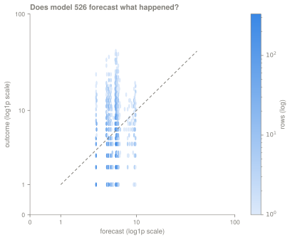
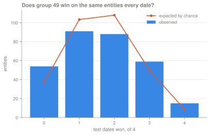
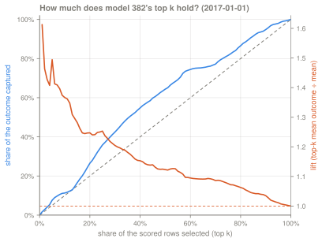

A classifier is wrong on a row or it is not. A regression model is wrong on every
row by some amount, so its diagnostics ask how large the errors are, where they
concentrate, which way they lean, and whether the model beats a trivial forecast
where it matters. This page reads those diagnostics on one worked Experiment. The
commands work on `regression` and `regression_ranking` models; on a classifier or
a survival model they exit with code 2 and name the command that answers the same
question for that type.

| Question | Command | Figure |
|---|---|---|
| How large are the errors, and which way do they lean? | `triage postmodel residuals MODEL` | `triage plot forecast-actual`, `plot residuals`, `plot bias` |
| Do my model groups compare on the same rows? | `triage postmodel compare-rows EXPERIMENT` | none |
| Where does the model beat its baseline? | `triage postmodel baseline GROUP` | `triage plot segments`, `plot win-consistency` |
| How much of the outcome does the top of the list hold? | stored `lift@`, `captured@`, `aucc`, `spearman` | `triage plot gains` |
| What did the fitted model learn? | `triage postmodel structure MODEL` | `triage plot importance` |

## The worked example

Every number on this page comes from the DirtyDuck tutorial database and the
Experiment `example/dirtyduck/experiment-regression.yaml`. The Cohort is the
active food facilities in Chicago. The label is the number of violations a
facility gets in its inspections over the next six months; a facility with no
inspection in that window has no label. The problem type is
`regression_ranking`: the model forecasts the count, and the list of
facilities is ranked by the forecast. The Experiment has four test dates, from
2015-07-01 to 2017-01-01, and 15 model groups: trees, a random forest, two
ridge regressions, two `DummyRegressor` floors and eight time-series baselines.

Most examples use model 526 in our run: the random forest of group 71 (ten
trees of depth 3), at its test date 2017-01-01. On that date it scored 14,261
facilities, 6,228 of them have a label, and their mean outcome is 5.06
violations. Model ids depend on the database; on a fresh one, find them with
`triage audition <hash>` and `triage models <hash> --group <id>`.

```bash
just tutorial-up
uv run triage check history example/dirtyduck/experiment-regression.yaml
uv run triage run example/dirtyduck/experiment-regression.yaml --project-path /tmp/dd-regression
```

`triage check history` comes first because the seasonal-naive, Holt–Winters and
Croston baselines read each facility's history: its violations in every
six-month period back to 2014, the label's quantity over the label's window. It
exits 0 when the history query returns every period (see
[target history](/triage-pg/concepts/target-history/)).

## Compare model groups on the same rows

### Definition

A baseline that has no usable history for a facility makes no forecast for it,
so model groups can score different rows. `triage audition` prints each group's
coverage, its scored rows over the labeled rows, averaged over the test dates:

```console
$ uv run triage audition 396938287f6d --metric mae
  Group   Splits   Avg ± σ           Dist. from best (avg)   Max regret   Coverage
  75      4        2.8259 ± 0.0708   0.0000                  0.0000       82.5%
  73      4        3.0698 ± 0.2041   0.2439                  0.4517       82.5%
  …
  71      4        3.1376 ± 0.0997   0.3117                  0.3910       82.5%
  …
  83      4        3.3186 ± 0.1315   0.4926                  0.5752       82.5%
  77      4        3.3304 ± 0.2267   0.5045                  0.7481       66.5%
  …
```

Coverage is below 100% for every group because the label query counts
violations for every inspected facility, and some of them are outside the
Cohort on that date. The lag baselines (groups 76 to 80) cover less, 66%,
because a facility needs earlier labels before they can forecast it.
`triage postmodel compare-rows` puts the groups side by side on the rows all
of them scored:

```console
$ uv run triage postmodel compare-rows 396938287f6d --groups 71,75,77,81
  Date         Group   Labeled   Scored   Common   MAE own   MAE common   …   Bias common
  2015-07-01   71      6755      5033     1271     3.2515    3.7819           1.5388
  2015-07-01   77      6755      1271     1271     3.6585    3.6585           1.1456
  …
  2017-01-01   71      7284      6228     6178     3.0128    3.0110           0.4165
  2017-01-01   75      7284      6228     6178     2.7592    2.7588           -1.0657
  2017-01-01   77      7284      6178     6178     3.1784    3.1784           -0.0125
  2017-01-01   81      7284      6228     6178     3.8992    3.8983           -1.2972
```

### How to read it

On 2015-07-01 group 77 (`PromedioDisponible`, each facility's mean earlier
label) scores 1,271 facilities and the random forest 5,033. On its own rows the
forest's MAE is 3.25; on the 1,271 rows both scored it is 3.78, worse than the
baseline's 3.66. An MAE over different rows compares different facilities.
`triage audition --common-rows --groups 71,75,77,81` ranks the groups on the
common rows instead; the default audition is unchanged.

Two more readings. The median `DummyRegressor` (group 75), which forecasts one
number for everyone, has the lowest MAE of all 15 groups. MAE is smallest at the
median, and these counts are skewed (a mean of 5.06 with outcomes up to 42), so
a constant median is hard to beat on MAE. It ranks nobody, so for a
`regression_ranking` problem read the gains curve below before choosing on MAE.
Group 81, the seasonal-naive baseline, forecasts each facility's violations in
the same six months a year earlier. Its bias on 2017-01-01 is −1.32 on its own
6,228 rows (−1.30 on the common ones), and the cause is the label: a facility
has a label only when it was inspected in the window, while the baseline
forecasts 0 for the 1,721 labeled facilities that were not inspected a year
earlier. On the other 4,507 its bias is −0.04. A raw-series baseline is a floor only when the history query measures
what the label measures; an earlier version of this example counted inspections
per month, and its seasonal-naive bias was −4.9.

## Error size and direction

### Definition

`triage postmodel residuals MODEL` reads the scored rows and their labels and
prints, per test date, the MAE, RMSE, WAPE (the absolute error over the total
outcome), the bias (mean forecast − outcome), the share of the absolute error
held by the 100 and the top 1% largest errors, and the share of rows the model
forecast at or above the outcome. Then it prints the errors by segment, the
forecast's structure and the largest errors.

```console
$ uv run triage postmodel residuals 526
  Date         n      Σy        MAE      RMSE     WAPE     Bias     Top 100   Top 1%   y ≤ ŷ
  2017-01-01   6228   31496.0   3.0128   4.2517   0.5957   0.4187   10.1%     7.3%     68.8%
…
Forecast structure on 2017-01-01: 48 distinct values; 33% of rows at 5.871; minimum 3.432,
maximum 9.788; 0.0% negative
  Entity   Label   Date         Forecast   Outcome   Error
  5034     —       2017-01-01   5.87       42.00     -36.13
  17570    —       2017-01-01   5.87       39.00     -33.13
  …
```



Reproduce on your data: `uv run triage plot forecast-actual 526`.

### How to read it

The forest misses by 3.0 violations on average, and its total absolute error is
60% of the total outcome (WAPE 0.596). It forecasts too high on 68.8% of the
rows, by 0.42 on average. The figure shows why: the forecasts fall in a few
columns, because a forest of ten trees of depth 3 can return few distinct
values (48 on this date), and one value, 5.871, is the forecast for 33% of the
facilities. Facilities with few violations sit below the diagonal (forecast too
high), and the few with many sit far above it: every one of the 20 largest
errors is an under-forecast of 25 to 36 violations. The 100 largest errors hold
10.1% of the total absolute error.

A few forecast values for many rows is also a ranking problem: the 30% of
facilities at 5.871 share one rank, and the list orders them by `entity_id`. The
calibration table of `triage model show 526` keeps them in one decile (see
[reading the model card](/triage-pg/guides/reading-the-model-card/#calibration-deciles)).

## Bias by history band

### Definition

`--by band` splits the rows by each facility's mean label on the Experiment's
earlier label dates whose window had closed by the test date: no history, (0,
10] and (10, 100] violations by default. `--by sbc` uses the Syntetos–Boylan
classes of that history (smooth, erratic, intermittent, lumpy, and three for the
histories the rule cannot place: no history, no demand, one demand period), and
`--by cold-start`
separates the facilities with no earlier label. The segments come from
`triage.labels`, not from the Matrix, so they exist for every regression
Experiment, with or without a history query.

```console
$ uv run triage postmodel residuals 526 --by band
  Segment      Rows   Entities   Σy        MAE      WAPE     Bias      |e| share
  no history   50     50         200.0     3.2285   0.8071   0.6881    0.9%
  (0, 10]      5678   5678       27625.0   2.9558   0.6075   0.5450    89.4%
  (10, 100]    500    500        3671.0    3.6377   0.4955   -1.0435   9.7%
```

![Mean forecast minus outcome for model 526 by history band: +0.69 for the 50 facilities with no history, +0.55 for (0, 10], and −1.04 for (10, 100]](../../../assets/guides/worked-regression-bias-band.svg)

Reproduce on your data: `uv run triage plot bias 526 --by band`.

### How to read it

The forest pulls every facility toward the middle. Facilities whose earlier
six-month windows averaged at most 10 violations get 0.55 too many; those that
averaged more than 10 get 1.04 too few. A bias with opposite signs at the two
ends is what a model that knows little about the facility does. The (10, 100]
band is 500 facilities, 8% of the rows, and holds 9.7% of the absolute error.

Decisions this reading changes:

- **Plan with the band, not the average.** A plan that sums forecasts over the
  high band undercounts by about one violation per facility.
- **Feature work.** The band is the facility's own history; a model that
  under-forecasts the high band has not learned enough from it. The lag features
  that the baselines read are not features, by design, so add a feature that
  carries the facility's past violation counts.

## The comparison against a baseline

### Definition

`triage postmodel baseline GROUP` compares a model group with a baseline group
on the rows both scored, over every test date of the group. Without
`--baseline`, it picks the Experiment's time-series baseline with the lowest MAE
on those rows; a baseline here is a class shipped with triage-pg, so
`DummyRegressor` is not one. It prints one row per segment of each cut (band, Syntetos–Boylan
class, cold start, and any Subset of the Experiment), the share of entities the
model wins, and two checks on those wins.

```console
$ uv run triage postmodel baseline 71
Group 71 against baseline group 83 (chosen: lowest MAE on shared rows): 23476 shared rows on 4 test date(s).
  Cut          Segment            Rows    Σy        MAE model   MAE base   …   Closer   Wins   Excess |e|   Excess share
  band         no history         4354    23007.0   3.1079      3.4753         52.2%    yes    -1599.8      —
  band         (0, 10]            17330   82748.0   3.0303      3.1251         48.7%    yes    -1643.9      —
  band         (10, 100]          1792    14202.0   4.1643      4.7139         57.1%    yes    -984.8       —
  sbc          smooth             6647    34528.0   3.1206      3.1719         48.2%    yes    -340.9       —
  sbc          erratic            1893    9410.0    3.3479      3.2177         45.1%    no     246.5        100.0%
  sbc          one demand period  10582   53012.0   3.1088      3.3483         51.2%    yes    -2534.3      —
  …
  cold_start   with history       19122   96950.0   3.1365      3.2740         49.5%    yes    -2628.7      —
  cold_start   cold start         4354    23007.0   3.1079      3.4753         52.2%    yes    -1599.8      —
Segments won: 88.9%
Entities: 11518 — model wins 51.0%, ties 0.0%; the won ones hold 64.1% of Σy; median error ratio (model / baseline) 0.977
…
chi-square 105.59 on 4 df, p = 6.33e-22
P(win last date) 46.2%; P(win last | won all 3 earlier) 63.4% over 101 entities
Out of time: the 5478 entities the model won before 2017-01-01, on that date — MAE model 3.0474, baseline 3.4888 (2848 rows)
```

![Model group 71 against baseline group 83, MAE per segment: the model is better in eight of nine segments, by most in the (10, 100] band (4.16 against 4.71) and for the facilities with no earlier label (3.11 against 3.48), and the baseline is better only in the erratic Syntetos–Boylan class (3.22 against 3.35)](../../../assets/guides/worked-regression-segments.svg)

Reproduce on your data: `uv run triage plot segments 71`.

### How to read the segments

The baseline chosen is group 83, Croston, which smooths each facility's
six-month violation totals. On the rows the forest scored, its MAE is the
lowest of the time-series baselines, just below the mean of each facility's
earlier labels (group 77). Croston forecasts every facility, 0 for one with no
history, so the shared rows include 4,354 rows with no earlier label, which the
lag baselines skip.

The forest beats Croston overall (MAE 3.13 against 3.31 on the 23,476 shared
rows) and in eight of nine segments, but by little where most facilities are.
In the (0, 10] band, 17,330 of the shared rows, the forest's MAE is 3.03 and
the baseline's 3.13, and the forest is closer on 48.7% of the rows. It wins by
more in the (10, 100] band (4.16 against 4.71) and on the facilities with no
earlier label (3.11 against 3.48). It loses one segment, the erratic
Syntetos–Boylan class of 1,893 rows (3.35 against 3.22). `Excess |e|` is the
extra absolute error where the model loses, and `Excess share` is that
segment's part of the excess within its cut: all of the sbc cut's excess, 247
violations, is in the erratic class.

So "the model beats the baseline" depends on the baseline as well as on the
facilities you care about. `--baseline 77` compares the forest with each
facility's mean earlier label, which forecasts the (0, 10] band better than the
forest does (MAE 2.71 against 3.03) and the (10, 100] band far worse (8.46
against 4.16).

### How to read the wins per entity

The per-entity lines ask whether the model's wins are a property of the
facility or chance. Over the 611 facilities scored on all four dates, the
figure compares the number of dates each one was won with what independent
coin flips at each date's win rate would give.



Reproduce on your data: `uv run triage plot win-consistency 71`.

More facilities than chance are won on none of the dates (98 against 50.6) or
on all four (64 against 27.8), and the chi-square test rejects chance
(p = 6.3e-22). Some facilities are consistently better served by the model and
some by the baseline. The out-of-time line tests whether that can be used: on
the 5,478 facilities the model won before 2017-01-01, it still wins on that
date (MAE 3.05 against 3.49). The per-facility persistence holds as well: of
the 101 facilities won on all three earlier dates, 63.4% are won on the last,
more than the 46.2% of facilities won on that date. The
[beats-baseline error tree](/triage-pg/guides/reading-the-error-trees/#wins-against-a-baseline)
looks for rules that describe the facilities the model wins.

`--entity-group-query FILE`, a SQL file that returns `entity_id, group_key`,
repeats the per-entity lines at a coarser level of your own, such as a district
or a chain.

## The gains curve

### Definition

A `regression_ranking` model is judged by its list. `triage plot gains MODEL`
draws the cumulative gains curve: for each share of the scored rows taken from
the top, the share of the total outcome those rows hold (`captured`), and the
lift, the mean outcome of the labeled rows in the top k over the mean of all
labeled rows. The stored metrics `captured@`, `lift@`, `aucc` (the area under
the gains curve) and `spearman` (the rank correlation of forecast and outcome)
summarize it. They are in the `regression_ranking` default metric set; the
example's `evaluation` block lists `rmse`, `mae`, `r2` and `pinball@τ` only,
so add them there to store them for every model.



Reproduce on your data: `uv run triage plot gains 526`.

```console
$ uv run triage query "select k_pct, k, n_labeled_topk, captured, lift
                       from triage.gains_curve(526, 'test', '2017-01-01', 10)"
│ k_pct │ k     │ n_labeled_topk │ captured            │ lift               │
│ 0.1   │ 1427  │ 515            │ 0.112998475996952   │ 1.3665136087553729 │
│ 0.2   │ 2853  │ 1324           │ 0.26514478028956057 │ 1.2472218214829178 │
…
```

### How to read it

The top 10% of the list, 1,427 facilities, had 1.37 times the mean number of
violations per inspected facility (6.91 against 5.06). Yet they hold only
11.3% of all the violations found, barely above their 10% share of the list.
The reason is in `n_labeled_topk`: 515 of the 1,427 were inspected (36%),
against 44% of all scored facilities. The facilities the forest ranks highest
were inspected less often, so fewer of their violations were found. Lift reads the
model; captured reads what the model and the inspection process found
together. In a resource-prioritization problem, where the label comes from the
process the model is meant to direct, report both.

## The fitted model's structure

`triage postmodel structure MODEL` reads the stored estimator. For a regression
model it prints the forecast structure; for a tree or a tree ensemble, the
leaves fitted on fewer than `--min-rows` training rows; for a linear model, the
change of the mean forecast from the training to the test split, by feature
family.

```console
$ uv run triage postmodel structure 526
Model 526: RandomForestRegressor (regression_ranking)
Forecast structure on 2017-01-01: 48 distinct values; 33% of rows at 5.871;
minimum 3.432, maximum 9.788; 0.0% negative
10 tree(s), 8–8 leaves each (mean 8.0); 0 leaves fitted on fewer than 2 training
rows, in 0 tree(s)
```

No leaf rests on a single training row, so the 48 distinct forecasts come from
the depth limit, not from leaves fitted to one facility. `triage postmodel
importance GROUP` shows how stable the feature importances are across the
group's test dates, and `triage postmodel sensitivity EXPERIMENT --param
max_depth` how the metric moves with one hyperparameter; the
[CLI reference](/triage-pg/reference/cli/) lists both.

## Limits

- **Labeled rows only.** Every number here is over the facilities with a label,
  the ones inspected in the window. The diagnostics say nothing about the
  facilities nobody inspected.
- **One model, one date.** `residuals`, `forecast-actual` and the gains curve read
  one model; the baseline comparison reads a whole group over its test dates. A
  pattern on one date is a lead to check on the others with `plot bias --by date`
  and `plot forecast-time`.
- **The bands and classes are fixed cuts.** The band edges (0, 10, 100) and the
  Syntetos–Boylan thresholds suit counts like these; a target on another scale
  needs other edges, which `triage.prior_label_history` takes as an argument.
- **Many segments, many comparisons.** With six segments and a test per entity,
  some difference will look large by chance. Act on a segment that holds on
  several dates.

## See also

- [Reading the error trees](/triage-pg/guides/reading-the-error-trees/#trees-for-a-regression-or-survival-model):
  where the absolute error concentrates, and where the model beats its baseline,
  as rules.
- [Reading the model card](/triage-pg/guides/reading-the-model-card/): the
  calibration deciles with lift, and tied scores.
- [Target history](/triage-pg/concepts/target-history/): the history the
  baselines read, and why a gap in it stops a run.
- [Baselines](/triage-pg/reference/baselines/): what each floor forecasts.
