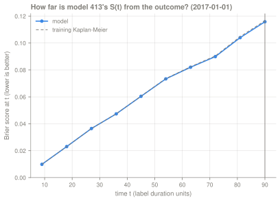
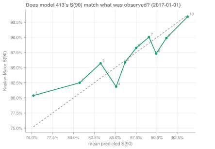

A survival model ranks entities by how soon an event will happen, and some of
its labels are censored: the window closed before the event, so all we know is
that it had not happened yet. The diagnostics on this page handle censoring.
They answer three questions: do the model's risk groups separate, does it rank
the events before a horizon above the rest, and is its survival curve close to
what happened. They run on `survival` models only; on another type the commands
exit with code 2 and name the command that answers the same question there.

| Question | Command | Figure |
|---|---|---|
| Do the risk groups separate? | `triage postmodel survival MODEL --horizon H` | `triage plot km` |
| Does it rank the early events first? | the same command (Uno's C, AUC(t)) | none |
| How far is S(t) from the outcome? | the same command (Brier(t)) | `triage plot brier` |
| Is S(H) calibrated? | the same command (ICI, E50, deciles) | `triage plot survival-calibration` |
| Where is it wrong at the horizon? | `triage postmodel error-tree MODEL --kind confusion --horizon H` | `triage plot error-rules` |

## The worked example

Every number on this page comes from the DirtyDuck tutorial database and the
Experiment `example/dirtyduck/experiment-survival.yaml`. The Cohort is the
active food facilities in Chicago. The label is the number of days from the
as_of_date to the facility's next failed inspection within six months
(`duration`), and whether a failure was seen (`event_observed`); a facility
inspected in the window without a failure is censored at the window's end, and
a facility not inspected has no label. The Experiment has four test dates and
six model groups: a Cox model on scaled features (group 62), a small random
survival forest (63), and four floors (Kaplan-Meier, Nelson-Aalen, marginal
hazard and a one-feature Cox).

Most examples use model 413 in our run, the Cox model of group 62, at its test
date 2017-01-01. On that date it scored 14,261 facilities; 6,228 have a label,
1,654 of them with an observed failure and 4,574 censored. Its stored C-index
(Harrell's, computed in PostgreSQL) is 0.567; the Kaplan-Meier floor's is 0.500.

```bash
just tutorial-up
uv run triage run example/dirtyduck/experiment-survival.yaml --project-path /tmp/dd-survival
uv run triage postmodel survival 413 --horizon 90
```

The horizon is in the units of the label's duration, days here. Pick the
horizon your decision uses: a facility that will fail within 90 days is one an
inspector should see this quarter. `postmodel survival` reads the scored
Matrix, the training Matrix and the stored model, computes the set below with
scikit-survival, and stores it in `triage.survival_diagnostics`; the plots and
the dashboard's survival panels read the stored rows. Running it again replaces
the rows of that horizon.

## Kaplan-Meier by risk decile

### Definition

The labeled rows are cut into ten deciles by score (decile 1 is the riskiest)
and into three tertiles. For each group, the Kaplan-Meier estimator gives the
probability of the event by the horizon, which uses every row up to the time it
was censored. The log-rank test asks whether the tertiles' survival curves
differ.

```console
$ uv run triage postmodel survival 413 --horizon 90
527 survival diagnostic row(s) persisted.
Model 413 (ScaledCoxPHSurvivalAnalysis) on 2017-01-01, horizon 90: 6228 labeled
rows, 839 events by the horizon, KM probability of the event 13.5%
                 Risk deciles at horizon 90
  Decile   Rows   Events ≤ 90   KM P(event)   Lift   Score
  1        622    122           19.6%         1.46   0.687
  2        623    109           17.5%         1.30   0.411
  3        623    89            14.3%         1.06   0.256
  4        623    113           18.1%         1.35   0.128
  5        623    88            14.1%         1.05   0.048
  6        622    73            11.7%         0.87   -0.062
  7        623    62            10.0%         0.74   -0.200
  8        623    79            12.7%         0.94   -0.287
  9        623    63            10.1%         0.75   -0.424
  10       623    41            6.6%          0.49   -0.801
Log-rank across the risk tertiles: p = 5.74e-19 (chi² 84.00)
…
```


Reproduce on your data: `uv run triage plot km 413 --horizon 90`.

### How to read it

The tertiles separate: the highest-risk third of the facilities is the lowest
curve from the first weeks on, and the log-rank test rejects equal curves by a
wide margin. The deciles show how much. Decile 1 fails within 90 days with a
probability of 19.6%, 1.46 times the 13.5% of all labeled facilities, and
decile 10 with 6.6%. Between them the order is loose: decile 4 (18.1%) is above
deciles 2 and 3, and decile 8 above decile 7. With about 620 facilities and 60
to 120 events per decile, a difference of 3 points between neighbours is within
the noise, so read the trend across the deciles, not each step.

A small p-value with 6,228 rows says the groups differ; it does not say they
differ enough to act on. The lift of 1.46 in decile 1 is the number to put next
to the inspection capacity.

## Uno's C and AUC(t)

Harrell's C-index, the stored metric that audition ranks, counts every pair
of rows it can order, and its weight on a pair depends on how censoring fell.
Uno's C reweights the pairs by the probability of remaining uncensored,
estimated on the training labels, and stops at the horizon, so it is closer to
the question "does the model rank the facilities that fail within 90 days above
the rest". AUC(t) asks that at each time t: of the facilities that failed by t
and those still without a failure at t, how often does the model rank the first
above the second.

```console
Uno's C up to the horizon: 0.5841 (839 rows before 90)
                   Over time
  t    AUC(t)   Brier(t)   Brier, training KM
  9    0.585    0.010      0.010
  18   0.575    0.023      0.023
  …
  81   0.592    0.104      0.105
  90   0.590    0.116      0.117
```

Model 413's Uno's C up to day 90 is 0.584, a little above its Harrell C of
0.567, and AUC(t) stays between 0.575 and 0.592 from day 9 to day 90. The model
ranks about as well for early failures as for later ones, and only modestly:
0.5 is a coin flip. `--times 30,60,90` sets the times; without it the grid is
ten evenly spaced times up to the horizon.

These numbers are stored as diagnostics, not as evaluations: audition and the
leaderboard keep ranking on the stored Harrell C, which every survival model in
the Experiment has. Uno's C needs the training labels and the model's survival
function, which only `postmodel survival` reads.

## The time-dependent Brier score

### Definition

Brier(t) is the mean squared distance between the predicted survival S(t) and
what happened by t (1 if the facility had not failed by t, 0 if it had),
reweighted for censoring. Lower is better. Each row of the output also carries
the Brier of the training Kaplan-Meier curve, the same S(t) for everyone: the
floor that knows only the base rate.



Reproduce on your data: `uv run triage plot brier 413 --horizon 90`.

### How to read it

The model's line lies on the Kaplan-Meier line: 0.116 against 0.117 at day 90,
and equal to three decimals at most times. The Brier score grows with t
because more facilities have failed by then, so read the gap to the floor, not
the level. Here there is almost none. Model 413 ranks the facilities somewhat
(Uno's C 0.584), but its survival probabilities are nearly the base rate's: an
inspector planning with its S(90) would plan almost as if every facility had
the overall 86.5% chance of no failure by day 90.

## Calibration at the horizon

The labeled rows are cut into deciles of predicted S(H), and each decile's mean
prediction is compared with its Kaplan-Meier S(H). ICI is the mean absolute gap,
weighted by rows, and E50 the median gap over the rows.

```console
   Calibration at horizon 90, per decile of predicted S(90)
  Decile   Rows   Predicted S   KM S    |gap|
  1        622    0.752         0.804   0.052
  2        623    0.808         0.825   0.018
  …
  10       623    0.937         0.934   0.003
ICI 0.0188, E50 0.0149 over 10 decile(s)
```



Reproduce on your data: `uv run triage plot survival-calibration 413 --horizon 90`.

Every decile lies within 0.052 of the diagonal, and the largest gap is in decile 1:
the model gives its riskiest tenth a 75.2% chance of no failure by day 90, and
80.4% of them had none. On average the predictions are off by 0.019 (ICI).
Calibration and the Brier score agree here: the probabilities are about right
on average and spread only a little around the base rate.

## Error trees at the horizon

A survival label has no positive class until you pick a horizon. With
`--horizon 90`, `triage postmodel error-tree` reads a facility as positive when
it failed within 90 days, drops the facilities censored before day 90 (their
outcome by day 90 is unknown), and fits the usual fp, fn or confusion trees at
the cut. The [error trees guide](/triage-pg/guides/reading-the-error-trees/#a-survival-tree-at-a-horizon)
reads the leaves; they are stored at the parameter `<cut>|horizon=90`, so
`triage postmodel error-rules` and `triage plot error-rules` show each horizon
apart.

## Limits

- **Labeled rows only.** Only inspected facilities have a label. A facility
  never inspected in the window is neither an event nor censored, and none of
  these numbers covers it.
- **Censoring is assumed independent of risk.** Every reweighting here
  (Kaplan-Meier, Uno's C, Brier) assumes that whether a facility's label is
  censored does not depend on its risk. Here a facility is censored when it is
  inspected without failing; if inspectors visit the riskier facilities sooner,
  that assumption is strained, and the numbers lean on it.
- **One horizon at a time.** Each run stores one horizon. A diagnostic at 90
  days says nothing about 180; run the command again with another horizon to
  compare.
- **A model without a survival function.** `FastSurvivalSVM` returns a risk score
  only, so its Brier and calibration rows are empty with the reason stored in
  `extra.undefined`; the risk deciles, log-rank and Uno's C still work.

## See also

- [Problem types and ranking](/triage-pg/concepts/problem-types-and-ranking/):
  how a survival model's risk lands on the same ranking spine as a classifier's
  score.
- [Reading the error trees](/triage-pg/guides/reading-the-error-trees/): the
  trees at a horizon.
- [Reading regression diagnostics](/triage-pg/guides/reading-regression-diagnostics/):
  the same questions for a forecast of a quantity.
