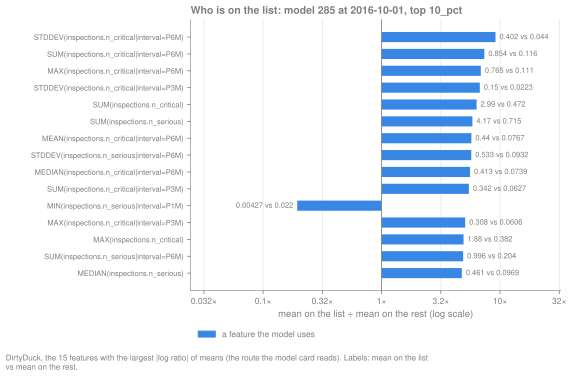
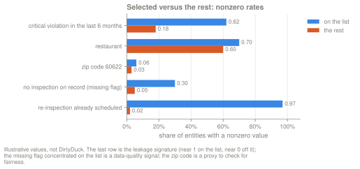
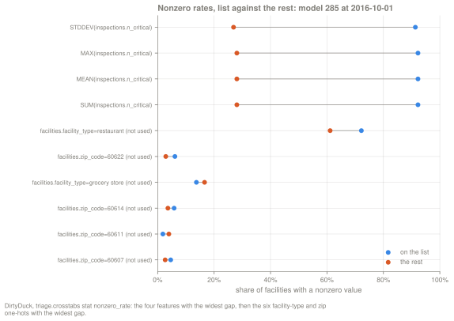
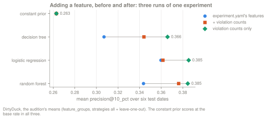
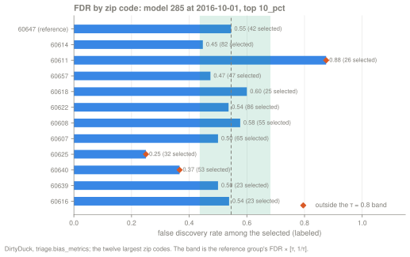
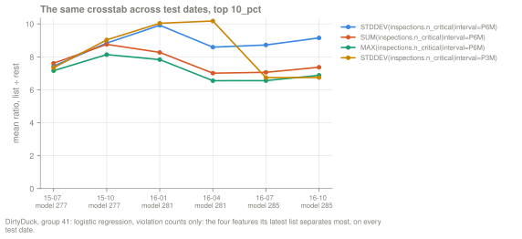
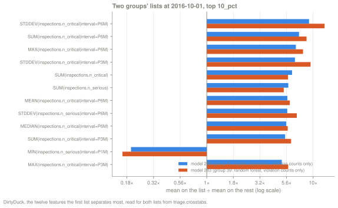

A crosstab compares the entities a model puts on its list with the rest of the
scored Cohort, one feature at a time. It answers the question "who is on the
list?" It reads no labels, so it describes the list and says nothing about
whether the list is right. That makes it the diagnostic to hand to the people
who will act on the list. It is also a check on what the score has picked up,
such as a feature the model never uses, a proxy for a protected group, missing
data, or a leak.

Every example on this page comes from one DirtyDuck Experiment,
[`example/dirtyduck/experiment-guides.yaml`](https://github.com/ccd-ia/triage-pg/blob/main/example/dirtyduck/experiment-guides.yaml),
run against the tutorial database. Its feature groups make three Runs over one
115-column Matrix: all features, the features of `experiment.yaml` alone, and
two violation counts (`n_critical` and `n_serious`, the critical and serious
violations an inspection found) alone. The cut is `10_pct` throughout. The
models are named by their role; the ids are the ones in our run, and a fresh
database gives different ids.

| Role | Model group | Estimator | Features the model uses | Model |
|---|---|---|---|---|
| Best group (audition pick at `precision@10_pct`) | 41 | scaled logistic regression | violation counts only (48 columns) | 285 |
| Runner-up | 39 | random forest | violation counts only (48 columns) | 283 |
| The best group's peer on `experiment.yaml`'s features | 45 | scaled logistic regression | inspection history, facility type and zip code (67 columns) | 297 |

Most examples read model 285 at the as_of_date 2016-10-01. On that date it
scored 14,053 facilities. The list at `10_pct` holds k = 1,406 of them, and
the rest holds 12,647.

## Definition

```bash
uv run triage postmodel crosstabs <model_id> -p 10_pct
```

The command reads the Matrix the model scored (Parquet, through the storage
adapter). For each test as_of_date the model scored, it does four things:

1. It ranks every scored row at that date, labeled or not, and takes the top k
   at the cut. These k entities are **the list**; the CLI and the table call
   them *selected*. Every other row of the Matrix at that date is **the rest**.
   This is the same top k that `precision@` and the
   [threshold curve](/triage-pg/guides/reading-the-threshold-curve/) cut.
2. For every column in the Matrix's `feature_names`, it computes three
   statistics on the list and on the rest: the mean, the sample standard
   deviation (`std`), and the nonzero rate (the share of rows whose value is
   not 0). It drops NULL values first. Imputed columns have none.
3. It divides the list's value by the rest's value. The ratio is NULL when the
   rest's value is 0.
4. It writes one row per model, split, as_of_date, cut, feature and statistic
   into `triage.crosstabs`. Running it again overwrites those rows.

For model 285 that is 115 features × 3 statistics × 2 test dates = 690 rows.

Three properties of the input decide what a crosstab can tell you.

- **No labels.** The list is defined by the score alone. To see where the list
  is wrong, read the [error trees](/triage-pg/guides/reading-the-error-trees/).
- **The whole Matrix, including columns the model does not use.** In a
  feature-group Run every Run shares the same Matrix, and the
  crosstabs cover all of its columns. Model 285 trained on 48 violation-count
  columns and uses no zip-code or facility-type column, yet its crosstabs have
  rows for both. Several use cases below depend on this. It also means that a
  crosstab row is not evidence that the model uses the feature.
- **No missing-value flags.** featurizer writes a `<feature>__missing` flag
  column into the Matrix Parquet for each feature imputed by a flagging rule
  (88 flags in the 2016 test Matrix; this Experiment imputes counts with
  `zero_noflag`, which writes none), but `matrices.feature_names` does not
  list the flags.
  Models never train on them, and the crosstabs never compute them.

The rows are read in four places:

| Surface | What it shows |
|---|---|
| `triage postmodel crosstabs` (after it writes) | the 15 mean rows with the largest \|log ratio\| at the cut, all test dates ranked together; `-n` changes the count |
| `triage model show <id>` | the 5 mean rows with the largest \|log ratio\|, across every date and every cut computed for the model |
| The model card's crosstabs panel (dashboard) | the 20 mean rows with the largest \|log ratio\|, across every date and every cut computed for the model |
| `triage.crosstabs` in SQL | every row, including `std` and `nonzero_rate` |

The nonzero rates and standard deviations are only in the table, so several
examples below query it directly.

## How to read it

### The ratio of means

The first rows of the CLI output for model 285:

```console
$ uv run triage postmodel crosstabs 285 -p 10_pct
690 crosstab row(s) persisted.
  As-of        Feature                                          Selected   Rest     Ratio
  2016-10-01   STDDEV(inspections.n_critical|interval=P6M)      0.4023     0.0440   9.15
  2016-07-01   STDDEV(inspections.n_critical|interval=P6M)      0.3587     0.0411   8.72
  2016-10-01   SUM(inspections.n_critical|interval=P6M)         0.8542     0.1159   7.37
  2016-07-01   facilities.facility_type=mobile food dispenser   0.0007     0.0053   0.14
  2016-07-01   SUM(inspections.n_critical|interval=P6M)         0.7965     0.1128   7.06
  2016-10-01   MAX(inspections.n_critical|interval=P6M)         0.7653     0.1113   6.88
  …
```

- **As-of** is the test as_of_date. The CLI ranks the model's test dates
  together; filter the table by `as_of_date` to read one date.
- **Feature** is featurizer's label for the column: an aggregation, the
  entity and variable, and the window. `SUM(inspections.n_critical|interval=P6M)`
  is the number of critical violations found in the facility's inspections in
  the 6 months before the as_of_date. `facilities.facility_type=restaurant` is
  a one-hot column, 1 for a restaurant and 0 otherwise.
- **Selected** and **Rest** are the means on the list and on the rest.
- **Ratio** is Selected ÷ Rest. The 7.37 in the third row says that the
  facilities on the list had, on average, 7.4 times as many critical
  violations in the last 6 months as the facilities off it (0.85 against
  0.12).

The ranking uses \|log ratio\|, so a ratio below 1 ranks next to its inverse.
The fourth row, 0.14, sits among ratios near 7 because 1 ÷ 0.14 ≈ 7.3. A ratio
below 1 means the feature is smaller, or rarer, on the list.

Turn rates back into counts before acting on a ratio. On 2016-07-01 the list
holds k = 1,386 of 13,859 scored facilities. The mobile-food-dispenser rate of
0.0007 is one facility on the list, and 0.0053 is 66 of the 12,473 in the
rest. That row ranks fourth in the table, and it rests on a single facility.



At 2016-10-01 all 15 of the largest ratios are violation-count features, and
the model uses every one of them. The one ratio below 1,
`MIN(inspections.n_serious|interval=P1M)`, is 0.0043 on the list against
0.022 off it.

### The nonzero rate

For a 0/1 column, such as a one-hot, the mean and the nonzero rate are the
same number: the share of the list in that category. For a count they differ.
The nonzero rate is the share with at least one, and the mean also counts how
many. Read both for the feature at the top of the table:

```sql
select stat, round(selected_value::numeric, 4) as selected,
       round(rest_value::numeric, 4) as rest, round(ratio::numeric, 2) as ratio
from triage.crosstabs
where model_id = 285 and as_of_date = '2016-10-01' and parameter = '10_pct'
  and feature = 'STDDEV(inspections.n_critical|interval=P6M)'
order by stat;
```

```text
     stat     | selected |  rest  | ratio
--------------+----------+--------+-------
 mean         |   0.4023 | 0.0440 |  9.15
 nonzero_rate |   0.3307 | 0.0489 |  6.77
 std          |   0.6578 | 0.2095 |  3.14
```

The ratio of means is the product of two ratios: how many have a nonzero
value (6.77), and how large the value is among those who have one. On the
list, the facilities with a nonzero value average 0.4023 ÷ 0.3307 = 1.22; off
it, 0.0440 ÷ 0.0489 = 0.90. That second ratio is 1.35, and 6.77 × 1.35 = 9.15.
Most of the headline 9.15 comes from the first factor: a third of the list has
a nonzero value (33%), against 5% of the rest. The other 67% of the list has
the value 0.

The `std` row gives the spread inside each side. A list whose standard
deviation is several times its mean holds a few large values and many small
ones, so a mean ratio there describes a minority of the list.

## Patterns

Five kinds of row mean something. The illustrative figure below shows one of
each, with made-up values.



| Row in the figure | Shape | What it usually means | Section |
|---|---|---|---|
| critical violation in the last 6 months | a large gap on a feature the model uses | the model's own signal; it describes the list | [Choose k and the intervention](#choose-k-and-the-intervention) |
| restaurant | a moderate gap on a category | one segment is over-represented on the list | [Refine the Cohort or split the model](#refine-the-cohort-or-split-the-model) |
| zip code | small rates, ratio near 2, on a group attribute | a proxy for a group; check fairness | [Fairness](#fairness) |
| no inspection on record (missing flag) | missingness higher on the list | the score follows missing data | [Data quality](#data-quality) |
| re-inspection already scheduled | near 1 on the list, near 0 off it | a feature that may know the outcome | [Leakage](#leakage) |

In DirtyDuck the first three shapes occur and the last two do not. The worked
version for model 285 at 2016-10-01 shows nonzero rates as pairs of points.
Rows marked "(not used)" are columns of the Matrix that the model does not
train on.



## Use it to improve the model

### Choose k and the intervention

The [threshold curve](/triage-pg/guides/reading-the-threshold-curve/) gives
precision and recall at a capacity k. The crosstabs describe the facilities at
that k, which is the profile the intervention has to serve.

```sql
select feature, round(selected_value::numeric, 3) as selected,
       round(rest_value::numeric, 3) as rest
from triage.crosstabs
where model_id = 285 and as_of_date = '2016-10-01' and parameter = '10_pct'
  and stat = 'nonzero_rate'
  and feature in ('MAX(inspections.n_serious)', 'MAX(inspections.n_critical)',
                  'MAX(inspections.n_critical|interval=P6M)',
                  'RECENCY(inspections.date|interval=P6M)',
                  'facilities.facility_type=restaurant',
                  'facilities.facility_type=school')
order by selected desc;
```

```text
                 feature                  | selected | rest
------------------------------------------+----------+-------
 MAX(inspections.n_serious)               |    0.999 | 0.416
 MAX(inspections.n_critical)              |    0.922 | 0.281
 facilities.facility_type=restaurant      |    0.722 | 0.611
 RECENCY(inspections.date|interval=P6M)   |    0.688 | 0.517
 MAX(inspections.n_critical|interval=P6M) |    0.416 | 0.083
 facilities.facility_type=school          |    0.045 | 0.064
```

In words, for the inspectors who would work through the list, each share
below is of the 1,406 facilities on the list, then of the 12,647 in the rest:

- Almost every facility on the list (99.9%) has had a serious violation on
  record, against 42% of the rest.
- 92% have had a critical violation, against 28%. Only 8% of the list has a
  clean critical record.
- 42% had a critical violation in the last 6 months, against 8%.
- 69% had an inspection in the last 6 months, against 52%. The other 31% of
  the list had none in that time.
- 72% are restaurants, against 61% of the rest. Schools are 4.5% of the list
  and 6.4% of the rest.

Every facility on the list has had at least one inspection, and most have a
history of violations, so the list sends inspectors back to facilities with
violations on record. A program that wants to find failures among facilities
with a clean record gets little of that from this list; only 8% of it has a
clean critical record.

**Next step.** Compute the crosstabs at the cut the program will use. The
cut does not have to be in `evaluation.thresholds`, because the command takes
its top k from `triage.prediction_ranks`, a view that ranks every stored
prediction. For a capacity of 1,400 inspections:

```bash
uv run triage postmodel crosstabs 285 -p 1400_abs
```

Describe the list in these terms to the people who will act on it. If the
profile does not fit the intervention, change k (read the threshold curve at
the new k first), or change the label or the Cohort so that the model ranks
the facilities the program is for.

### Find missing features

A feature that separates the list from the rest without being used by the
model is a candidate missing feature. The list already differs on it, so the
score must be carrying some of its information through the features the model
does use. Adding it can lift the model or add nothing, and only a retrained
model tells which.

The peer model 297 (logistic regression on `experiment.yaml`'s features) does
not use the violation counts. Its list still separates on them:

```text
           feature           |     stat     | selected |  rest  | ratio
-----------------------------+--------------+----------+--------+-------
 SUM(inspections.n_critical) | mean         |   2.2489 | 0.5551 |  4.05
 SUM(inspections.n_critical) | nonzero_rate |   0.7895 | 0.2954 |  2.67
 SUM(inspections.n_critical) | std          |   2.1806 | 1.1035 |  1.98
 SUM(inspections.n_serious)  | mean         |   3.1081 | 0.8332 |  3.73
 SUM(inspections.n_serious)  | nonzero_rate |   0.9374 | 0.4227 |  2.22
 SUM(inspections.n_serious)  | std          |   2.3793 | 1.3053 |  1.82
```

The facilities on 297's list had four times as many critical violations on
record as the rest, though the model never sees that count. The Experiment
tests what happens when the counts become features. Its three Runs train the
same estimators with and without them, and the audition means of
`precision@10_pct` over six test dates are:

| Estimator | `experiment.yaml`'s features | + violation counts | violation counts only |
|---|---|---|---|
| logistic regression | 0.3598 (group 45) | 0.3616 (37) | 0.3854 (41) |
| random forest | 0.3436 (43) | 0.3762 (35) | 0.3846 (39) |
| decision tree | 0.3070 (44) | 0.3440 (36) | 0.3659 (40) |
| constant prior | 0.2629 | 0.2629 | 0.2629 |



The counts lift every real estimator. For the logistic regression, adding
them to the existing features gains only 0.0018, and the counts alone do best,
so more features did not always help.

The opposite reading matters too. A feature the model uses can separate the
list strongly and still carry little weight in the model. Join the crosstabs
to the persisted coefficients of model 285:

```sql
select c.feature, round(c.ratio::numeric, 2) as mean_ratio,
       fi.rank_abs as coef_rank, round(fi.signed_value::numeric, 3) as coef
from triage.crosstabs c
left join triage.feature_importances fi
  on fi.model_id = c.model_id and fi.feature = c.feature
where c.model_id = 285 and c.as_of_date = '2016-10-01' and c.parameter = '10_pct'
  and c.stat = 'mean' and c.ratio > 0
order by abs(ln(c.ratio)) desc
limit 6;
```

```text
                   feature                   | mean_ratio | coef_rank |  coef
---------------------------------------------+------------+-----------+--------
 STDDEV(inspections.n_critical|interval=P6M) |       9.15 |        28 |  0.159
 SUM(inspections.n_critical|interval=P6M)    |       7.37 |        42 |  0.091
 MAX(inspections.n_critical|interval=P6M)    |       6.88 |        46 |  0.035
 STDDEV(inspections.n_critical|interval=P3M) |       6.75 |        24 | -0.222
 SUM(inspections.n_critical)                 |       6.34 |         8 |  0.511
 SUM(inspections.n_serious)                  |       5.84 |         5 |  0.674
```

`MAX(inspections.n_critical|interval=P6M)` has the third-largest ratio and the
46th-largest coefficient of the model's 48. It separates the list because it
moves with the features the model does weight, such as
`SUM(inspections.n_serious)` (rank 5). A low coefficient on a feature that
separates the list points to redundancy, not to a missing feature. Correlated
columns share and trade weight in a linear model, so a low coefficient does
not mean the information is absent from the score.

A related question, whether a feature separates the list in only one
subgroup, cannot be answered from the crosstabs. The command computes them
over the whole scored Cohort, never per Subset. A rule in an
[error tree](/triage-pg/guides/reading-the-error-trees/) that splits on the
subgroup first and on the feature second is the tool for that.

**Next step.** Put the candidate in `feature_config` (a new variable on its
entity, or a new aggregation), give it its own group under
`feature_groups.definitions`, and set `strategies: [all, leave-one-out]` (or
`leave-one-in`). One `triage run` then trains the before and the after side by
side, and `triage audition <hash> -m precision@ -p 10_pct` compares them over
every test date.

### Refine the Cohort or split the model

A segment can dominate the list for a reason outside the problem. Facilities
that are inspected more often only because of where they are, for example,
accumulate more recorded violations, and a count-based score lifts them. When
one category or one group of facilities takes a large share of the list, ask
whether the reason is part of what the program wants to rank.

DirtyDuck shows no dominating segment. The largest over-representation by
share is restaurants, 72.2% of the list against 61.1% of the rest (1.18×). The
largest by ratio among categories is zip code 60622, at 2.13×, which is 6.1% of
the list. Inspection frequency is the outside reason worth testing here,
because the model's features are counts that grow with the number of
inspections:

```text
                feature                 |     stat     | selected | rest  | ratio
----------------------------------------+--------------+----------+-------+-------
 SUM(inspections.n_critical)            | mean         |    2.994 | 0.472 |  6.34
 MEAN(inspections.n_critical)           | mean         |    0.554 | 0.131 |  4.22
 COUNT(inspections.date)                | mean         |    5.594 | 2.978 |  1.88
 facilities.facility_type=restaurant    | nonzero_rate |    0.722 | 0.611 |  1.18
 facilities.facility_type=grocery store | nonzero_rate |    0.137 | 0.166 |  0.83
 facilities.facility_type=school        | nonzero_rate |    0.045 | 0.064 |  0.70
```

The facilities on the list had 1.88 times as many inspections on record (5.6
against 3.0). Part of the 6.34× gap in total critical violations comes from
that. The critical violations found per inspection still differ by 4.22×
(0.55 against 0.13), so the list is not only the facilities inspected most
often. In this run, frequency adds to the gap without explaining it.

**Next step.** When a segment does dominate for an outside reason, add it to
`evaluation.subsets` and read its curve with
`triage model curve <id> --subset <name>`. Then either restrict
`cohort_config.query` to exclude it, in a new Experiment, or give it an
Experiment of its own, whose Cohort is that segment.

## Use it to check the model

### Leakage

A feature that knows the outcome shows up in the crosstabs as near-total
separation. Its nonzero rate is close to 1 on the list and close to 0 off it,
like the last row of the illustrative figure (0.97 against 0.02).

No DirtyDuck feature comes close. The five widest gaps in nonzero rate for
model 285 at 2016-10-01:

```sql
select feature, round(selected_value::numeric, 3) as selected,
       round(rest_value::numeric, 3) as rest,
       round((selected_value - rest_value)::numeric, 3) as gap
from triage.crosstabs
where model_id = 285 and as_of_date = '2016-10-01' and parameter = '10_pct'
  and stat = 'nonzero_rate'
order by abs(selected_value - rest_value) desc
limit 5;
```

```text
            feature             | selected | rest  |  gap
--------------------------------+----------+-------+-------
 STDDEV(inspections.n_critical) |    0.913 | 0.269 | 0.644
 MEAN(inspections.n_critical)   |    0.922 | 0.281 | 0.642
 MAX(inspections.n_critical)    |    0.922 | 0.281 | 0.642
 SUM(inspections.n_critical)    |    0.922 | 0.281 | 0.642
 STDDEV(inspections.n_serious)  |    0.989 | 0.403 | 0.587
```

The widest gap is 0.644 across all 115 features. The row nearest to 1 on the
list, any serious violation on record, is 0.999 on the list, but 0.416 of the
rest have one too. That feature is the model's main signal. A leak would also
be near 0 off the list.

Query by gap, as above, rather than reading the CLI table. The CLI and the
model card rank the mean ratio and skip two kinds of row. A ratio is NULL when
the rest's value is 0, and 0 when the list's value is 0, and both are left
out. A 0/1 feature that is 1 for some of the list and 0 for every row of the
rest, which is the most extreme leak, therefore never appears in the CLI
output. For model 285 the skipped rows are the facility types "unknown" and
"daycare combo 1586", which have no facility on the list on either date.

**Next step.** For a row near 1 against near 0, find the Source the feature
is built from and run `uv run triage check leakage experiment.yaml`. If the
check is clean, the leak is in the raw data itself, such as a column recorded
after the outcome, which the check cannot see.
[How to find leakage](/triage-pg/guides/finding-leakage/) covers the check and its
limits.

### Data quality

Missing values that concentrate on the list mean the score is ranking
missingness. That can be signal (a facility with no recent inspection may be
riskier) or an artifact of how the data was collected.

triage-pg does not show the missing flags in the crosstabs, because they are
not in `feature_names`. Missingness shows up through the zero-filled features
instead. This Experiment imputes with `all: {type: zero}`, so a feature with
no value becomes 0, and for such a feature the nonzero rate is 1 minus its
missing rate.

```text
                feature                 |     stat     | selected |   rest   | ratio
----------------------------------------+--------------+----------+----------+-------
 RECENCY(inspections.date|interval=P6M) | mean         |  64.6152 |  44.2931 |  1.46
 RECENCY(inspections.date|interval=P6M) | nonzero_rate |   0.6885 |   0.5167 |  1.33
 RECENCY(inspections.date)              | mean         | 162.2696 | 231.4428 |  0.70
 RECENCY(inspections.date)              | nonzero_rate |   1.0000 |   0.9812 |  1.02
```

`RECENCY(inspections.date|interval=P6M)` is the days since the last inspection
within the past 6 months. It has no value when there was no inspection in
those 6 months. At 2016-10-01 every one of its 6,550 zero values carries the
`__missing` flag in the Matrix, so here a zero always means missing. The
missing rate is 31% on the list (1 − 0.6885) and 48% off it, so missingness is
less common on the list. Facilities never inspected at all
(`RECENCY(inspections.date)` is 0) are 0% of the list and 1.9% of the rest.
The illustrative row, with a flag at 0.30 on the list against 0.05 off it, is
the pattern DirtyDuck does not show.

The zero fill also distorts the mean. The ratio of means, 1.46, suggests the
list was inspected longer ago. Among the facilities with a value, the mean is
93.9 days on the list (64.6152 ÷ 0.6885) and 85.7 days off it (44.2931 ÷
0.5167). Most of the 1.46 comes from more of the list having a value at all.

**Next step.** Read the nonzero rate of a zero-filled feature as "had a
value", and divide the mean by the nonzero rate before comparing magnitudes.
If a rule must separate a true 0 from a missing value, change the imputation
for that feature in `imputation_config` to a `constant` that no real value
takes. The [error trees](/triage-pg/guides/reading-the-error-trees/#data-quality)
page shows the same zero fill inside a leaf.

### Fairness

A column that is over-represented on the list and lines up with a protected
group is a proxy to audit. DirtyDuck has no demographic columns, so the
Experiment declares zip code in `bias_config` as a geographic proxy. Treat zip
code as a proxy only by that assumption.

Model 285 uses no zip-code column, and its list still differs by zip. Model
297 uses the zip one-hots, and its list differs much more:

```text
 model_id |          feature          | selected |  rest  | ratio
----------+---------------------------+----------+--------+-------
      285 | facilities.zip_code=60611 |   0.0185 | 0.0397 |  0.47
      297 | facilities.zip_code=60611 |   0.0043 | 0.0413 |  0.10
      285 | facilities.zip_code=60618 |   0.0178 | 0.0337 |  0.53
      297 | facilities.zip_code=60618 |   0.0043 | 0.0352 |  0.12
      285 | facilities.zip_code=60622 |   0.0612 | 0.0288 |  2.13
      297 | facilities.zip_code=60622 |   0.1629 | 0.0175 |  9.32
```

Zip code 60622 is 6.1% of model 285's list (86 facilities) and 2.9% of the
rest. Through the violation counts alone, the model selects 86 of the 450
facilities the bias audit counts in 60622 (19.1%), against 42 of 545 (7.7%) in
the reference zip 60647. `triage.bias_metrics` reports that as a
selection-rate disparity of 2.48. Model 297's coefficient on `zip_code=60622` is +0.537, its 10th largest
of 67, and 60622 is 16.3% of its list. The two models differ in more than the
zip columns, so this comparison does not isolate what the zip columns add.

The crosstab says whom the model selects. Whether that is unfair depends on
the intervention and on which error matters. The Experiment records the
intervention as punitive, so the audit checks the false discovery rate (FDR)
among the selected:



Zip 60622, over-represented on the list, passes (FDR 0.537 against the
reference 0.545). Zip 60611, under-represented on the list (0.47×), fails. Of
its 26 selected facilities, the labeled ones were wrong at an FDR of 0.875.
Zips 60625 and 60640 fail on the low side, with fewer wrong flags than the
reference. Every group here has 23 to 86 selected facilities, and fewer
labeled ones, so a few facilities move these rates a lot.

**Next step.** Put the attribute in `bias_config.query` and in
`evaluation.subsets`, and read the group's curve with
`triage model curve <id> --subset <name>` next to the Bias tab. To test whether
a feature acts as a proxy, compare the group's selection rate between two
feature-group Runs, one with that feature and one without.
[`docs/fairness.md`](https://github.com/ccd-ia/triage-pg/blob/main/docs/fairness.md)
explains which disparity matters for which intervention.

### Stability over time

Read the same crosstab on every test date, and between the lists of two model
groups. A ratio that moves between two dates scored by the same model points to
a change in the data. A ratio that moves where the model changes points to the
model, or to both.

Across dates, for the best group's four top features:



```text
 as_of_date | model_id | ratio
------------+----------+-------
 2015-07-01 |      277 |  7.34
 2015-10-01 |      277 |  9.03
 2016-01-01 |      281 | 10.04
 2016-04-01 |      281 | 10.18
 2016-07-01 |      285 |  6.74
 2016-10-01 |      285 |  6.75
```

The ratio of `STDDEV(inspections.n_critical|interval=P3M)` drops from 10.18 to
6.74 between 2016-04-01 and 2016-07-01, where model 281 gives way to model 285.
Between the two dates of model 281 it moves by 0.14, and between the two dates
of model 285 by 0.01. Not every feature behaves this way. The ratio of
`SUM(inspections.n_critical|interval=P6M)` moves 1.26 between model 281's own
two dates (8.27 to 7.01), so that feature's separation changed with the data.

Between two model groups, read the lists of the best group (285, logistic
regression) and the runner-up (283, random forest) on the same date:



The same features separate both lists. The forest's list is more extreme on
the 6-month critical-violation features (`STDDEV` 12.79 against 9.15, `SUM`
8.67 against 7.37). To see whether the lists hold the same facilities, compare
them directly:

```console
$ uv run triage postmodel compare 285 283 -p 10_pct
          List overlap — m285 vs m283 @ 10_pct
  As-of        k(a)   k(b)   ∩      Jaccard   Rank corr
  2016-07-01   1386   1386   1025   0.587     0.951
  2016-10-01   1406   1406   1069   0.613     0.951
```

1,069 of the 1,406 facilities are on both lists at 2016-10-01. Over the six
test dates the Jaccard index of the two groups' lists is between 0.47 and
0.65. For contrast, two random forests on different features (model 295 on
`experiment.yaml`'s features, model 271 on all of them) share far less: a
Jaccard index of 0.317 and 0.344 on the same two dates.

**Next step.** When two groups' crosstabs and lists agree, prefer the simpler
or the steadier group. `triage audition <hash> -m precision@ -p 10_pct --rule
best_avg_var_penalized` penalizes variance across test dates. When the lists differ, the choice of model changes who
gets inspected, so take the two crosstabs to the people who act on the list.
[Reading the model card](/triage-pg/guides/reading-the-model-card/) covers the
list-overlap panel.

## Caveats

- **One feature at a time.** A crosstab cannot show an interaction. It shows
  that zip code 60622 and critical violations are both more common on model
  285's list, but not whether the 60622 facilities are there because of their
  violations. An [error tree](/triage-pg/guides/reading-the-error-trees/) can
  split on both.
- **A mean ratio hides the shape of the distribution.** The 9.15× at the top
  of model 285's table describes the third of the list with a nonzero value;
  67% of the list has 0. Read the nonzero rate and the `std` next to the mean,
  and read the Matrix itself when the shape matters.
- **Ratios of small numbers.** A category with a handful of members can rank
  near the top on one facility. Multiply the rate by k before acting on it.
- **No labels, no errors.** The crosstabs describe the list. They cannot tell
  whether the list is right.
- **No significance test.** 115 features, three statistics and several dates
  make hundreds of comparisons, and some gaps will appear by chance. A gap
  that holds across dates is worth more than one that appears once.
- **A row is not a feature the model uses.** In a feature-group Run the
  crosstabs cover the whole Matrix. Check the model group's feature list, or
  `triage.feature_importances`, before saying the model uses a column.
- **One cut, and mixed surfaces.** The list changes with k, so compute the
  crosstabs at the cut you will use. `triage model show` and the model card
  rank every date and every cut computed for the model together; filter the
  table when you need one.

## See also

- [Reading the threshold curve](/triage-pg/guides/reading-the-threshold-curve/)
  for choosing k.
- [Reading the error trees](/triage-pg/guides/reading-the-error-trees/) for
  where the list is wrong, and for interactions.
- [Reading the model card](/triage-pg/guides/reading-the-model-card/) for
  calibration, the score histogram and list overlap.
- [How to find leakage](/triage-pg/guides/finding-leakage/) for
  `triage check leakage`.
- [CLI reference](/triage-pg/reference/cli/) for every `triage postmodel`
  command.
