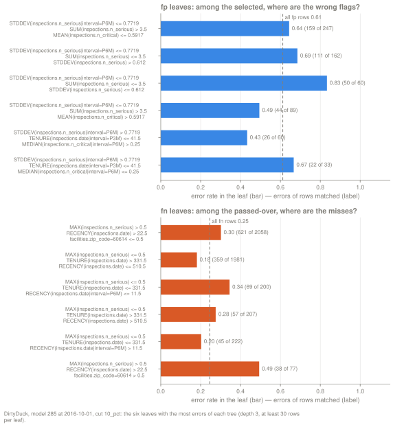
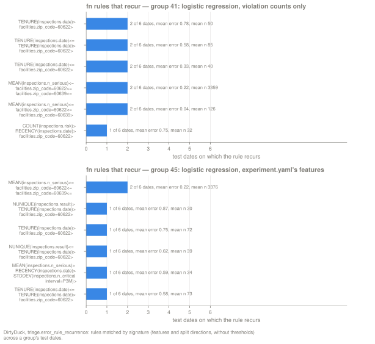
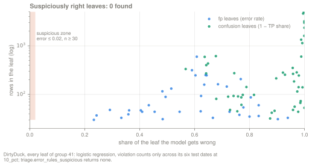

The [threshold curve](/triage-pg/guides/reading-the-threshold-curve/) says how many
of the entities on a list are right. The error trees say which ones are wrong, and
what they have in common. `triage postmodel error-tree` fits shallow decision trees
on a model's mistakes at a cut, one test date at a time, and stores each leaf as a
rule: a set of feature conditions, the number of rows it covers, and the share of
those rows the model got wrong. This page covers which rows each tree sees, how to
read a leaf, and how to use the rules to improve a model and to check it. The guides
to the threshold curve and to the [crosstabs](/triage-pg/guides/reading-the-crosstabs/)
follow the same plan.

**The worked example.** Every DirtyDuck number on this page comes from the guides'
Experiment,
[`example/dirtyduck/experiment-guides.yaml`](https://github.com/ccd-ia/triage-pg/blob/main/example/dirtyduck/experiment-guides.yaml),
run against the tutorial database (`just tutorial-up`). One `triage run` of it makes
three Runs through `feature_groups`: all 115 features, the 67 features of
`experiment.yaml`, and the 48 violation counts alone. The audition at `precision@`
and `10_pct` picks a logistic regression trained on the violation counts alone
(model group 41 in our run). Most examples use that group's latest model (model 285
in our run) at its last test date, 2016-10-01. Model ids depend on the database, so a
fresh run gives the same roles different ids. The cut throughout is `10_pct`, the
top 10% of the scored Cohort. To fit the three trees for one model:

```bash
uv run triage postmodel error-tree 285 -p 10_pct --kind all
```

## Definition

### Three trees, each fitted on its own rows

At a cut, every labeled row of a test date falls into one of four classes. The list
is the top k rows by score, with k counted over every scored row. A row on the list
with a positive outcome is a true positive (TP), a row on the list with a negative
outcome is a false positive (FP), a passed-over positive is a false negative (FN),
and a passed-over negative is a true negative (TN). `error-tree` fits each tree on a
different set of these rows:

| Tree | Rows it is fitted on | What it predicts | Model 285, 2016-10-01, `10_pct` |
|---|---|---|---|
| `fp` | labeled rows on the list | FP (1) or TP (0) | 688 rows, 421 FP: error rate 0.612 |
| `fn` | labeled rows passed over | FN (1) or TN (0) | 4,987 rows, 1,224 FN: error rate 0.245 |
| `confusion` | every labeled row | TP, FP, FN or TN | 5,675 rows: 267 TP, 421 FP, 1,224 FN, 3,763 TN |

The fp tree asks which of the facilities on the list would pass inspection. The fn
tree asks which of the facilities left off the list would fail. Each compares rows
on one side of the cut with each other, so neither has to rediscover the cut. The
confusion tree sees both sides at once and does have to; the section
[on the confusion tree](#the-confusion-trees-first-splits-redraw-the-cut)
explains what that does to its leaves.

Only labeled rows enter a tree. At 2016-10-01 model 285 scored 14,053 facilities,
and the 10% cut puts k = 1,406 of them on the list. Of those 1,406, 688 were
inspected in the six-month label window, so the fp tree sees 688 rows. In
DirtyDuck's resource-prioritization framing a facility nobody inspected has no
label, and the trees say nothing about the 8,378 unlabeled facilities at this date.

### The stored rules and their readers

`triage postmodel error-tree MODEL -p CUT --kind all` reads the model's scored
Matrix, fits one scikit-learn decision tree per kind and per test date, and writes
one row per leaf to `triage.error_analysis`. The defaults are depth 3 and at least
30 rows per leaf (`--depth`, `--min-leaf`); `--kind both` fits the fp and fn trees
only. For model 285 the command wrote 45 leaves over its two test dates. Running it
again replaces a date's leaves of each kind it fits.

The trees split on any column that `triage.matrices.feature_names` lists for the
Matrix, including columns the model does not use. A Run made by `feature_groups`
scores a Matrix that carries every feature in `feature_config`: model 285 uses 48
features, its test Matrix has 115, and its fn trees split on zip-code columns the
model never saw. Several sections below rely on this. It also means that a rule
naming a feature is no evidence that the model uses that feature.

Three readers query the stored leaves without fitting anything:

- `triage postmodel error-rules MODEL` lists the leaves, highest error rate first;
  `--kind fp|fn|confusion` keeps one kind. With `--suspicious` it reads
  `triage.error_rules_suspicious` instead (see [Leakage](#leakage)).
- `triage postmodel error-recurrence GROUP -p CUT --kind fn` reads
  `triage.error_rule_recurrence`, which counts the test dates of a model group on
  which each rule appears (see [Stability over time](#stability-over-time)).
- In the dashboard, the model card's error-rules panel has one tab per kind and a
  "suspiciously right" chip, and the model group sheet has a table of rule
  recurrence across test dates.

### A diagnostic, not a booster

The rule from
[`docs/postmodeling.md`](https://github.com/ccd-ia/triage-pg/blob/main/docs/postmodeling.md)
holds here: the error tree says where the model fails, and nothing feeds its output
back into the scores. A second model that corrects the first one's errors would
leave the pair without a single identity in the derivation DAG, and it would learn
from errors on the test set. When an error signal is strong enough to act on,
promote it to a feature and retrain through the normal pipeline, as the section
[Find missing features](#find-missing-features) does.

## How to read it

### One leaf, field by field

`error-rules` prints the stored leaves. Two of model 285's fn leaves at 2016-10-01
(an excerpt; the full listing mixes both test dates):

```console
$ uv run triage postmodel error-rules 285 --kind fn
  As-of        Cut      Kind   Rule                                                         n      Errors   Rate
  2016-10-01   10_pct   fn     MAX(inspections.n_serious) > 0.5 AND RECENCY(inspections.date) > 22.5
                               AND facilities.zip_code=60614 > 0.5                          77     38       0.49
  2016-10-01   10_pct   fn     MAX(inspections.n_serious) > 0.5 AND RECENCY(inspections.date) > 22.5
                               AND facilities.zip_code=60614 <= 0.5                         2058   621      0.30
```

- **Rule** (column `rule`, and the same path as JSON in `conditions`): the conditions
  from the root to the leaf, joined by AND. Feature names follow featurizer's form
  `AGG(entity.column|interval=W)`. `MAX(inspections.n_serious)` is the largest number
  of serious violations any past inspection found, and `RECENCY(inspections.date)`
  is the number of days since the last inspection. A one-hot column such as
  `facilities.zip_code=60614` holds 0 or 1, so `> 0.5` reads "in zip 60614" and
  `<= 0.5` reads "not in zip 60614". The thresholds are this date's split points and
  move from date to date.
- **n** (`n_matched`): the leaf's support, the rows of this tree that match the
  rule. Here, 77 inspected facilities that the list passed over.
- **Errors** (`n_errors`): how many of those rows are errors of the tree's kind, here
  38 FN.
- **Rate** (`error_rate`): errors ÷ n, so 0.49.
- **Class counts** (`class_counts`, in the table and on the dashboard but not in this
  listing): rows per class, here `{"fn": 38, "tn": 39}`. fp leaves carry TP and FP
  counts, fn leaves FN and TN, and confusion leaves all four.

Compare a leaf's rate with its tree's rate over all its rows, not with zero. The fn
tree's rate over all 4,987 passed-over rows is 0.245. The first leaf misses failures
at twice that rate, and the second at 0.30, a little above it. The second leaf is 27
times larger, and it holds 621 of the 1,224 missed failures (51%). A small leaf with
an extreme rate and a large leaf with a moderate one answer different questions, so
read n and the rate together.

### Lift, and how to read it on a confusion leaf

The suspicious-leaf query (`error-rules --suspicious`) adds two columns. `tp_share`
is TP ÷ n. `lift` is (1 − error_rate) ÷ precision@, where precision@ is the model's
precision at the same date and cut in `triage.evaluations`; it is NULL when that cut
was not evaluated.

On an fp leaf, 1 − error_rate is the leaf's TP share, so lift compares the leaf's
precision with the list's. Model 285's list at 2016-10-01 has precision 0.388 (267 of
688). Its fp leaf `STDDEV(inspections.n_serious|interval=P6M) > 0.7719 AND
TENURE(inspections.date|interval=P3M) > 41.5` holds 37 rows with 9 FP, so
1 − error_rate is 0.757 and the formula gives a lift of 1.95: these facilities
failed at about twice the rate of the list as a whole.

On a confusion leaf, error_rate counts the FP and FN rows as errors, so
1 − error_rate is (TP + TN) ÷ n. **The lift of a confusion leaf counts true
negatives as correct.** Model 285's largest confusion leaf at 2016-10-01 has 2,353
rows: 1,887 TN, 466 FN and no TP. Its 1 − error_rate is 0.80, and the formula would
give it a lift of 2.07 without a single true positive. The suspicious query never
returns that leaf, because it selects confusion leaves by their TP share, but the
lift it prints beside a confusion leaf still includes the TN rows. On a confusion
leaf, read `tp_share`; tp_share ÷ precision@ is the comparison that lift makes on an
fp leaf.

### The confusion tree's first splits redraw the cut

A row's class in the confusion tree depends first on which side of the cut it
falls: TP and FP on the list, FN and TN off it. The features that best
separate the two sides are the features the model scores on, so the confusion
tree's first split tends to reproduce the selection boundary, approximately and on
one feature.


*Illustrative, not DirtyDuck: 600 simulated entities and a model that weighs
feature 1 heavily, with the top quarter of the 600 selected. The tree's first split,
at feature 1 ≈ 0.72, approximates the diagonal selection boundary, and leaf C (68 TP,
31 FP, no FN or TN) lies entirely on the list. Leaf A, at low feature 1 and high
feature 2, gathers 43 FN among its 95 rows: failures the score ranks low.*

Model 285's confusion tree at 2016-10-01 does the same. Its first split is
`SUM(inspections.n_serious) > 2.5`. That side holds 593 of the 688 labeled rows on
the list (86%) and 434 of the 4,987 passed over (9%). One leaf below it, the third
row here, holds 510 of the 688 rows on the list by itself:

```sql
select n_matched as n,
       (class_counts ->> 'tp')::int as tp,
       (class_counts ->> 'fp')::int as fp,
       (class_counts ->> 'fn')::int as fn,
       (class_counts ->> 'tn')::int as tn,
       rule
from triage.error_analysis
where model_id = 285 and as_of_date = '2016-10-01'
  and parameter = '10_pct' and error_kind = 'confusion'
order by n_matched desc;
```

```text
  n   | tp  | fp  | fn  |  tn  | rule
------+-----+-----+-----+------+-----------------------------------------------------------------------------------------------------------------------------
 2353 |   0 |   0 | 466 | 1887 | SUM(inspections.n_serious) <= 2.5 AND STDDEV(inspections.n_critical) <= 0.6704 AND MAX(inspections.n_serious) <= 0.5
 1605 |   1 |   2 | 432 | 1170 | SUM(inspections.n_serious) <= 2.5 AND STDDEV(inspections.n_critical) <= 0.6704 AND MAX(inspections.n_serious) > 0.5
  614 | 198 | 312 |  35 |   69 | SUM(inspections.n_serious) > 2.5 AND STDDEV(inspections.n_critical) > 0.4149 AND MIN(inspections.n_serious|interval=P3M) <= 0.5
  600 |   7 |  30 | 174 |  389 | SUM(inspections.n_serious) <= 2.5 AND STDDEV(inspections.n_critical) > 0.6704 AND MAX(inspections.n_serious) <= 1.5
  284 |   8 |   9 |  83 |  184 | SUM(inspections.n_serious) > 2.5 AND STDDEV(inspections.n_critical) <= 0.4149 AND STDDEV(inspections.n_serious) <= 1.104
   90 |  25 |  30 |  10 |   25 | SUM(inspections.n_serious) <= 2.5 AND STDDEV(inspections.n_critical) > 0.6704 AND MAX(inspections.n_serious) > 1.5
   81 |  26 |  33 |  10 |   12 | SUM(inspections.n_serious) > 2.5 AND STDDEV(inspections.n_critical) <= 0.4149 AND STDDEV(inspections.n_serious) > 1.104
   48 |   2 |   5 |  14 |   27 | SUM(inspections.n_serious) > 2.5 AND STDDEV(inspections.n_critical) > 0.4149 AND MIN(inspections.n_serious|interval=P3M) > 0.5
```

Read the confusion tree in this order. Skip the first split, which is the cut. Then
look for leaves whose classes straddle the cut: the 90-row leaf has 55 rows on the
list and 35 off it, with failures on both sides (25 TP, 10 FN). It describes
facilities the model ranks near the cut, which the fp and fn trees each see only
half of. Last, use the confusion tree for the one check the binary trees cannot
make, a leaf that is almost all TP (see [Leakage](#leakage)).

## Patterns

### A leaf far above its tree's error rate



*Model 285 at 2016-10-01, `10_pct`: the six fp and six fn leaves with the most
errors. Each bar is a leaf's error rate; the dashed line is its tree's rate over all
its rows (fp 0.61, fn 0.25).*

Errors that concentrate under a set of conditions form a failure mode. The fp leaf
`STDDEV(inspections.n_serious|interval=P6M) <= 0.7719 AND SUM(inspections.n_serious)
<= 3.5 AND STDDEV(inspections.n_serious) <= 0.612` puts 60 facilities on the list,
and 50 of them passed: an error rate of 0.83 against 0.61 for the whole list. The fn
leaf in zip 60614 misses 38 failures of 77, 0.49 against 0.25. Read the size with
the rate, because a leaf near the floor of 30 rows can sit far from the dashed line
by chance (see [Caveats](#caveats)).

### A rule that recurs across test dates



*`triage.error_rule_recurrence` for the fn trees of two model groups. Top: group 41,
the logistic regression on the violation counts. Bottom: group 45, the same
estimator on `experiment.yaml`'s features. No signature recurs on more than 2 of 6
test dates.*

`triage.error_rule_recurrence` matches rules across a model group's test dates by
their signature, the sorted set of `feature op` pairs without thresholds. In group
41, model 281's fn trees hold `facilities.zip_code=60622 > 0.5 AND
TENURE(inspections.date) > 480.5 AND TENURE(inspections.date) > 680.5` at 2016-01-01
(31 FN of 38 rows) and `facilities.zip_code=60622 > 0.5 AND TENURE(inspections.date)
> 548 AND TENURE(inspections.date) > 705` at 2016-04-01 (46 FN of 62). Both have the
signature `TENURE(inspections.date)>|facilities.zip_code=60622>`, so the function
counts that rule on 2 dates, with a mean error rate of 0.78 over a mean of 50 rows.
A rule found on most dates is a stable failure mode. A rule found on one date may
come from chance or from a one-off event.

### A large leaf with almost no errors



*Every fp and confusion leaf of group 41 on its six test dates at `10_pct`, by the
share of the leaf the model gets wrong and the number of rows in the leaf. The shaded
suspicious zone (error at most 0.02, at least 30 rows) is empty.*

An fp leaf with many rows and an error rate near zero, or a confusion leaf that is
nearly all TP, describes a set of rows on which the model is almost never wrong. In
DirtyDuck no leaf comes near; model 285's list at 2016-10-01 is wrong on 421 of its
688 labeled rows. Such a leaf can be a strong real signal or a feature that knows
the outcome, and the tree cannot tell which, so check it (see [Leakage](#leakage)).

## Use it to improve the model

### Choose k and the intervention

The fn tree at the cut you can afford names who the list leaves out. At 2016-10-01
model 285's `10_pct` list passes over 1,224 inspected facilities that failed. Its fn tree
splits first on whether the facility has any serious violation on record:

```sql
select n_matched as n, n_errors as fn, round(error_rate::numeric, 3) as rate, rule
from triage.error_analysis
where model_id = 285 and as_of_date = '2016-10-01'
  and parameter = '10_pct' and error_kind = 'fn'
order by n_errors desc;
```

```text
  n   | fn  | rate  | rule
------+-----+-------+----------------------------------------------------------------------------------------------------------------------------
 2058 | 621 | 0.302 | MAX(inspections.n_serious) > 0.5 AND RECENCY(inspections.date) > 22.5 AND facilities.zip_code=60614 <= 0.5
 1981 | 359 | 0.181 | MAX(inspections.n_serious) <= 0.5 AND TENURE(inspections.date) > 331.5 AND RECENCY(inspections.date) <= 510.5
  200 |  69 | 0.345 | MAX(inspections.n_serious) <= 0.5 AND TENURE(inspections.date) <= 331.5 AND RECENCY(inspections.date|interval=P6M) <= 11.5
  207 |  57 | 0.275 | MAX(inspections.n_serious) <= 0.5 AND TENURE(inspections.date) > 331.5 AND RECENCY(inspections.date) > 510.5
  222 |  45 | 0.203 | MAX(inspections.n_serious) <= 0.5 AND TENURE(inspections.date) <= 331.5 AND RECENCY(inspections.date|interval=P6M) > 11.5
   77 |  38 | 0.494 | MAX(inspections.n_serious) > 0.5 AND RECENCY(inspections.date) > 22.5 AND facilities.zip_code=60614 > 0.5
  132 |  26 | 0.197 | MAX(inspections.n_serious) > 0.5 AND RECENCY(inspections.date) <= 22.5 AND MIN(inspections.n_serious|interval=P6M) <= 0.5
  110 |   9 | 0.082 | MAX(inspections.n_serious) > 0.5 AND RECENCY(inspections.date) <= 22.5 AND MIN(inspections.n_serious|interval=P6M) > 0.5
```

Two leaves share the path `MAX(inspections.n_serious) > 0.5 AND
RECENCY(inspections.date) > 22.5`: facilities with a serious violation on record and
no inspection in the last 22 days. Together they hold 659 of the 1,224 missed
failures (54%) in 2,135 rows, a miss rate of 0.31 against 0.245 over all
passed-over rows. The tree describes who sits just below the line; what to do about
them is a decision about capacity and about the intervention.

- **If capacity can grow**, refit the fn tree at the larger cut and see whether this
  group shrinks: `uv run triage postmodel error-tree 285 -p 20_pct --kind fn`. The
  command resolves k from any cut. Add the cut to `evaluation.thresholds` as well, so
  `triage.evaluations` holds its precision@ for the comparison. The threshold-curve
  guide shows what precision and recall do between the two cuts
  ([use it to improve the model](/triage-pg/guides/reading-the-threshold-curve/#use-it-to-improve-the-model)).
- **If it cannot**, the rule describes the group for a second, cheaper intervention.
  In DirtyDuck that could be a notice to facilities with a serious violation on
  record that the list did not reach. Before sizing it, count the unlabeled
  facilities that match the rule too, because the tree saw only the inspected ones.

### Find missing features

A failure mode that recurs across dates and splits on a column the model does not
use points at a missing feature. The guides' Experiment ran the before and the after
in one `triage run`; in a project of your own the same steps happen one after the
other.

**Before.** Model group 45 is the same logistic regression trained on
`experiment.yaml`'s 67 features, which leave out the violation counts. Its scored
Matrix still carries them (all 115 columns of the guides' `feature_config`), and its
fn trees split on one of them, `MEAN(inspections.n_serious)`, on every one of its six
test dates.
This query counts, for each feature, the dates on which it appears anywhere in the
group's fn trees:

```sql
select c ->> 'feature' as feature,
       count(distinct (ea.model_id, ea.as_of_date)) as dates
from triage.error_analysis as ea
inner join triage.models as m using (model_id)
cross join lateral jsonb_array_elements(ea.conditions) as c
where m.model_group_id = 45
  and ea.parameter = '10_pct'
  and ea.error_kind = 'fn'
  and ea.split_kind = 'test'
group by 1
order by 2 desc, 1
limit 5;
```

```text
           feature           | dates
-----------------------------+-------
 MEAN(inspections.n_serious) |     6
 TENURE(inspections.date)    |     6
 facilities.zip_code=60622   |     3
 facilities.zip_code=60618   |     2
 facilities.zip_code=60639   |     2
```

`error-recurrence` matches whole signatures, a stricter test. Its top rule for group
45 contains `MEAN(inspections.n_serious)` and recurs on 2 of the 6 dates:

```console
$ uv run triage postmodel error-recurrence 45 -p 10_pct --kind fn
  Signature                                                     Dates   Mean rate   Mean n
  MEAN(inspections.n_serious)<=|facilities.zip_code=60622<=|…   2/6     0.22        3376.0
  NUNIQUE(inspections.result)>|TENURE(inspections.date)>|…      1/6     0.87        30.0
```

The recurring leaf is the large side of the split, where the model misses fewer
failures. The other side holds the signal. At 2016-04-01 (model 293), outside zips 60622
and 60639, passed-over facilities whose past inspections averaged more than 0.268
serious violations failed at 0.338, against 0.226 at or below that average and 0.266
over all 5,668 passed-over rows:

```text
 as_of_date |  n   | fn  | rate  | rule
------------+------+-----+-------+-----------------------------------------------------------------------------------------------------------------
 2016-04-01 | 3524 | 797 | 0.226 | facilities.zip_code=60622 <= 0.5 AND MEAN(inspections.n_serious) <= 0.2679 AND facilities.zip_code=60639 <= 0.5
 2016-04-01 | 1719 | 581 | 0.338 | facilities.zip_code=60622 <= 0.5 AND MEAN(inspections.n_serious) > 0.2679 AND facilities.zip_code=60639 <= 0.5
```

The model misses more failures where past inspections found more serious
violations, a column it does not have.

**Promote it.** Add the variable to `feature_config` under the entity that holds it,
give its columns a feature group of their own, and sweep the groups. The guides'
Experiment does this with two numeric columns of `ontology.events`:

```yaml
feature_config:
  entities:
    - alias: inspections
      id: ~
      table: ontology.events
      temporal_ix: date
      variables:
        # ... result, risk and type, as in experiment.yaml ...
        n_critical:
          type: numeric
        n_serious:
          type: numeric
  feature_groups:
    definitions:
      base:
        - "facilities.*"
        - "*inspections.date*"
        - "*inspections.result*"
        - "*inspections.risk*"
        - "*inspections.type*"
      severity:
        - "*inspections.n_critical*"
        - "*inspections.n_serious*"
    strategies: [all, leave-one-out]
```

Then `uv run triage run` and `uv run triage audition <experiment_hash> -m precision@
-p 10_pct`. Features are not part of an Experiment's identity, so the three Runs share
one Experiment, and the audition compares their model groups on the same labels and
splits.

**After.** The audition, with the rows of the decision tree and the constant prior
left out:

```console
$ uv run triage audition 0494a5078c4a -m precision@ -p 10_pct
  Group   Splits   Avg ± σ           Dist. from best (avg)   Max regret   Regret next time (max)
  41      6        0.3854 ± 0.0228   0.0161                  0.0489       0.0489
  39      6        0.3846 ± 0.0155   0.0169                  0.0586       0.0586
  35      6        0.3762 ± 0.0142   0.0254                  0.0435       0.0435
  37      6        0.3616 ± 0.0354   0.0399                  0.0670       0.0670
  45      6        0.3598 ± 0.0339   0.0418                  0.0730       0.0730
  43      6        0.3436 ± 0.0213   0.0579                  0.0723       0.0723
```

("Splits" counts test dates: three splits with two dates each.) By estimator, mean
precision@10_pct over the six dates, with the model group in parentheses:

| Estimator | `experiment.yaml`'s features | + violation counts | Violation counts only |
|---|---|---|---|
| Logistic regression | 0.3598 (45) | 0.3616 (37) | 0.3854 (41) |
| Random forest | 0.3436 (43) | 0.3762 (35) | 0.3846 (39) |
| Decision tree | 0.3070 (44) | 0.3440 (36) | 0.3659 (40) |
| Constant prior | 0.2629 | 0.2629 | 0.2629 |


*The audition's means for the three Runs of one Experiment. The constant prior
scores at the base rate in all three.*

Read the gains against their spread. Adding the counts to the base features raises
the random forest by 0.033 and the decision tree by 0.037, more than the standard
deviation of any of those four groups over six dates. For the logistic regression the
gain is 0.0018, well inside its standard deviation of 0.034. The counts alone score
highest for all three estimators, so more columns did not make a better model here.

The rule does not have to disappear. After promotion, `MEAN(inspections.n_serious)`
still appears in the fn trees of group 41 on 4 of 6 dates, and in those of group 35
(the forest on all features) on 5 of 6. The error trees proposed the feature; the
leaderboard is the test of it.

The tree can only name a column that is in the Matrix. Group 45's trees could name
`MEAN(inspections.n_serious)` because the Experiment computed the violation counts
for every Run and kept them out of group 45's models through `feature_groups`. To let
the trees test a candidate before any model uses it, compute it in `feature_config`
and keep it out of the current models with a `leave-one-out` group. A signal the
Matrix does not carry can only show up through a column correlated with it. The same
query with `error_kind = 'fp'` lists the features that the wrong flags split on.

### Refine the Cohort or split the model

A leaf that isolates a group the intervention cannot help is a reason to change the
Cohort, or to model that group apart. DirtyDuck's trees show no such group. The
nearest leaf describes a group the model cannot reach: model 281's confusion tree at
2016-04-01 has a leaf of 53 facilities in zip 60622 that the model never put on the
list, and 40 of them failed.

```text
 as_of_date |  n  | tp | fp | fn | tn | rule
------------+-----+----+----+----+----+-----------------------------------------------------------------------------------------------------------
 2016-04-01 |  53 |  0 |  0 | 40 | 13 | MAX(inspections.n_serious) <= 1.5 AND facilities.zip_code=60622 > 0.5 AND TENURE(inspections.date) > 705
 2016-04-01 | 115 |  3 |  0 | 55 | 57 | MAX(inspections.n_serious) <= 1.5 AND facilities.zip_code=60622 > 0.5 AND TENURE(inspections.date) <= 705
```

An inspection would have found those 40 failures, so the problem is the ranking, not
the intervention. That leaf belongs under [Fairness](#fairness) and
[Find missing features](#find-missing-features). Leaf A of the illustrative figure
above has the same shape.

A leaf of the other kind describes rows on which the intervention has no effect, such
as entities that another program already handles. When one appears:

- **To drop the group**, add its condition to `cohort_config.query`. The Cohort is
  part of the Experiment's identity, so this makes a new Experiment with its own
  labels and splits. Compare the two Experiments at the same cut, and do not mix
  their model groups in one audition.
- **To model the group apart**, write a second Experiment whose Cohort is that group,
  and add the group to the first Experiment's `evaluation.subsets`, so both are
  evaluated on the same rows.

Write the condition from what the group is, such as a facility type or a program
flag, rather than from a split point: the thresholds come from one date's tree.

## Use it to check the model

### Leakage

A feature that knows the outcome makes the model right on the rows where it is set.
In the trees this appears as a large leaf with almost no errors. `error-rules
--suspicious` lists the fp leaves with an error rate of at most `--max-error`
(default 0.02) and the confusion leaves whose TP share is at least 1 − `--max-error`,
each holding at least `--min-support` rows (default 30):

```console
$ uv run triage postmodel error-rules 285 --suspicious
No suspiciously-right leaves for model 285 at error ≤ 0.02 and support ≥ 30.
$ uv run triage postmodel error-rules 285 --suspicious --max-error 0.1
No suspiciously-right leaves for model 285 at error ≤ 0.1 and support ≥ 30.
```

The command prints the same for models 277 and 281, the group's other two models.
Over all 84 fp and confusion leaves of group 41 at `10_pct`, the lowest fp error rate
is 0.233 and the lowest non-TP share of a confusion leaf is 0.568; the figure under
[Patterns](#a-large-leaf-with-almost-no-errors) plots them all. `triage check
leakage` on the same config exits 0. DirtyDuck shows no leak.

The test suite shows what a hit looks like
(`test_planted_perfect_segment_is_suspiciously_right` in
`src/tests/test_diagnostics.py`). It plants 200 entities, a list of 100 with
precision 0.75, and a feature equal to the outcome inside one group of 100. The fp
tree returns a leaf of 50 rows with no errors and a lift of 1.33 (1 ÷ 0.75), and the
confusion tree returns a leaf of 50 rows, all TP.

When a suspicious leaf appears:

1. Read its rule, and list the features in it.
2. For each feature, find the Source featurizer computes it from, and check that the Source's
   `knowledge_date_column` records when the value became known, not when the event
   happened.
3. Run `uv run triage check leakage experiment.yaml`. It reports whether the cohort,
   label or feature queries read rows from after each as_of_date. If the check is
   clean and the leaf still stands, look at the raw data: a column recorded after the
   outcome, or a table the queries read without declaring it as a Source.
   [How to find leakage](/triage-pg/guides/finding-leakage/) covers both cases.

### Data quality

A data-quality reading of error trees often looks for leaves defined by `__missing`
flags. In triage-pg no leaf can be. Featurizer writes a `<feature>__missing` flag beside every
feature that had NULLs (88 of them in the 2016 test Matrix), but the adapter keeps the
flags out of the model's features and out of `matrices.feature_names`, so the trees
never see them. What the trees can show is a leaf defined by an imputed value, and
such a leaf is easy to misread. Model 285's fn tree at 2016-10-01 has this one:

```console
$ uv run triage postmodel error-rules 285 --kind fn
  As-of        Cut      Kind   Rule                                                         n      Errors   Rate
  …
  2016-10-01   10_pct   fn     MAX(inspections.n_serious) <= 0.5 AND TENURE(inspections.date) <= 331.5
                               AND RECENCY(inspections.date|interval=P6M) <= 11.5           200    69       0.34
```

Taken at face value, the rule describes facilities with no serious violation on record,
first inspected less than 332 days before the as_of_date, and last inspected in the
past 11 days. `RECENCY(inspections.date|interval=P6M)` is the number of days since the
last inspection within the six months before the as_of_date. When there was none,
featurizer returns NULL, and the config's `imputation_config` (`all: {type: zero}`)
writes 0. "At most 11.5 days" therefore also catches every facility without an
inspection in six months. Read against the scored Matrix and its flags, 174 of the
leaf's 200 rows (87%) hold such a zero-filled value, and 26 of those 174 have no
inspection on record at all. The leaf is mostly young facilities without a recent
inspection, and 59 of its 69 missed failures are among them.

Trace the value to its Source. The feature comes from the `inspections` entity, which
featurizer reads from `ontology.events`, declared as the Source `ontology_events` with
`date` as its knowledge date. Count the Cohort's facilities with no row in
`ontology.events` in the six months before the as_of_date:

```sql
with cohort as (
    select e.entity_id
    from ontology.entities as e
    where e.activity_period @> '2016-10-01'::date
), recent as (
    select distinct entity_id
    from ontology.events
    where date >= '2016-10-01'::date - interval '6 months'
      and date < '2016-10-01'::date
)
select count(*) as cohort,
       count(*) filter (where r.entity_id is null) as no_inspection_in_6_months
from cohort as c
left join recent as r using (entity_id);
```

```text
 cohort | no_inspection_in_6_months
--------+---------------------------
  14053 |                      6550
```

The scored Matrix has 6,550 rows with `RECENCY(inspections.date|interval=P6M) = 0`,
and every one of them carries the `__missing` flag. The zeros are missing values, and
their number matches the Source exactly. Here the data are what they claim to be and
only the rule reads wrong. In another project the same trace can end at a Source that
stopped loading for some weeks, or at a join column whose format changed, and then the
leaf points at a fault in the data.

Next steps:

- For a time-since feature, impute a value that cannot be mistaken for a real one.
  `imputation_config` keys its rules on the aggregation's name, `recency` for
  `RECENCY(...)`, so `recency: {type: constant, value: 9999}` places facilities without
  a recent inspection above every split point, where a rule reads them as "long ago".
  A large constant also changes what a linear model sees, so compare the leaderboard
  before and after the change.
- Or keep the zero, and read every rule on such a column with its flag in mind. The
  [crosstabs guide](/triage-pg/guides/reading-the-crosstabs/#data-quality)
  reads the same missingness from the list's side.

### Fairness

A rule that splits on a protected attribute, or on a column that stands in for one,
says that the model's errors fall unevenly across groups. DirtyDuck has no
demographic columns. The guides' `bias_config` uses zip code as a geographic proxy,
and the config records the intervention as punitive, because a wrong flag sends an
inspector to a business that was compliant. DirtyDuck has one case of each kind of
error.

**Missed failures in a zip the model does not use.** Group 41's models have no zip
column, but their fn trees split on `facilities.zip_code=60622` on 3 of 6 test dates,
and the same rule recurs on 2 of them:

```console
$ uv run triage postmodel error-recurrence 41 -p 10_pct --kind fn
  Signature                                              Dates   Mean rate   Mean n
  TENURE(inspections.date)>|facilities.zip_code=60622>   2/6     0.78        50.0
```

On those two dates (model 281 at 2016-01-01 and 2016-04-01), the inspected
facilities in zip 60622 that the list passed over failed at 0.57 (93 of 164) and
0.59 (110 of 187), against 0.25 and 0.26 over all passed-over rows. Among all
inspected facilities in zip 60622, the failure rate on those dates was 0.575 and
0.587, against 0.268 and 0.275 across the Cohort. The facilities the list left out
in that zip failed at nearly the zip's own rate, so the list took little of the
zip's excess risk.

**Wrong flags in a zip the model does use.** Group 45's logistic regression includes
the zip one-hots. On both of model 293's test dates, its fp tree splits first on zip
60618, so every inspected facility from that zip on the list lands in one subtree,
and nearly all of them passed:

```text
 as_of_date | n  | fp | rate  | rule
------------+----+----+-------+-----------------------------------------------------------------------------------------------------------------------
 2016-01-01 | 42 | 36 | 0.857 | facilities.zip_code=60618 > 0.5 AND TENURE(inspections.date) > 622.5
 2016-01-01 | 35 | 35 | 1.000 | facilities.zip_code=60618 > 0.5 AND TENURE(inspections.date) <= 622.5 AND TENURE(inspections.date) > 526
 2016-01-01 | 30 | 29 | 0.967 | facilities.zip_code=60618 > 0.5 AND TENURE(inspections.date) <= 622.5 AND TENURE(inspections.date) <= 526
 2016-04-01 | 35 | 29 | 0.829 | facilities.zip_code=60618 > 0.5 AND RECENCY(inspections.date|interval=P6M) <= 78 AND RECENCY(inspections.date) <= 317
 2016-04-01 | 31 | 30 | 0.968 | facilities.zip_code=60618 > 0.5 AND RECENCY(inspections.date|interval=P6M) <= 78 AND RECENCY(inspections.date) > 317
 2016-04-01 | 30 | 30 | 1.000 | facilities.zip_code=60618 > 0.5 AND RECENCY(inspections.date|interval=P6M) > 78
```

At 2016-01-01, 100 of the 107 inspected facilities from zip 60618 on the list passed
(0.93), against 0.66 for the whole list; at 2016-04-01, 89 of 96 (0.93) against 0.66. The
model's coefficient on `facilities.zip_code=60618` was +0.907 (the third largest) in
model 289, trained to 2015-07-01, and +0.542 (the eighth) in model 293. Zip 60618's
failure rate had been 0.407 at 2015-01-01 and was 0.057 at 2016-01-01, so the model
carried an old zip-level rate into a period where it no longer held. Under a punitive
intervention, these flags send inspectors to compliant businesses in one zip.

Next steps:

- Put the attribute, or its proxy, in `bias_config` and in `evaluation.subsets`, and
  read FDR and FNR parity in `triage.bias_metrics` (the dashboard's Bias tab) next to
  these rules.
  [`docs/fairness.md`](https://github.com/ccd-ia/triage-pg/blob/main/docs/fairness.md)
  explains which disparity matters for which intervention.
- If fp rules split on a proxy under a punitive intervention, train a Run without
  it. A feature group that holds the proxy, swept with `leave-one-out`, shows on the
  leaderboard what dropping it costs.
- If fn rules split on a group the model does not see, as with zip 60622, draw the
  group's own threshold curve (`triage model curve <id> --subset <name>`) to see how
  the model ranks inside it; the
  [threshold-curve guide](/triage-pg/guides/reading-the-threshold-curve/#use-it-to-check-the-model)
  covers per-group curves.

### Stability over time

`error-recurrence` shows whether the same failure modes come back from date to date.
In DirtyDuck they mostly do not. In group 41 no fp rule recurs on more than 1 of 6
dates, and the most recurrent fn and confusion rules recur on 2. Group 45 is the same
(fn 2 of 6, fp 1 of 6).

```console
$ uv run triage postmodel error-recurrence 41 -p 10_pct --kind fp
  Signature                                                       Dates   Mean rate   Mean n
  MEAN(inspections.n_serious)<=|RECENCY(inspections.date)<=|…     1/6     0.94        33.0
  facilities.zip_code=60618>                                      1/6     0.90        31.0
```

A signature keeps every split of the path, so two depth-3 rules match only when the
same three features split in the same directions. Few whole signatures will recur,
even when the failure modes behind them are stable. Read recurrence at two levels:

- **The first splits.** In DirtyDuck the recurring part is the zip 60622 split in
  group 41's fn trees, while the conditions below it change from date to date. The
  feature-count query under [Find missing features](#find-missing-features) gives this
  coarser view: in group 45's fn trees, `MEAN(inspections.n_serious)` and
  `TENURE(inspections.date)` appear on 6 of 6 dates.
- **Shallower trees.** `--depth 2` gives signatures with fewer conditions, and so
  more chances to match across dates.

Recurrence counts (model, date) pairs. `n_dates_total` is every pair analysed for the
group at that cut and kind: six here, three models with two test dates each. The zip
60622 signature recurs on both dates of model 281 and on no other model, so it says
more about that model than about the data; the zip 60622 split itself also appears in
model 285's tree at 2016-07-01. Nothing in DirtyDuck recurs on most dates. The test
suite plants a rule that does (`test_a_rule_on_every_date_recurs_on_every_date`), and
the function reports it on 3 of 3 dates. Read recurrence next to the threshold curve
and the crosstabs across the same dates.

## Caveats

- **The trees describe; they do not explain.** A leaf says where the errors of one
  date concentrate, using the columns in the Matrix. It does not say why, and a
  column in a rule may stand in for something else. Zip 60622 stands in for whatever
  raised that zip's failure rate from 0.209 at 2015-01-01 to 0.575 at 2016-01-01,
  which the data do not record.
- **One date per tree.** Each tree sees the rows of one test date. Thresholds
  move between dates, and a leaf can come from a one-off event. Act on rules that
  recur, or that you can confirm on another date.
- **Depth and leaf size are choices.** Depth 3 and 30 rows per leaf keep rules
  readable and their support above a floor. A deeper tree finds narrower groups with
  fewer rows each, and a larger `--min-leaf` merges them. Several of the zip 60618 fp
  leaves above hold 30 to 35 rows, at the floor.
- **Many leaves, many comparisons.** Model 285 alone has 45 leaves, and group 41 has
  three trees on each of six dates. Some leaf will look extreme by chance, and the
  tree picks its splits to make the leaves differ, which makes extremes more likely.
  At the 30-row floor, a leaf whose true miss rate equals the fn tree's 0.245 has a
  standard error of about 0.08 (√(0.245 × 0.755 ÷ 30)), so a reading of 0.40 is
  within two standard errors of no difference at all.
- **Only labeled rows.** In a resource-prioritization problem the labels come from
  the process the model is meant to prioritize. The trees describe errors among the
  facilities someone inspected, and the 8,378 uninspected facilities at 2016-10-01
  enter none of them.
- **Columns the model does not use.** A rule can name a feature the model never saw
  (see [Definition](#definition)). That helps when looking for missing features and
  proxies, and misleads when a rule is read as an account of the model's logic.

## See also

- [Reading the threshold curve](/triage-pg/guides/reading-the-threshold-curve/): how
  much of the list is right at each k, for everyone and per Subset.
- [Reading the crosstabs](/triage-pg/guides/reading-the-crosstabs/): what the list
  looks like next to the rest, one feature at a time.
- [Reading the model card](/triage-pg/guides/reading-the-model-card/): the score
  histogram, calibration, list overlap and Subset metrics.
- [How to find leakage](/triage-pg/guides/finding-leakage/): `triage check leakage`,
  and how the three diagnostics point at what it cannot see.
