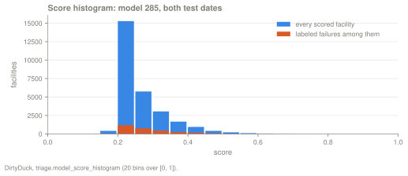
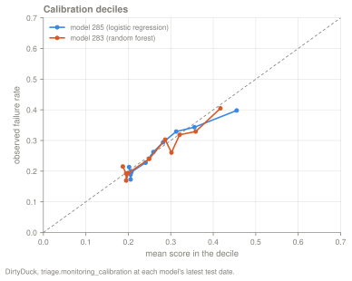
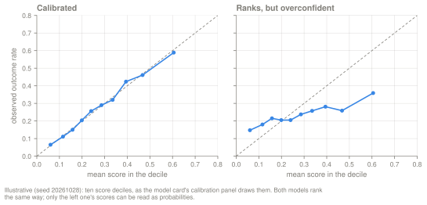
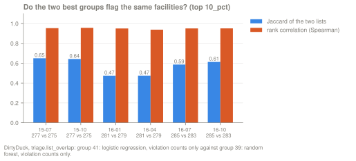
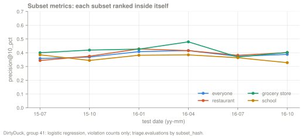

A model's card in the dashboard, and `triage model show <id>` in the terminal,
holds the threshold curve, the error rules and the crosstabs. Each of those has
its own guide. This page covers the other four panels.

| Panel | What it tells you | Where it comes from |
|---|---|---|
| Score histogram | how spread out the scores are, and how many entities share one score | `triage.model_score_histogram(model_id, bins)` |
| Calibration deciles | whether a score can be read as a probability | `triage.monitoring_calibration(...)`, `triage model show` |
| List overlap | whether two models flag the same entities | `triage postmodel compare`, `triage.list_overlap(...)` |
| Subset metrics | how the model ranks inside one slice of the Cohort | `evaluation.subsets`, `triage.evaluations` by `subset_hash` |

## The worked example

Every number on this page comes from the DirtyDuck tutorial database and the
Experiment `example/dirtyduck/experiment-guides.yaml`. The Cohort is the active
food facilities in Chicago, the label is a failed inspection in the next six
months, and only inspected facilities get a label. The Experiment has three
Runs (violation counts only, the base features only, and both) and six test
dates from 2015-07-01 to 2016-10-01.

Audition at `precision@` `10_pct` picks group 41, a logistic regression on the
48 violation-count features, with a mean of 0.3854 over the six test dates. The
runner-up, group 39, is a random forest on the same features (0.3846). Most
examples below use group 41's latest model, model 285 in our run, on its last
test date, 2016-10-01. On that date it scored 14,053 facilities. Inspectors
visited 5,675 of them in the next six months, so those have a label, and 1,491
of those failed, a base rate of 0.263.

Model ids depend on the database. On a fresh one, find them with
`triage audition` and `triage models <hash> --group <id>`.

```bash
just tutorial-up
uv run triage db upgrade
uv run triage run example/dirtyduck/experiment-guides.yaml \
    --project-path "$HOME/.cache/triage-pg/dirtyduck-guides"
uv run triage audition <hash> -m precision@ -p 10_pct
uv run triage model show 285
```

`just docs-figures` regenerates every figure on this page from the same
database.

## Score histogram

### Definition

`triage.model_score_histogram(model_id, bins)` cuts the interval [0, 1] into
equal-width bins (20 on the card). For each bin it counts every scored row
(`n`) and the labeled failures among them (`n_pos`). It reads
`triage.scored_labels`, the latest Prediction for each entity on each test date,
and it pools all of the model's test dates. For model 285 that is 27,912 rows
from 2016-07-01 and 2016-10-01.



```console
$ uv run triage query "select bin, lo, hi, n, n_pos from triage.model_score_histogram(285, 20)"
│ bin │ lo   │ hi   │ n     │ n_pos │
│ 3   │ 0.1  │ 0.15 │ 1     │ 0     │
│ 4   │ 0.15 │ 0.2  │ 411   │ 24    │
│ 5   │ 0.2  │ 0.25 │ 15280 │ 1183  │
│ 6   │ 0.25 │ 0.3  │ 5754  │ 745   │
│ 7   │ 0.3  │ 0.35 │ 3044  │ 465   │
│ 8   │ 0.35 │ 0.4  │ 1665  │ 264   │
…
│ 15  │ 0.7  │ 0.75 │ 11    │ 6     │
│ 16  │ 0.75 │ 0.8  │ 1     │ 0     │
```

### How to read the spread

Look at where the scores sit first. Model 285's scores fall between 0.10 and
0.80, and 24,078 of the 27,912 rows (86%) lie between 0.20 and 0.35, close to
the base rate of 0.26. For a model with calibrated scores (next section), a
narrow histogram near the base rate means the model tells facilities apart only
a little. This model's AUC is 0.585 and 0.606 on its two test dates. A model
without calibrated scores can rank well with a narrow histogram, so read the
spread together with the calibration panel.

`n_pos ÷ n` is not a failure rate. `n` counts every scored row, labeled or not,
and at 2016-10-01 only 5,675 of the 14,053 scored facilities have a label. In
the 0.20–0.25 bin, 5,656 of the 15,280 rows have a label and 1,183 of those
failed, a rate of 0.209. In the 0.45–0.50 bin, 89 of 204 labeled rows failed
(0.436). The calibration deciles report these rates directly.

### How to read a tall bar

A tall, narrow bar can be one score shared by many entities. At 2016-10-01,
6,160 of model 285's 14,053 facilities (43.8%) share one score:

```console
$ uv run triage query "
select round(score::numeric, 5) as score, count(*) as n,
       min(rank_abs) as first_rank, max(rank_abs) as last_rank
from triage.prediction_ranks
where model_id = 285 and split_kind = 'test' and as_of_date = '2016-10-01'
group by score
order by n desc
limit 3"
│ score   │ n    │ first_rank │ last_rank │
│ 0.20540 │ 6160 │ 7660       │ 13819     │
│ 0.25232 │ 348  │ 5940       │ 6287      │
│ 0.25669 │ 328  │ 5485       │ 5812      │
```

We read the scored Matrix (the test Parquet) for these 6,160 facilities. Every
one of the model's 48 features is 0 for each of them, and for no other facility
scored on that date. A 0 here means no
critical or serious violation on record, or no inspection to count from: the
zero imputation writes 0 in both cases. The model has nothing that tells these
facilities apart, so it gives them one score, and `triage.prediction_ranks`
orders them by `entity_id`. Inside the block, 400 of the 2,051 labeled
facilities failed (0.195). That is below the base rate of 0.263, but it is 400
failures the model cannot rank.

Any cut between k = 7,660 and k = 13,819 is therefore set partly by
`entity_id`. DirtyDuck's cut at 10% (k = 1,406), and even a cut at 50%
(k = 7,027), lie above the block, so its list is not affected. If your
capacity falls inside a block, you have two options:

- Move k outside the block, or read `value_worst` and `value_best` of
  `precision@` in `triage.evaluations`. They are the extremes over every
  ordering of the rows tied at the cut
  ([evaluation reference](/triage-pg/reference/evaluation/)).
- Add features that tell the tied entities apart. In this run the tie comes
  from the feature set, not from the estimator. The random forest on the same
  48 features (model 283) ties the same 6,160 facilities at 0.1949. The two
  models we checked that also see the base features (inspection counts,
  recency, tenure, facility type, zip) have no such block. At 2016-10-01 their
  largest tie is 107 facilities for model 297 (logistic regression, base
  features) and 108 for model 271 (random forest, all 115 features).

## Calibration deciles

### Definition

`triage.monitoring_calibration(model_id, 'test', as_of_date, label_timespan)`
takes the labeled rows of one test date, sorts them by score and cuts them into
ten deciles of equal count. For each decile it returns the mean score and the
observed failure rate (the `Realized` column). `triage model show <id>` prints
it for the model's latest test date, and the card plots it against the
diagonal.

```console
$ uv run triage model show 285
…
        Calibration @ 2016-10-01
  Decile   n     Mean score   Realized
  1        568   0.4551       0.3979
  2        568   0.3557       0.3433
  3        568   0.3127       0.3292
  4        568   0.2819       0.2940
  5        568   0.2590       0.2623
  6        567   0.2406       0.2275
  7        567   0.2075       0.1975
  8        567   0.2054       0.1728
  9        567   0.2054       0.1887
  10       567   0.2018       0.2134
```



### How to read it

A point on the diagonal means that among the facilities scored around 0.3,
about 30% failed. Model 285 sits close to it. Decile 5 has a mean score of
0.259 and an observed rate of 0.262; decile 10 has 0.202 and 0.213. The top
decile is the farthest off, at 0.455 against 0.398, so the model overstates
the risk of its highest-scored facilities by about 0.06. The runner-up group's
random forest (model 283) is about as close: its top decile is 0.417 against
0.405.

Deciles 8 and 9 of model 285 have the same mean score, 0.2054, the tied score
from the histogram: both lie inside the tie block. The model gives every
facility in them the same score, and the split of the block between the two
deciles is arbitrary, so the gap between their observed rates, 0.173 and
0.189, is chance.

`ece@10` summarizes calibration in one number: the expected calibration error
over ten equal-width score bins (equal-width bins of [0, 1], not the deciles of
the panel). It is a loss, so lower is better, and it is opt-in. The guides
Experiment adds it to `evaluation.metrics`:

```yaml
evaluation:
  metrics: [precision@, recall@, auc_roc, average_precision, brier, 'ece@10']
```

Model 285's `ece@10` is 0.0099 and 0.0107 on its two test dates.

DirtyDuck does not show a badly calibrated model. The figure below is
synthetic: two models that rank the facilities in the same order, one
calibrated and one whose observed rates move a third as much as its scores.



### Decisions that need calibrated scores

A decision that acts on the top k, with k set by capacity, uses only the order
of the scores. Any change to the scores that keeps their order gives the same
list, the same `precision@`, `recall@` and AUC, and the same audition result on
those metrics. The two models in the synthetic figure would select the same
entities. DirtyDuck's
inspections are this kind of decision, so model 285's overconfidence at the top
does not change which facilities get inspected.

A decision needs calibrated scores when it uses the value of the score:

- **Planning with expected counts.** Inspectors visited 688 of the 1,406
  facilities on model 285's 10% list at 2016-10-01. The scores of those 688
  add up to 303.9, and 267 of them failed. A plan built on the scores would
  expect 37 more failures than the inspectors found (303.9 against 267, or 14%
  more).
- **A score threshold instead of a k**, such as "inspect every facility above
  0.4".
- **Comparing or adding scores** across models, test dates or Subsets. A score
  of 0.3 means the same in two models only if both models have calibrated
  scores.
- **Showing the score to the people who act** as a probability of failure.
- **Weighing costs**, where the expected benefit of acting (probability × value)
  is set against the cost of acting.

```console
$ uv run triage query "
select count(*) as on_list, count(outcome) as labeled, sum(outcome) as failed,
       round((sum(score) filter (where outcome is not null))::numeric, 1) as expected
from triage.scored_labels(285, 'test')
where as_of_date = '2016-10-01' and rank_abs <= 1406"
│ on_list │ labeled │ failed │ expected │
│ 1406    │ 688     │ 267.0  │ 303.9    │
```

Calibration says nothing about ranking. Audition on `ece@10` puts the
constant-prior floor (groups 38, 42 and 46, which give every facility the same
score) at 0.0209, close to the best-calibrated group (35, at 0.0137) and to
group 41 (0.0173). The floor's `precision@10_pct`
averages 0.2629 over the six test dates, about the base rate, which moves
between 0.24 and 0.28 across those dates:

```console
$ uv run triage audition <hash> -m ece@10
  Group   Splits   Avg ± σ           Dist. from best (avg)   Max regret
  35      6        0.0137 ± 0.0058   0.0035                  0.0111
  39      6        0.0143 ± 0.0096   0.0041                  0.0092
  41      6        0.0173 ± 0.0069   0.0071                  0.0144
  43      6        0.0198 ± 0.0070   0.0096                  0.0168
  38      6        0.0209 ± 0.0127   0.0107                  0.0186
  …
```

So select on a ranking metric first, and use `-m ece@10` or `-m brier` to
choose among groups whose ranking is about equal. triage-pg has no
recalibration step. If the decision needs probabilities and the best ranker is
poorly calibrated, you make that trade-off when you select the model group.

### Limits

The deciles use labeled rows only. In DirtyDuck these are the inspected
facilities, 5,675 of the 14,053 scored at 2016-10-01, and the panel says nothing
about how well the scores fit the facilities nobody inspected. The deciles
divide the labeled rows, so decile 1 holds the 568 highest-scored inspected
facilities, not the top 10% of the list. Each panel is one test date; compare
dates before you call a model miscalibrated.

## List overlap

### Definition

`triage postmodel compare <a> <b> -p <cut>` reads `triage.list_overlap`. For
each test date that both models scored, it reports the size of each top-k list,
the number of entities on both (∩), the Jaccard index ∩ ÷ (k(a) + k(b) − ∩),
and a rank correlation: the Spearman correlation of the two models' ranks over
every entity both scored. The ranks are `rank_abs` from
`triage.prediction_ranks`, where ties are broken by `entity_id`. The
dashboard's compare modal shows the same numbers.

```console
$ uv run triage postmodel compare 285 283 -p 10_pct
          List overlap — m285 vs m283 @ 10_pct
  As-of        k(a)   k(b)   ∩      Jaccard   Rank corr
  2016-07-01   1386   1386   1025   0.587     0.951
  2016-10-01   1406   1406   1069   0.613     0.951
```



### How to read Jaccard

Jaccard measures what the people who act will notice: whether the other model
would send them to the same places. At 2016-10-01, 1,069 of the 1,406
facilities on model 285's list are also on model 283's, a Jaccard of 0.613.
Each list holds 337 facilities that the other does not. Over the six test
dates, the two best groups' lists have a Jaccard between 0.473 (2016-01-01, 859
of 1,337 shared) and 0.650 (2015-07-01). On each date, between 21% and 36% of
one list (261 to 486 facilities) is missing from the other. The two groups'
audition means differ by 0.0008, so the choice between them barely moves
precision but changes which facilities the inspectors visit.

### How to read the rank correlation

The rank correlation reads much higher, 0.938 to 0.957 on every date, and it is
easy to misread. It counts every scored facility, and both models tie the same
6,160 facilities (the ones with no violation counts, from the histogram
section). Both models order that block by `entity_id`, so those pairs line up
exactly. Without them, the correlation at 2016-10-01 drops to 0.811. Among the
facilities on either list, it is 0.175:

```console
$ uv run triage query "
with a as (
    select entity_id, score, rank_abs from triage.prediction_ranks
    where model_id = 285 and split_kind = 'test' and as_of_date = '2016-10-01'),
b as (
    select entity_id, score, rank_abs from triage.prediction_ranks
    where model_id = 283 and split_kind = 'test' and as_of_date = '2016-10-01'),
pairs as (
    select a.rank_abs as rank_a, b.rank_abs as rank_b,
           a.score = (select mode() within group (order by score) from a)
       and b.score = (select mode() within group (order by score) from b) as shared_tie
    from a inner join b using (entity_id))
select round(corr(rank_a, rank_b)::numeric, 3) as everyone,
       round((corr(rank_a, rank_b) filter (where not shared_tie))::numeric, 3) as without_shared_tie,
       round((corr(rank_a, rank_b) filter (where rank_a <= 1406 or rank_b <= 1406))::numeric, 3) as on_either_list
from pairs"
│ everyone │ without_shared_tie │ on_either_list │
│ 0.951    │ 0.811              │ 0.175          │
```

Here the rank correlation mostly measures agreement about facilities that
neither list holds, above all the tied block that both models order the same
way. Jaccard at the cut measures agreement about the facilities that receive
the intervention, and that is the number the decision needs.

### Choice between two model groups

Compare models that differ in one thing. In this run, changing the estimator
moves the list less than changing the features does. The same features with a
different estimator (285 against 283) give a Jaccard of 0.587 and 0.613 on the
two latest test dates. The same estimator with different features (a random
forest on the base features, model 295, against one on all 115 features, model
271) gives 0.317 and 0.344.

When two groups score alike and their lists overlap heavily, prefer the simpler
or steadier one. When they score alike and their lists differ, the choice
decides who receives the intervention. Take it to the people who act, together
with the crosstabs of both lists. The "Stability over time" section of
[Reading the crosstabs](/triage-pg/guides/reading-the-crosstabs/) compares
these two groups' lists feature by feature. The CLI flags one such case:
`triage audition` prints `audition pick (group 41, model 285) DIVERGES from
leaderboard #1 (group 39, model 283)`, because the leaderboard ranks one test
date and audition averages six. The overlap tells you how much that divergence
matters for the list.

## Subset metrics

### Definition

A Subset is a named slice of the Cohort, declared in `evaluation.subsets` as a
name and a query. triage-pg ranks the Subset's members among themselves,
computes every metric again, and stores the rows in `triage.evaluations` under
the Subset's `subset_hash`; the whole Cohort has `subset_hash = ''`. The
experiment overview's population selector switches the heatmap to a Subset,
and `triage model curve <id> --subset <name>` draws the threshold curve inside
it. Subsets are identity-neutral: adding one and running `triage run` again
scores and evaluates the cached models without retraining them.

The guides Experiment declares three facility types and two zip codes. The
first one:

```yaml
evaluation:
  subsets:
    - name: restaurant
      query: |
        select e.entity_id
        from ontology.entities as e
        where e.facility_type = 'restaurant'
          and e.activity_period @> {as_of_date}::date
```



```console
$ uv run triage query "
select coalesce(s.config ->> 'name', 'everyone') as population,
       e.num_labeled_above_threshold as labeled_on_list,
       round(e.value::numeric, 3) as precision,
       round(e.num_positive::numeric / e.num_labeled, 3) as base_rate,
       round(e.value::numeric / (e.num_positive::numeric / e.num_labeled), 2) as lift
from triage.evaluations as e
inner join triage.models as m using (model_id)
left join triage.subsets as s using (subset_hash)
where m.model_group_id = 41 and e.split_kind = 'test' and e.as_of_date = '2016-10-01'
  and e.metric = 'precision@' and e.parameter = '10_pct'
  and (e.subset_hash = '' or s.config ->> 'name' in ('restaurant', 'grocery_store', 'school'))
order by lift desc"
│ population    │ labeled_on_list │ precision │ base_rate │ lift │
│ restaurant    │ 459             │ 0.401     │ 0.262     │ 1.53 │
│ everyone      │ 688             │ 0.388     │ 0.263     │ 1.48 │
│ grocery_store │ 82              │ 0.402     │ 0.302     │ 1.33 │
│ school        │ 61              │ 0.328     │ 0.283     │ 1.16 │
```

### How to read it

**The Subset is the population.** The schools' `precision@10_pct` of 0.328 is
the precision among the top 10% of schools ranked against each other (the top
88 of 872 schools at 2016-10-01). It is not the precision among the schools on
everyone's list. Schools make up 4.5% of model 285's list and 6.4% of the
rest; the crosstabs report that.

**Read precision next to the Subset's base rate.** On precision alone,
restaurants and grocery stores tie at 0.401 and 0.402. Divided by the base rate
(the `lift` column), the model does better for restaurants (1.53) than for
grocery stores (1.33), and least well for schools (1.16), against 1.48 for
everyone.

**Count the labeled rows behind each number.** `num_labeled_above_threshold`
holds them. For schools it ranges from 13 to 61 across the six test dates. The
0.385 at 2016-04-01 is 5 failures among 13 inspected schools; one inspection
with the other result would make it 0.31 or 0.46. The number of labeled
schools also swings between dates: 235, 619, 645, 282, 231 and 598. The
October and January dates have two to three times as many as the April and
July dates, and the data does not record why.

### Next steps

- **A Subset the features do not rank.** Its curve stays near its own base
  rate. Schools are the nearest case in DirtyDuck, and the "Find missing
  features" section of
  [Reading the threshold curve](/triage-pg/guides/reading-the-threshold-curve/)
  works through them.
- **Protected groups or their proxies.** Declare them as Subsets and in
  `bias_config`, then read the per-Subset curve next to the dashboard's Bias
  tab. [`docs/fairness.md`](https://github.com/ccd-ia/triage-pg/blob/main/docs/fairness.md)
  explains which disparity matters for which intervention, and the "Fairness"
  section of the threshold curve guide works the zip-code Subsets through.
- **A Subset whose numbers swing between test dates.** Check its labeled counts
  and base rate before you blame the model. The zip 60618 Subset, in the "Data
  quality" section of the threshold curve guide, is a case where the outcome
  changed and the model did not.

## The other guides

- [Reading the threshold curve](/triage-pg/guides/reading-the-threshold-curve/):
  precision and recall at every k, per Subset and per test date.
- [Reading the error trees](/triage-pg/guides/reading-the-error-trees/): where
  the list is wrong, as rules you can read.
- [Reading the crosstabs](/triage-pg/guides/reading-the-crosstabs/): who is on
  the list, feature by feature.
- [How to find leakage](/triage-pg/guides/finding-leakage/):
  `triage check leakage` and the leakage signs in all three diagnostics.
- The [dashboard reference](/triage-pg/reference/dashboard/) and the
  [CLI reference](/triage-pg/reference/cli/) list every panel and command.
