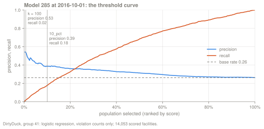
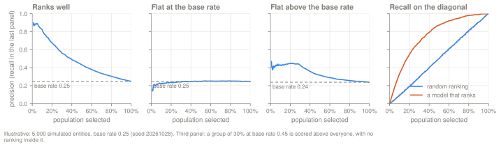
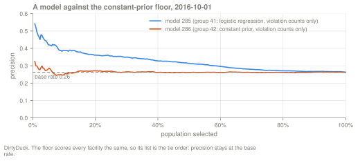
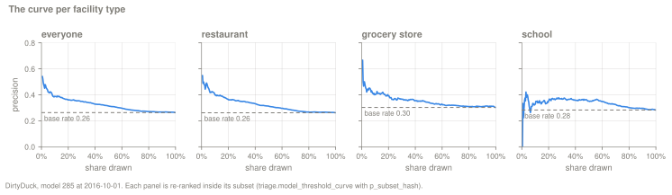
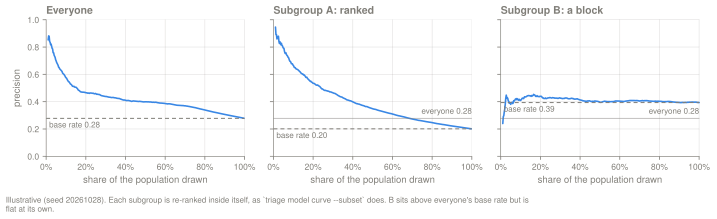
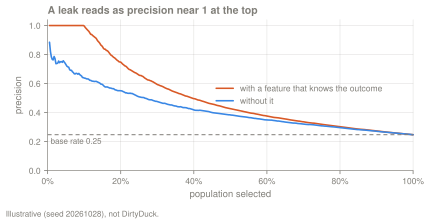
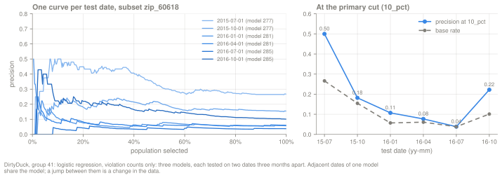
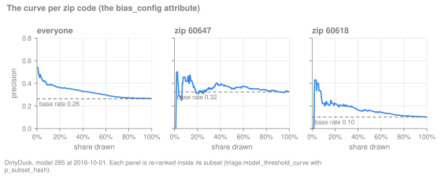
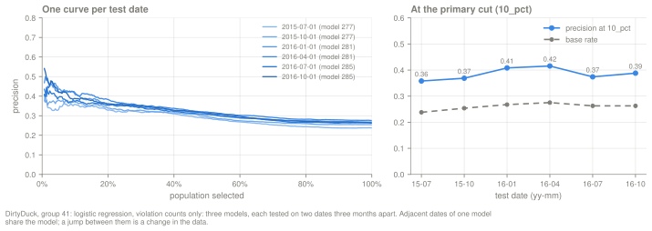

A ranking model is built for people who can act on only the top k entities of a
list. They need to know how many of those k the model gets right, and how much
of the problem the list reaches. The threshold curve gives both numbers for
every k at once. DSSG material calls this plot the **Rayid curve**, after Rayid
Ghani, and the dashboard's model card uses that name. This page calls it the
threshold curve.

The page is the first of three diagnostic guides. The
[error trees](/triage-pg/guides/reading-the-error-trees/) say which entities the
list gets wrong, and the [Crosstabs](/triage-pg/guides/reading-the-crosstabs/)
say what the entities on the list have in common. The
[model card guide](/triage-pg/guides/reading-the-model-card/) covers the score
histogram, calibration and list overlap. Each diagnostic page has the same
sections: how to read the plot, the patterns that mean something, how to use it
to improve a model, and how to use it to check one.

**The worked example.** Every number on this page comes from one Experiment on
the DirtyDuck tutorial database:
[`example/dirtyduck/experiment-guides.yaml`](https://github.com/ccd-ia/triage-pg/blob/main/example/dirtyduck/experiment-guides.yaml).
The label is "the facility fails an inspection in the next six months", the
intervention is an inspection, and a facility that nobody inspected in those six
months has no label. The config makes three Runs (all features, the features of
the tutorial's `experiment.yaml`, and the violation counts alone) and tests each
split on two as_of_dates three months apart. Audition at `precision@` `10_pct`
picks the logistic regression on the violation counts alone (group 41 in our
run). Its latest model (285 in our run) is the one this page reads, on its test
date 2016-10-01. Model ids depend on your database, so the page names models by
their role and gives the id we got.

```bash
just tutorial-up                 # DirtyDuck database; PG* must point at it
uv run triage db upgrade
uv run triage run example/dirtyduck/experiment-guides.yaml \
    --project-path "$HOME/.cache/triage-pg/dirtyduck-guides"
uv run triage audition <experiment_hash> -m precision@ -p 10_pct
uv run triage model curve <model_id>
```

## Definition

For one model, one test as_of_date and one population, the curve sorts the
population by score and reports, at every list size k from 1 to N:

| Column | Meaning | Model 285 at k = 100 |
|---|---|---|
| `k` | rows on the list; every scored row counts, labeled or not | 100 |
| `% pop` | k ÷ N | 0.7% of 14,053 |
| precision | failures ÷ labeled rows among the top k | 27 ÷ 51 = 0.529 |
| recall | failures among the top k ÷ labeled failures in the whole population | 27 ÷ 1,491 = 0.018 |
| base rate | labeled failures ÷ labeled rows in the population; the same at every k | 1,491 ÷ 5,675 = 0.263 |

The population is the set of rows the curve ranks. By default it is the scored
Cohort at that as_of_date; with a Subset, it is that Subset. The numbers
come from the SQL function
`triage.model_threshold_curve(p_model, p_as_of_date, p_subset_hash)`, which
reads the same ranks and labels as the stored `precision@` and `recall@`
metrics. The row at k = 100 therefore equals the stored `precision@100_abs`,
and the row at 10% is the cut of `precision@10_pct`
(see [how top-k cuts count labels](/triage-pg/reference/evaluation/#top-k-cuts-the-whole-population-metrics-count-the-labeled-rows)).

Three surfaces read the function:

- `triage model curve MODEL_ID [--date D] [--subset NAME] [--points N] [--json]`
  prints the curve. Without `--date` it uses the model's latest test date.
  `--json` adds the TP, FP, FN and TN counts at each k.
- The dashboard's model card has a panel named "Rayid curve · k-slider". It
  draws the latest test date, a dashed line at the base rate, and a slider that
  reads precision, recall and the four counts at any share of the list.
- `GET /api/models/{id}/curve?as_of_date=…&subset=<subset_hash>` returns the
  rows as JSON.

## How to read it



```text
$ uv run triage model curve 285 --points 10
Threshold curve — model 285 @ 2016-10-01
14053 scored row(s); base rate = labeled positives ÷ labeled rows
      k    % pop   Precision   Recall   Base rate
   1406    10.0%      0.3881   0.1791      0.2627
   2811    20.0%      0.3607   0.3266      0.2627
   4216    30.0%      0.3496   0.4722      0.2627
   5622    40.0%      0.3274   0.5755      0.2627
   7027    50.0%      0.3145   0.6854      0.2627
   ...
  14053   100.0%      0.2627   1.0000      0.2627
```

**The horizontal axis** is the share of the population on the list, ranked by
score. On 2016-10-01 the Cohort holds 14,053 facilities, so the 10% mark is
k = 1,406.

**The precision line** gives the share of inspected facilities on the list
that failed. At k = 100, inspectors visited 51 of the 100 facilities in the
following six months, and 27 of those failed, so precision is 27 ÷ 51 = 0.529.
The other 49 count toward k but not toward precision, because nobody knows
whether they would have failed. The line is noisy at the very top. Inspectors
visited none of the first four facilities on the list, so precision is blank
until k = 5, and at k = 8 it reads 0.75 on four inspected facilities. When the
list holds the whole population, precision equals the base rate.

**The recall line** gives the share of all failures that the list reaches. At
k = 100 the list holds 27 of the 1,491 failures (0.018), and at the 10% cut it
holds 267 of them (0.179). Recall always ends at 1.

**The dashed base-rate line** is the precision a random ordering of the same
population expects at any k. Of the 5,675 facilities inspectors visited, 1,491
failed, so the base rate is 0.263. The gap between the
precision line and this line is what the model adds. The ratio of the two is
the lift, 0.388 ÷ 0.263 = 1.48 at 10%.

**The crossing of the two lines** carries no meaning for the decision.
Precision equals recall where the number of labeled rows on the list equals the
number of labeled failures, which for model 285 happens between 20% (1,350
inspected facilities on the list) and 30% (2,014), on either side of the 1,491
failures.

### One curve per Subset

`--subset` makes a Subset the population. The function re-ranks the Subset's
members among themselves and computes precision, recall and the base rate
inside it, the same way the Subset rows of `triage.evaluations` are computed.
You declare a Subset in
[`evaluation.subsets`](/triage-pg/reference/configuration/#evaluation). That
block is identity-neutral, so adding a Subset and running `triage run` again
re-evaluates the existing models without retraining them.

```text
$ uv run triage model curve 285 --subset restaurant --points 10
Threshold curve — model 285 @ 2016-10-01 · subset restaurant
8745 scored row(s); base rate = labeled positives ÷ labeled rows
     k    % pop   Precision   Recall   Base rate
   875    10.0%      0.4009   0.1792      0.2617
  1749    20.0%      0.3625   0.3184      0.2617
  2624    30.0%      0.3495   0.4567      0.2617
```

In the dashboard, the "population" selector above the curve switches between
"full cohort" and each Subset of the Experiment. The dashboard draws the latest
test date only. For an earlier date, use `--date` or the API's `as_of_date`.

A Subset curve answers "how well does the score order the members of this
group among themselves?" It does not show what happens to the group on the
list everyone shares. That question belongs to the bias audit, and the
[fairness section](#fairness) below reads the two side by side.

## Patterns



The figure shows four shapes on 5,000 simulated entities with a base rate of
0.25. The first three panels plot precision, the fourth recall.

### Ranks well

Precision starts well above the base rate and falls toward it; recall climbs
faster than the share of the list. Model 285 is a modest case of this shape:
precision 0.53 at k = 100, 0.39 at 10% and 0.31 at 50%, against a base rate of
0.26. The illustrative model in the first panel starts near 0.9.

### Flat at the base rate



A model whose precision stays on the base-rate line does not rank. The
Experiment includes such a model on purpose. The constant-prior floor (model
286, `DummyClassifier` with `strategy: prior`, same Run and split as 285)
scores every facility the same, so its list is the tie order. Its precision is
0.249 at 10%, 0.271 at 20% and 0.261 at 50%, against a base rate of 0.263.
When a real model's curve looks like this on one Subset, the features do not
order that group ([find missing features](#find-missing-features)).

### Flat above the base rate

The third panel shows a subgroup of 30% of the population with a base rate of
0.45 that the model scores above everyone else, with no order inside it.
Precision holds at 0.45 for the first 30% of the list and then falls. The model
lifts the group as a block: membership raises every member's score, and nothing
separates one member from another. On the group's own Subset curve the line is
flat at the group's base rate, above everyone's
([refine the Cohort or split the model](#refine-the-cohort-or-split-the-model)).

### Recall on the diagonal

A random ordering finds failures in proportion to the share of the list, so its
recall with 10% of the population on the list is about 0.10. The floor model
shows it on real data:

```text
$ uv run triage model curve 286 --points 10
Threshold curve — model 286 @ 2016-10-01
14053 scored row(s); base rate = labeled positives ÷ labeled rows
      k    % pop   Precision   Recall   Base rate
   1406    10.0%      0.2493   0.1268      0.2627
   2811    20.0%      0.2710   0.2730      0.2627
   4216    30.0%      0.2650   0.3964      0.2627
   5622    40.0%      0.2618   0.5003      0.2627
   7027    50.0%      0.2614   0.6009      0.2627
```

Model 285 reaches 0.179, 0.327, 0.472, 0.576 and 0.685 at the same cuts. The
distance above the diagonal is the share of failures the ranking concentrates
at the top.

## Use it to improve the model

### Choose k and the intervention

The list size should come from the capacity of the people who act on it. The
curve then says what that capacity buys, and where adding to the list stops
paying.

Suppose the city's inspectors can visit about 1,400 facilities in six months.
DirtyDuck records no capacity, so the number is an assumption for this example.
At k = 1,406 (10% of the Cohort), model 285's precision is 0.388 and its
recall 0.179. Inspectors visited 688 of the listed facilities in the following
six months, and 267 of those failed an inspection. The list therefore holds 267
of the 1,491 facilities that failed in that half-year. Nobody visited the other
718 listed facilities, so their outcomes are unknown.

The cumulative precision on the curve hides where the list stops being useful,
because every row from the top is still in the average. The precision of each
band of the list shows it. `triage model curve --json` gives the counts, or the
function can be queried directly:

```sql
-- precision of each band of the list (ranks k_prev+1 .. k), not of the top k
with cuts as (
    select k, tp, fp
    from triage.model_threshold_curve(285, '2016-10-01', '')
    where k in (1406, 2811, 4216, 5622, 7027, 14053)
)

select
    k,
    tp - lag(tp, 1, 0) over w as band_failed,
    (tp + fp) - lag(tp + fp, 1, 0) over w as band_inspected,
    round(
        (tp - lag(tp, 1, 0) over w)::numeric
        / ((tp + fp) - lag(tp + fp, 1, 0) over w),
        3
    ) as band_precision
from cuts
window w as (order by k)
order by k;
```

```text
   k   | band_failed | band_inspected | band_precision
-------+-------------+----------------+----------------
  1406 |         267 |            688 |          0.388
  2811 |         220 |            662 |          0.332
  4216 |         217 |            664 |          0.327
  5622 |         154 |            607 |          0.254
  7027 |         164 |            629 |          0.261
 14053 |         469 |           2425 |          0.193
```

The second and third tenths of the list fail at 0.33. The band from rank 4,217
to rank 5,622 (30% to 40% of the Cohort) fails at 0.254, below the base rate of
0.263, so from there on the next facility on model 285's list is no more likely
to fail than one picked at random. DirtyDuck's curve has no sharp knee. Precision drops fast over the
first 1,406 ranks (0.53 at k = 100, 0.39 at k = 1,406) and slowly after them.
Here the capacity sets k, and the band table sets an upper limit near rank
4,200, beyond which a longer list adds facilities no more likely to fail than a
random pick.

The intervention follows from the same numbers. An inspection that finds a
failure about one time in three is worth sending if a visit is cheap relative
to a missed failure. A costlier intervention argues for a shorter list, and a
cheap one, such as a letter, for a longer list reaching more of the 1,491
failures.

Next steps in triage-pg:

1. Write the capacity as an absolute cut in
   [`evaluation.thresholds`](/triage-pg/reference/configuration/#evaluation),
   for example `thresholds: [1400_abs, 10_pct]`, and set
   `bias_config.parameter: 1400_abs` so the bias audit uses the same list. An
   `_abs` cut keeps the list the same size when the Cohort grows or shrinks; a
   `_pct` cut does not (10% was k = 1,386 on 2016-07-01 and 1,406 on
   2016-10-01).
2. Run `triage run` again. The `evaluation` block is identity-neutral, so the
   run reuses the trained models and evaluates them at the new cut.
3. Select at that cut: `triage audition <experiment_hash> -m precision@ -p 1400_abs`.
4. Read the false-negative rules at that k in the
   [error trees](/triage-pg/guides/reading-the-error-trees/#choose-k-and-the-intervention)
   (who the list misses) and the
   [Crosstabs](/triage-pg/guides/reading-the-crosstabs/#choose-k-and-the-intervention)
   (who is on it), and describe that profile to the people who will act.

### Find missing features



A Subset whose curve stays near its own base rate is a group the features do
not order. The Experiment declares three facility types as Subsets. Model 285
at 2016-10-01:

| Population | Scored | Base rate | Precision at 10% | Lift at 10% | Precision at 30% |
|---|---|---|---|---|---|
| everyone | 14,053 | 0.263 | 0.388 | 1.48 | 0.350 |
| restaurant | 8,745 | 0.262 | 0.401 | 1.53 | 0.350 |
| grocery_store | 2,295 | 0.303 | 0.402 | 1.33 | 0.366 |
| school | 872 | 0.283 | 0.328 | 1.16 | 0.368 |

```text
$ uv run triage model curve 285 --subset school --points 10
Threshold curve — model 285 @ 2016-10-01 · subset school
872 scored row(s); base rate = labeled positives ÷ labeled rows
    k    % pop   Precision   Recall   Base rate
   88    10.1%      0.3279   0.1183      0.2826
  175    20.1%      0.3520   0.2604      0.2826
  262    30.0%      0.3681   0.3964      0.2826
  349    40.0%      0.3595   0.5148      0.2826
  436    50.0%      0.3522   0.6272      0.2826
  ...
  872   100.0%      0.2826   1.0000      0.2826
```

The school curve rises from 10% to 30%, so the schools ranked just below the
top tenth fail more often than the top tenth itself. The counts are small.
Inspectors visited 61 of the top 88 schools, and 20 of those failed; with 61
inspected rows, one standard error of the precision is about 0.06 (binomial, at
the school base rate of 0.28). One date settles nothing, so read the others
too.


Across the six test dates of the best model group, the school Subset's
precision at 10% is below everyone's on five dates (2015-07-01 is the
exception). The number of inspected schools in the school list's top 10% ranges
from 13 to 61 between dates, so each point is weak alone.

The other Runs separate the estimator from the features, because they score the
same schools with other estimators and other feature sets. School precision at
10% on 2016-10-01, from `triage model curve <id> --subset school`:

| Model (our run) | Estimator | Features | Precision at 10% |
|---|---|---|---|
| 285 | logistic regression | violation counts only | 0.328 |
| 273 | logistic regression | all | 0.317 |
| 297 | logistic regression | the tutorial's features | 0.311 |
| 283 | random forest | violation counts only | 0.356 |
| 271 | random forest | all | 0.250 |

No model orders schools much above their base rate of 0.28, including the
three (273, 297 and 271) whose features contain facility-type and zip
indicators. The signal that would rank schools is not in the Matrix.

Next steps in triage-pg:

- Keep `school` in `evaluation.subsets`, so every Run reports it.
- Look for a Source that describes schools specifically. DirtyDuck has none,
  so the worked example stops here. In a real project, declare the Source, add
  its columns to `feature_config`, put them in their own
  `feature_config.feature_groups.definitions` group with
  `strategies: [all, leave-one-out]`,
  and run once. Then compare `triage model curve <id> --subset school` across
  the Runs that one run produces.
- When the candidate feature is already in the Matrix but not in the model, the
  [error trees guide](/triage-pg/guides/reading-the-error-trees/) and the
  [Crosstabs guide](/triage-pg/guides/reading-the-crosstabs/) show the same
  loop on DirtyDuck's violation counts, with the leaderboard before and after.

### Refine the Cohort or split the model



A Subset that is flat at its own base rate while that base rate sits above
everyone's is a group the model lifts as a block. In the illustrative figure,
subgroup B has a base rate of 0.39 against everyone's 0.28. The model has
learned that B fails more often and moves all of B up the list, but nothing it
knows orders B's members. When the list ends inside B, small differences in
score that carry no information decide which members of B are on it.

Three readings together identify a block:

1. the Subset curve is flat (the pattern above);
2. the Subset's base rate is above everyone's;
3. the group's share of the list is well above its share of the rest, which the
   Crosstabs show for any indicator column in the Matrix.

DirtyDuck shows no block. The nearest case is school: its base rate (0.283) is
above everyone's (0.263) and its curve is nearly flat, but the gap is 0.02 and
the model does not lift schools. They are under-represented on the list, as
are grocery stores:

```sql
-- share of each facility type on the list (top 10%) and off it
select feature, round(selected_value::numeric, 3) as on_list, round(rest_value::numeric, 3) as rest
from triage.crosstabs
where model_id = 285
    and as_of_date = '2016-10-01'
    and parameter = '10_pct'
    and stat = 'nonzero_rate'
    and feature in (
        'facilities.facility_type=restaurant',
        'facilities.facility_type=grocery store',
        'facilities.facility_type=school'
    )
order by feature;
```

```text
                feature                 | on_list | rest
----------------------------------------+---------+-------
 facilities.facility_type=grocery store |   0.137 | 0.166
 facilities.facility_type=restaurant    |   0.722 | 0.611
 facilities.facility_type=school        |   0.045 | 0.064
```

Restaurants are the only facility type over-represented on the list, and the
restaurant curve ranks within the group (lift 1.53 at 10%), so they are not a
block either.

Next steps in triage-pg, when a block appears:

- Add the group to `evaluation.subsets` if it is not there, and confirm the
  shape with `triage model curve <id> --subset <name>` on several dates.
- If the group should not receive the intervention at all, remove it in
  `cohort_config.query`. That changes the Cohort, so it is a new Experiment
  (the Cohort is part of an Experiment's identity).
- If the group should receive it but needs its own order, give it its own
  Experiment whose Cohort is the group, so that its models learn to rank
  inside it, and keep the main Experiment for everyone else.

## Use it to check the model

### Leakage



A feature that knows the outcome produces a plateau at 1.0. In the illustrative
figure, one feature identifies 40% of the failures outright. At a base rate of
0.25 that is 10% of the population, and precision stays at 1.0 for exactly
that share of the list. Real features recorded before the as_of_date rarely
hold precision at 1.0 over hundreds of labeled rows. The same shape on a single
Subset, with precision near 1 there and ordinary elsewhere, points at a leak
confined to that group.

Do not confuse a plateau with the noise at the very top. Model 285's precision
is 0.75 at k = 8, on four inspected facilities. Read the top of the curve only
where the list holds enough labeled rows:

```sql
-- the highest precision once at least 30 labeled rows are on the list
select k, tp, tp + fp as labeled, round(prec::numeric, 3) as precision
from triage.model_threshold_curve(285, '2016-10-01', '')
where tp + fp >= 30
order by prec desc, k
limit 1;
```

```text
 k  | tp | labeled | precision
----+----+---------+-----------
 65 | 21 |      33 |     0.636
```

Once 30 inspected facilities are on the list, model 285's precision never goes
above 0.64. The highest Subset precision at 10% is 0.417 (zip 60647: 5 failures
among 12 inspected facilities). DirtyDuck shows no leak shape, and the leakage
check agrees:

```text
$ uv run triage check leakage example/dirtyduck/experiment-guides.yaml
...
Checked 7 as_of_date(s) in 10.9s: no differences (exit 0).
```

Next steps in triage-pg, when a plateau appears:

1. Run `triage check leakage <config>`. For each as_of_date it builds the
   Cohort, labels and features on all data, builds them again with the rows
   each one may not see deleted (inside a transaction it rolls back), and
   reports what changed. The
   [leakage guide](/triage-pg/guides/finding-leakage/) explains its output and
   the leaks it cannot see, such as a table that no Source declares.
2. Run `triage postmodel error-rules <id> --suspicious`. It lists the
   false-positive leaves with an error rate of 0.02 or less and the confusion
   leaves that are almost all true positives, each holding at least 30 rows by
   default. The rule of the leaf behind the plateau names the feature.
3. In the Crosstabs, look for a feature that is nonzero for almost everyone on
   the list and almost no one off it.

A plateau is not proof of a leak. A feature recorded before the as_of_date can
nearly determine the outcome for some entities. The check decides, not the
shape.

### Data quality



The Experiment tests each model on two as_of_dates three months apart. On two
such dates the model is the same, so a jump in its curve between them is a
change in the data: the labels, the Cohort, or the features. A jump between
dates scored by different models can come from either.

On the whole Cohort, the best model group shows no jump: adjacent dates of one
model differ by at most 0.014 in precision at 10% (see the
[stability section](#stability-over-time) below). The zip 60618 Subset does
jump. Under model 277, precision at 10% falls from 0.500 to 0.182 between
2015-07-01 and 2015-10-01:

```text
$ uv run triage model curve 277 --subset zip_60618 --date 2015-07-01
Threshold curve — model 277 @ 2015-07-01 · subset zip_60618
420 scored row(s); base rate = labeled positives ÷ labeled rows
    k    % pop   Precision   Recall   Base rate
   42    10.0%      0.5000   0.1951      0.2662
   ...
$ uv run triage model curve 277 --subset zip_60618 --date 2015-10-01
Threshold curve — model 277 @ 2015-10-01 · subset zip_60618
433 scored row(s); base rate = labeled positives ÷ labeled rows
    k    % pop   Precision   Recall   Base rate
   44    10.2%      0.1818   0.1333      0.1546
   ...
```

The Subset's base rate fell with it, from 0.266 to 0.155. Over all six dates
the two move together:

```sql
-- one Subset's precision and base rate on every test date of a model group
select
    e.as_of_date,
    e.model_id,
    round(e.value::numeric, 3) as precision_10pct,
    e.num_labeled_above_threshold as inspected_on_list,
    round(e.num_positive::numeric / e.num_labeled, 3) as base_rate
from triage.evaluations as e
inner join triage.subsets as s on s.subset_hash = e.subset_hash
where s.config ->> 'name' = 'zip_60618'
    and e.model_id in (277, 281, 285)
    and e.split_kind = 'test'
    and e.metric = 'precision@'
    and e.parameter = '10_pct'
order by e.as_of_date;
```

```text
 as_of_date | model_id | precision_10pct | inspected_on_list | base_rate
------------+----------+-----------------+-------------------+-----------
 2015-07-01 |      277 |           0.500 |                16 |     0.266
 2015-10-01 |      277 |           0.182 |                22 |     0.155
 2016-01-01 |      281 |           0.107 |                28 |     0.057
 2016-04-01 |      281 |           0.077 |                26 |     0.061
 2016-07-01 |      285 |           0.038 |                26 |     0.038
 2016-10-01 |      285 |           0.222 |                18 |     0.101
```

Both jumps within one model (277 in 2015, 285 in 2016) follow the base rate.
The failure rate among inspected facilities in this zip moved, and the model's
precision moved with it. DirtyDuck does not record why: a real improvement, a
change in who inspected the zip, or a change in how results were recorded would
all look the same in this table. Each precision rests on 16 to 28 inspected
facilities, so the size of each jump is uncertain too.

Next steps in triage-pg:

- Keep the Subset in `evaluation.subsets`, and run the query above for each
  Subset after every Run.
- Find out from the data owner whether the change is operational. If it is, fix
  the label definition in `label_config` (a new Experiment) or document the
  break.
- If the change is real, give the model a way to follow it: a point-in-time
  feature such as the zip's recent failure rate, built in `feature_config` from
  data known before each as_of_date.

### Fairness



DirtyDuck has no demographic columns, so the Experiment's `bias_config` uses
zip code as a geographic proxy, by assumption. Two zips are also declared as
Subsets: 60647, the bias audit's reference group (the largest zip), and 60618.

```text
$ uv run triage model curve 285 --subset zip_60618 --points 10
Threshold curve — model 285 @ 2016-10-01 · subset zip_60618
451 scored row(s); base rate = labeled positives ÷ labeled rows
    k    % pop   Precision   Recall   Base rate
   46    10.2%      0.2222   0.2222      0.1011
   91    20.2%      0.2195   0.5000      0.1011
   ...
  451   100.0%      0.1011   1.0000      0.1011
```

The Subset curve and the bias audit answer different questions, so read them
side by side. The Subset curve re-ranks the zip's facilities among themselves.
The bias audit (`triage.bias_metrics`, the dashboard's Bias tab) takes the list
everyone shares, the top 10% of the whole Cohort, and counts the zip's
facilities on it.

| Zip | Scored | Base rate | Subset curve: precision at its own 10% | Shared list: selected | Shared list: precision | FDR | FDR disparity |
|---|---|---|---|---|---|---|---|
| 60647 (reference) | 545 | 0.322 | 0.417 (5 of 12 inspected) | 42 | 0.455 | 0.545 | 1.00 |
| 60618 | 451 | 0.101 | 0.222 (4 of 18 inspected) | 25 | 0.400 | 0.600 | 1.10 |

The Subset curve says the score orders facilities inside 60618 about as well,
relative to its base rate, as inside 60647: lift 2.2 against 1.3, on 4 and 5
failures. The precision values differ mainly because the base rates differ by a
factor of three, and precision follows the base rate. Comparing the raw curves
of two groups with such different base rates mostly compares the base rates.

The bias audit says what the shared list does to each zip. The Experiment
records the intervention as punitive (a wrong flag sends an inspector to a
compliant business), and for a punitive intervention on a capped list the
fairness tree points at FDR, the share of wrong flags among the flagged.
60618's FDR is 0.600 against the reference's 0.545, a disparity of 1.10, inside
the τ = 0.8 band. Three other zips fall outside it:


Every zip in the figure has between 23 and 86 selected facilities, and fewer
inspected ones, so a single failure moves its FDR by several points.

Next steps in triage-pg:

- Put the protected attribute, or the proxy you use for it, in
  `bias_config.query`, and set `bias_config.intervention` so the fairness tree
  highlights the disparity that carries the harm.
- Declare each group you need to watch as a Subset in `evaluation.subsets`,
  and read `triage model curve <id> --subset <group>` next to the Bias tab.
- Read [`docs/fairness.md`](https://github.com/ccd-ia/triage-pg/blob/main/docs/fairness.md)
  for the fairness tree and the metric definitions, and the
  [dashboard reference](/triage-pg/reference/dashboard/) for the Bias tab.

### Stability over time



A model group is easier to trust when its curve holds its shape across test
dates. The
best model group (three models, each tested on two dates) has precision at 10%
of 0.358, 0.369, 0.408, 0.416, 0.374 and 0.388 from 2015-07-01 to 2016-10-01,
against base rates between 0.238 and 0.275. The lift stays between 1.42 and
1.53.

Within one model, adjacent dates differ by at most 0.014 (277: 0.358 to 0.369;
281: 0.408 to 0.416; 285: 0.374 to 0.388). Where the model changes, the steps
are about 0.04 (0.369 to 0.408 from 277 to 281, and 0.416 to 0.374 from 281 to
285). Retraining seems to move the curve more than three months of new data do
here, though two dates per model is little evidence.

Audition puts the same information in numbers:

```text
$ uv run triage audition <experiment_hash> -m precision@ -p 10_pct
  Group   Splits   Avg ± σ           Dist. from best (avg)   Max regret
  41      6        0.3854 ± 0.0228   0.0161                  0.0489
  39      6        0.3846 ± 0.0155   0.0169                  0.0586
  ...
  Rule                       Picked group
  best_average_value         41
  best_avg_var_penalized     39
```

The "Splits" column counts test dates: three splits with two dates each. Group
39, the random forest on the same features, has nearly the same mean (0.3846
against 0.3854) and a smaller standard deviation (0.0155 against 0.0228). The
choice between the two is a choice between a slightly higher average and a
steadier one.

Next steps in triage-pg:

- Read each model across its whole test window with
  `triage leaderboard <experiment_hash> --windowed`.
- Select with a rule that penalises variance:
  `triage audition <experiment_hash> -m precision@ -p 10_pct --rule best_avg_var_penalized`
  picks group 39 here.
- To select on the recent regime only, add `--from <date>` to `triage audition`.
- Read the curve of an earlier date with `triage model curve <id> --date <date>`;
  the dashboard shows only the latest.

## Caveats

**Precision counts the labeled rows only.** At k = 1,406, 718 listed
facilities were not inspected and do not enter precision or recall. The curve
measures the list against the inspections that happened, and the city's
existing practice chose those inspections. A model that ranks facilities nobody
inspects high cannot be scored on them. The
[evaluation reference](/triage-pg/reference/evaluation/) shows how the label
counts are stored (`num_labeled`, `num_labeled_above_threshold`).

**Small counts make noisy curves.** The first rows of any list, small Subsets
(zip 60618 had 18 labeled failures on 2016-10-01) and late as_of_dates with few
labels all swing by chance. A rough standard error for a precision p on n
labeled rows is the square root of p(1 − p) ÷ n.

**Ties decide part of the curve.** On 2016-10-01, 6,160 of model 285's 14,053
facilities share one score, at ranks 7,660 to 13,819 (55% to 98% of the
ranked Cohort).
Inside that block the order is the tie order (by `entity_id`), so the curve
there says nothing about the model, and a cut inside it picks facilities
arbitrarily. The 10% cut lies above the block. The
[model card guide](/triage-pg/guides/reading-the-model-card/) reads ties on the
score histogram.

**One curve is one date and one model.** The dashboard draws the latest test
date. Read several dates, and several model groups, before acting on a shape.

**The curve says where, not who.** A flat stretch or a jump says that something
is wrong in part of the list. The
[error trees](/triage-pg/guides/reading-the-error-trees/) and the
[Crosstabs](/triage-pg/guides/reading-the-crosstabs/) say which entities.

**Predictions are append-only.** A model scored twice on the same as_of_date
has two sets of rows; the curve reads the latest `scored_at`. We scored the
worked database twice, and the numbers on this page come from the latest pass.
