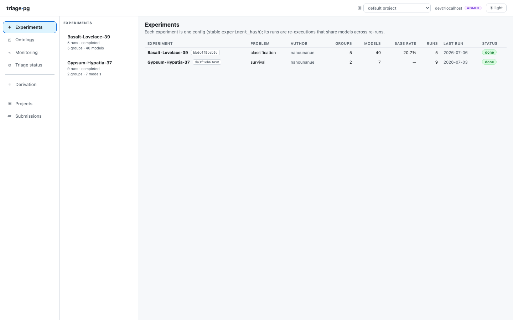
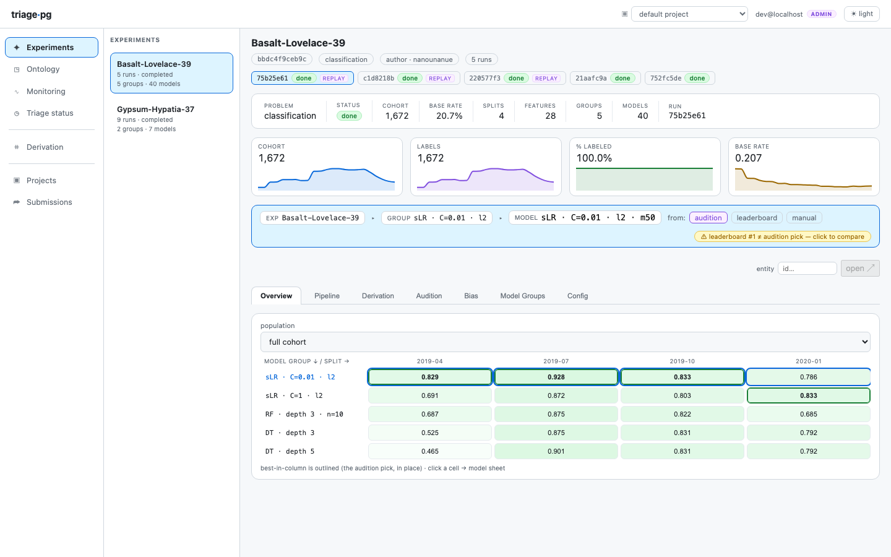
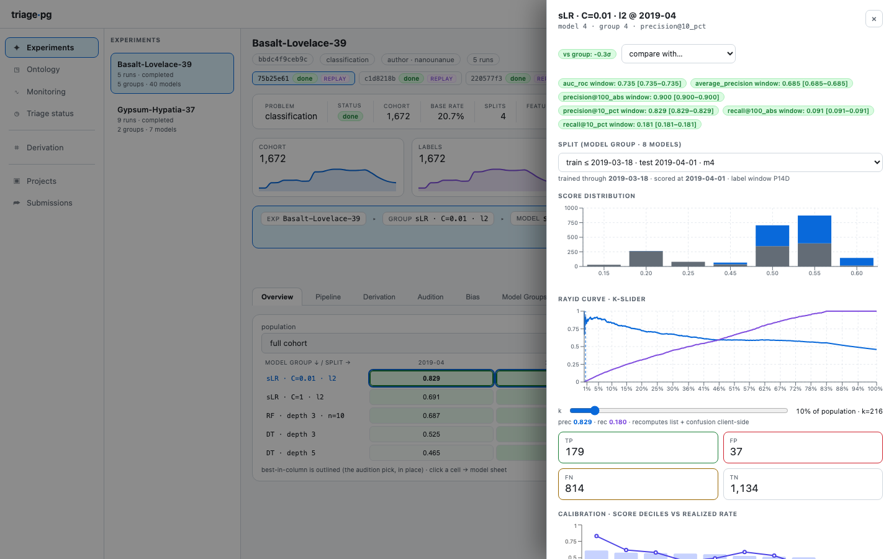
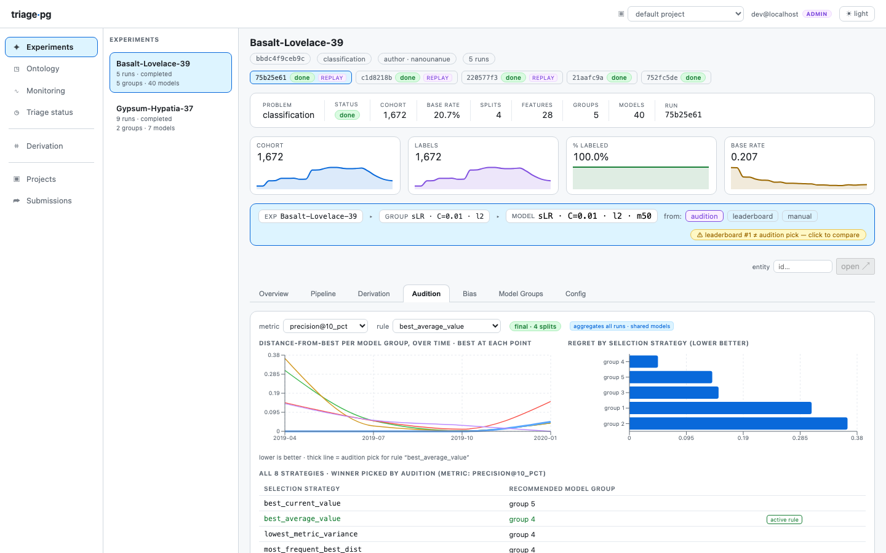
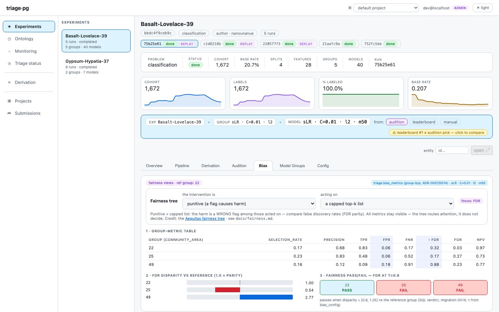
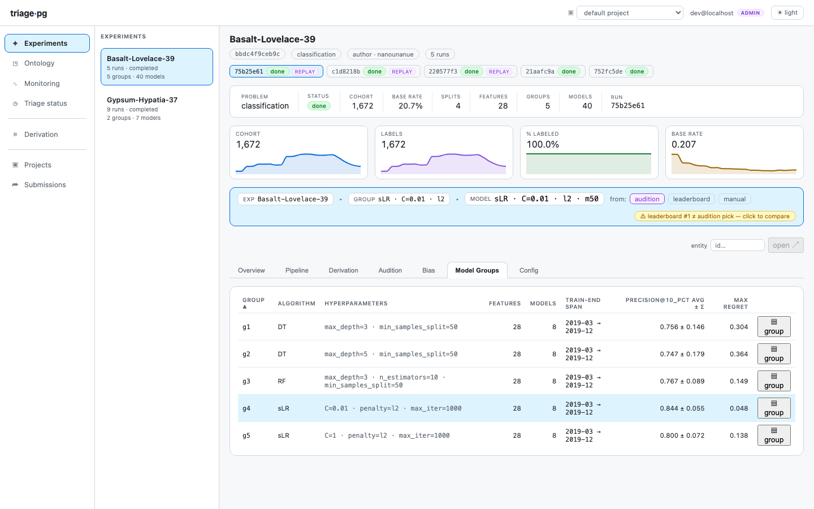
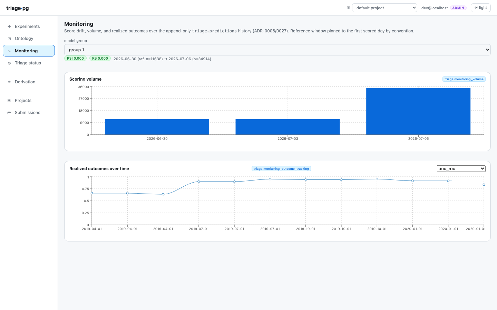
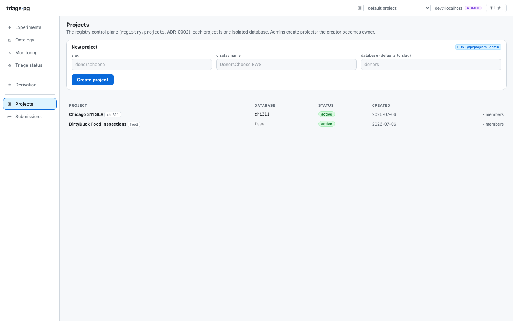
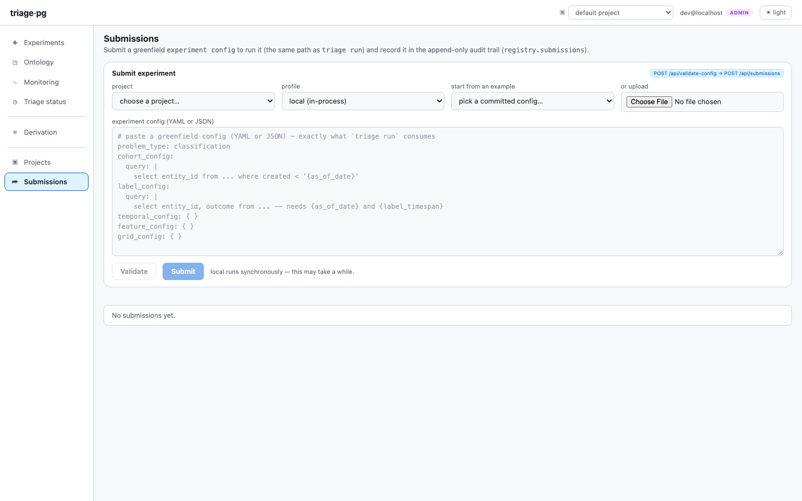

The dashboard is a deliberately thin window: every number you'll see is a
`SELECT` over the views and functions in the `triage` schema (no
business logic in the UI), so anything shown here is equally scriptable from
[the CLI](/triage-pg/reference/cli/) or `psql`. Start it with `triage serve`
from any project directory (`just serve` in a checkout of this repository).

## Experiments — the front page

One row per **experiment** (= prediction problem): problem type,
observation-regime pill (`early warning` / `resource prioritization` /
`visit level`), model/group counts, base rate, last run status. The question
it answers: *what problems does this project attack, and are they healthy?*

## The experiment overview

The working view. The header carries the identity chips (hash, problem type,
framing) and the four per-split sparklines — cohort size, labels, %-labeled
(framing-aware: an inspections problem *expects* <100%), base rate. Below,
the **heatmap**: model groups × temporal splits, best-in-split outlined —
the "which model family is winning, and is it stable over time?" panel. A
population selector re-scopes everything to a named subset when subset
evaluations exist.

## The model card

One model's dossier. The **threshold curve** is the operational panel —
precision/recall as you sweep the list size k, i.e. "if we can act on the top
k, what do we get?". Score histogram, calibration deciles, persisted feature
importances, and the postmodeling panels (crosstabs, error tree) when
`triage postmodel` has run.

The curve shows the model's latest test date; `GET
/api/models/{id}/curve?as_of_date=YYYY-MM-DD` returns another one. At every k it
equals the stored `precision@k_abs` ([evaluation](/triage-pg/reference/evaluation/)).
The score histogram counts every test date. The predicted list
(`/api/models/{id}/predictions`) shows the test split unless `split_kind=` names
another one, such as `production` for `triage score` output.

When the experiment declares `evaluation.subsets`, a row of **population**
buttons sits above the curve: *everyone*, and one button per Subset. A Subset
becomes the population, ranked among its own members, so its curve at k equals
the stored subset `precision@k_abs` (`?subset=<subset_hash>` on the curve route).
A subset with no scored rows at that date says so instead of drawing an empty
chart. With one population on, the panel draws its full curve and the k-slider.
Turn on a second one, up to four Subsets and everyone, and the panel overlays
them: one precision line per population, each with its own dashed base-rate
line in the same colour. The overlay reads each curve at 101 evenly spaced
shares of its population plus the exact row of every configured cut
(`?points=101`). The dashed horizontal line marked *base rate* is the population's labeled
positives over its labeled rows, which is the precision a random ranking
expects; the readout under the k-slider repeats it next to precision and recall.
A precision line that stays near it means the model barely ranks that
population. [Reading the threshold curve](/triage-pg/guides/reading-the-threshold-curve/)
explains the shapes to look for.

The error-rules panel has one tab per kind of leaf: **FP · wrong flags**,
**FN · missed need** and **Confusion · all four** (`error_kind=` on
`/api/models/{id}/error-rules`). The chip beside the tabs, **suspiciously right
· N**, counts the leaves `triage.error_rules_suspicious` returns at its defaults
(error rate at most 0.02, at least 30 rows). Clicking it lists them with their
TP share and their lift over the model's `precision@`; at N = 0 the chip is
disabled. Each leaf's error-rate bar carries a tick at the population error rate
of its kind at the same cut and date (`reference_error_rate` on the route): the
wrong share of the whole list for fp, the missed share of everyone passed over
for fn, and the wrong share of all labeled rows for confusion. A bar that ends
past its tick marks a leaf worse than the list as a whole.

The crosstabs panel has two views. *Mean ratio*, the default, ranks features by
the ratio of the list's mean to the rest's. *Nonzero rate* draws two bars per
feature, the share of the list and the share of the rest with a nonzero value,
ranked by the gap between them (`?stat=nonzero_rate` on
`/api/models/{id}/crosstabs`). A feature near 1 on the list and near 0 off it is
the leakage shape, and a missing-value flag concentrated on the list is a data
quality signal. See [Reading the crosstabs](/triage-pg/guides/reading-the-crosstabs/). See [Reading the error trees](/triage-pg/guides/reading-the-error-trees/)
and [How to find leakage](/triage-pg/guides/finding-leakage/).

## Audition — model selection with discipline

DSSG's selection rules (distance-from-best, max regret, regret-next-time…)
computed as SQL views. The question: *which model group would we actually
deploy* — the one that's never far from best across time, not the lucky
winner of one split. When the leaderboard's #1 and audition's pick disagree,
the context bar flags it.

## Bias — fairness with a guide

Per-protected-group metrics over the top-k list with disparity ratios and
τ-verdicts, straight from the SQL `bias_metrics` table (Aequitas' math, no
Python runtime). The **fairness-tree wizard** asks the two Aequitas questions
(punitive or assistive? intervene on all flagged?) and highlights the metric
family your intervention actually implicates.

## Model groups

The hyperparameter-family rollup (avg ± σ, max regret, fit time) — and where
feature-group ablation runs become comparable side by side.

Opening a group shows its sheet. Its **curve across test dates** panel draws one
precision line per test date, scored by the group's model for that date, with
the legend in date order and a dashed base-rate line per date
(`/api/model-groups/{id}/curves?points=101`). A selector switches between
everyone and one of the experiment's Subsets. Two dates scored by the same model
that differ point to a change in the data.

The sheet ends with a **recurrence** table: each
error-rule signature with the number of the group's test dates it appears on
(`2/6`), its mean error rate, its mean number of rows and an example rule.
Buttons switch between fp, fn and confusion leaves, and a cut selector appears
when `triage postmodel error-tree` ran at more than one cut on the group's
models. The table reads `triage.error_rule_recurrence`
(`/api/model-groups/{id}/error-recurrence`); until `error-tree` has run on the
group's models, it names that command instead.
[Reading the error trees](/triage-pg/guides/reading-the-error-trees/) explains
what a recurring rule tells you.

## Monitoring

The post-deployment view over the append-only predictions history: score
drift (PSI/KS chips), the scoring-volume heartbeat, and realized outcomes as
labels mature. The purpose chip is the provenance honesty marker —
`experiment` rows are backtest history, `forward_score` rows are production.

## Projects & Submissions — the write surface

With a registry configured (`TRIAGE_REGISTRY_URL`), **Projects** manages the
one-database-per-project lifecycle and **Submissions** accepts experiment
configs through the same validator the CLI uses — dry-run verdicts with
path-addressed errors before anything runs:

Without a registry, both render a neutral read-only notice — a supported
deployment, not an error.

## Where next

- The [entity drawer and derivation graph](/triage-pg/tutorials/dirtyduckling/)
  appear in the tutorials' guided tours.
- [Architecture](/triage-pg/reference/architecture/) explains the tables all
  of this reads.
- [Emacs](/triage-pg/reference/emacs/) reads the same Project from a status
  buffer, and its serve menu starts this dashboard.
