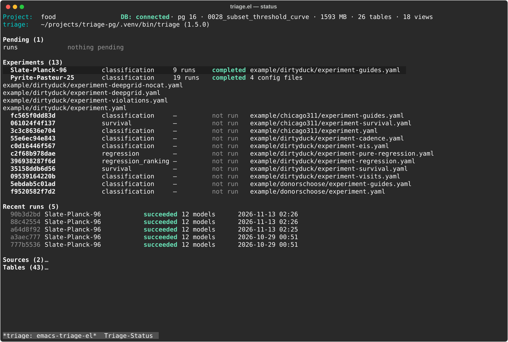
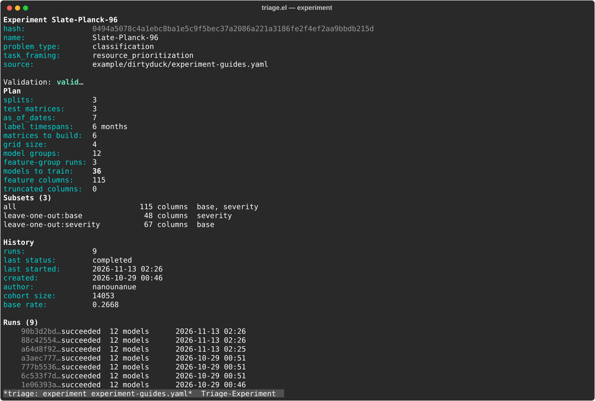
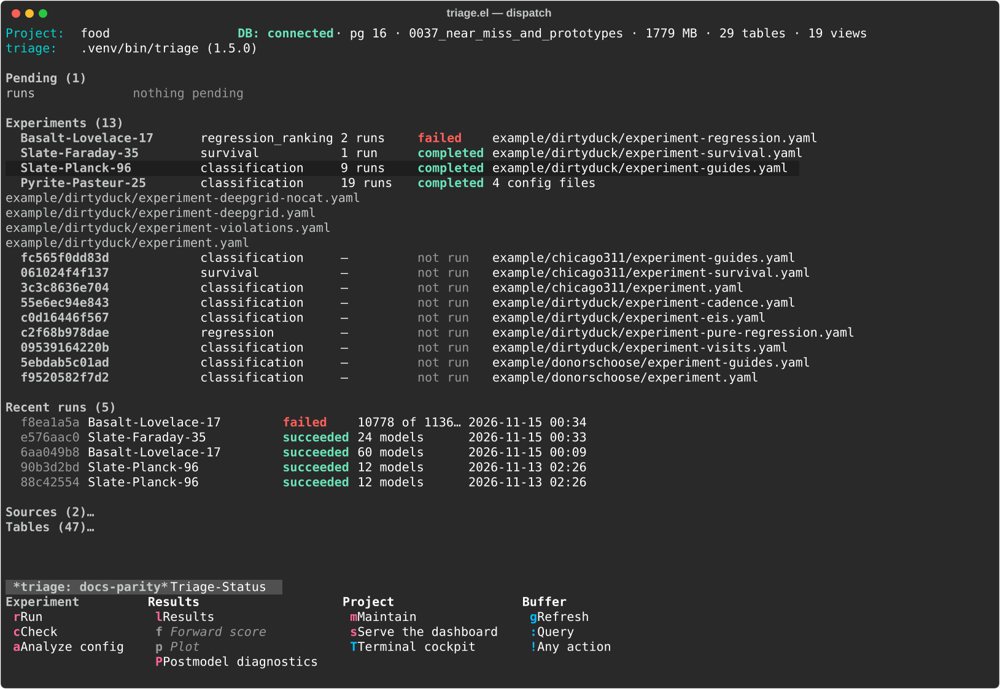

`triage.el` shows a triage-pg Project inside Emacs. `M-x triage-status` opens
a buffer with the Project's Experiments, each matched to its config file, plus
the recent Runs, the declared Sources and the tables of the `triage` schema.
`RET` on an Experiment shows the plan its config implies and what the database
holds for it. `e` opens the YAML. Menus start every action the
[CLI](/triage-pg/reference/cli/) offers.

Emacs never connects to PostgreSQL and never reads a config. It starts the
`triage` CLI in the background and draws the JSON the CLI prints. Every number
on screen therefore comes out of a CLI verb, and you can read the same number
from a terminal.

## Requirements

- Emacs 29.1 or newer.
- The packages `magit-section` (4.0 or newer) and `transient` (0.7 or newer).
  Emacs 29 ships an older `transient`, so install the current one from GNU ELPA.
- triage-pg 1.6.0 or newer in the Project, because the buffers read
  `triage status --json --full` and `triage experiment show --json`.
- [envrc.el](https://github.com/purcell/envrc) if your database credentials
  come from direnv. It sets `PG*` per buffer, and `triage.el` passes that
  environment on to every process it starts.

## Install

The package lives in the `emacs/` directory of the triage-pg repository.

With straight.el:

```elisp
(straight-use-package
 '(triage :host github :repo "ccd-ia/triage-pg" :files ("emacs/*.el")))
```

With the built-in `package-vc` (Emacs 29 or newer):

```elisp
(package-vc-install
 '(triage :url "https://github.com/ccd-ia/triage-pg" :lisp-dir "emacs"))
```

With `use-package` on Emacs 30:

```elisp
(use-package triage
  :vc (:url "https://github.com/ccd-ia/triage-pg" :lisp-dir "emacs")
  :bind ("C-c t" . triage-status))
```

The package binds no global key. The examples use `C-c t`.

## Open a Project

Run `M-x triage-status` (or `M-x triage`) from any buffer inside a Project. The
buffer is called `*triage: PROJECT*`, and calling the command again reuses it.

The Project root is the nearest directory above the current one that has
either:

- a `pyproject.toml` that names the triage-pg repository, such as the
  dependency `"triage @ git+https://github.com/ccd-ia/triage-pg.git@v1.6.0"` or
  the uv source `triage = { path = "../triage-pg" }` (comment lines do not
  count), or
- a `database.yaml`.

Add markers with the option `triage-project-markers`. Every process runs with
the root as its working directory, so `database.yaml` resolves the way it does
in a shell.

The `triage` executable is found in this order, and the status buffer shows
which one it uses:

1. `$UV_PROJECT_ENVIRONMENT/bin/triage`
2. `ROOT/.venv/bin/triage`
3. `triage` on the `exec-path`
4. `uv run triage`

`uv run` comes last because it can re-sync the environment, which adds start-up
time. Set `triage-executable` to a path or a command list to choose it
yourself. With a prefix argument, `C-u M-x triage-status` forgets the cached
roots and executables.

## The status buffer



One refresh is one call to `triage status --json --full`. The CLI takes about
a second to start, so the call runs in the background: the command returns at
once, and the mode line says `refreshing…` until the data arrives.

The Experiments section joins two lists on the `experiment_hash`: the
Experiments the database holds, and the config files the CLI found under the
root (it hashes each one). The join gives four kinds of line:

| Line | Meaning |
|---|---|
| a path | the Experiment has exactly one config file |
| `N config files` | several files hash to the same Experiment; they are listed under it |
| `not run` | a config file whose Experiment is not in the database yet |
| `(no config file)` | an Experiment in the database whose config is not under this root |

The buffer lists a config that does not parse with its error. Archived Experiments
are hidden; `A` shows them. When the database cannot be reached, the header
shows the connection error, and the Experiments section still lists the config
files.

| Key | Where | What it does |
|---|---|---|
| `g` | anywhere | refresh |
| `RET` | Experiment, config, Run, table, source | open it |
| `e` | Experiment, config | visit the YAML (asks when there are several files) |
| `TAB`, `M-1`…`M-4` | sections | fold and unfold, as in Magit |
| `A` | anywhere | show or hide archived Experiments |
| `?` or `h` | anywhere | the menu of menus |
| `r` `c` `a` `l` `f` `p` `P` `m` `s` | anywhere | the run, check, analyze, results, score, plot, postmodel, maintain and serve menus |
| `:` | anywhere | a read-only SQL query, shown as a table |
| `!` | anywhere | any action from `triage actions list` |
| `T` | anywhere | the [terminal cockpit](/triage-pg/reference/tui/) in vterm, or in `ansi-term` |
| `q` | anywhere | bury the buffer |

## The Experiment view

`RET` on an Experiment reads `triage experiment show TARGET --json` once.
TARGET is the config file when there is one, and the hash otherwise. The view
has four sections:



- **Identity**: hash, name, problem type, task framing, and the source (a file
  or the stored config).
- **Validation**: errors and warnings. Folded when there are none.
- **Plan**: what the config implies, computed without the database. Splits,
  as_of_dates, label timespans, matrices to build, grid size, model groups,
  feature-group runs, and the number of models to train, in bold. Then the
  subsets and any baseline issues.
- **History**: the Experiment's Runs, its model groups (average ± standard
  deviation and maximum regret on the experiment's most-evaluated metric) and
  the top ten rows of its leaderboard. It says `not run yet` when the database
  has no row for the hash.

`e` visits the config file. For an Experiment opened by its hash, `e` shows the
stored config as YAML, which the CLI formats, in a read-only buffer. `RET` on a
Run opens the Run view, on a model group its member models, and on a
leaderboard row the model.

## The other views

| View | Opened by | CLI call |
|---|---|---|
| Run | `RET` on a Run | `triage runs show ID --json`; `t` follows it with `triage runs tail ID` |
| Model group | `RET` on a model group | `triage models HASH --group G --json` |
| Model | `RET` on a model | `triage model show ID --json` |
| Table | `RET` on a table | `triage query --json "select * from triage.NAME limit 200"` |
| Query | `:` | `triage query --json SQL` |

The table browser builds the only SQL text in `triage.el`. The relation name
comes from the CLI's own listing, `triage.el` quotes it, and the CLI runs every
query in a read-only transaction. `triage-table-limit` sets how many rows it reads.

## The menus



Each menu entry builds the arguments of one CLI verb. The Experiment, Run,
model or model group at point fills the target; otherwise the entry asks for
one. The menu greys out an entry that needs a target when there is none at point
and none to choose from. It also greys out an entry whose command refuses the
problem type at point; [type gating](#type-gating) below says how.

| Menu | CLI verb | Output |
|---|---|---|
| run `r` | `triage run CONFIG` with `--profile`, `--random-seed`, `--cache-policy`, `--project-path` | a process buffer; the status buffer refreshes when the run ends. With `--profile=cloud` the CLI only submits the job to AWS Batch. |
| check `c` | `triage check leakage CONFIG` with `--dates`, `triage check history CONFIG` with `--as-of`, and `triage check metrics` of the model, model group or Experiment with `--tolerance`, each with `--json FILE` | leakage and history: exit 0 says the check is clean, exit 1 opens the report. Metrics: the report opens on exit 0 and 1. Any other exit: the error |
| analyze `a` | `triage analyze-config CONFIG` with `--estimate`, `--estimate-dates`, `--features`, `--plot` | a process buffer; with `--plot`, the splits figure opens when it ends |
| results `l` | `triage leaderboard`, `triage leaderboard --refresh`, `triage audition`, `triage models` with `--metric`, `--parameter`, `--windowed`; audition also takes `--common-rows` and `--groups` | table views |
| score `f` | `triage score MODEL [DATE]` with `--cohort-query`, `--project-path` | a process buffer |
| plot `p` | `triage plot`: 21 figures, listed below | the figure, in an image buffer |
| postmodel `P` | `triage postmodel`: 13 diagnostics, listed below | a table view, or a process buffer for the commands without `--json` |
| maintain `m` | `triage archive HASH`, `triage gc`, `triage gc --delete`, `triage db upgrade` | a process buffer; archive and delete ask first |
| serve `s` | `triage serve` with `--port` | a process buffer; the browser opens when the dashboard listens |

### The check reports

`triage check history` renders the config's `history_query` and reports the
series with missing periods. On exit 0 the echo area says the history is
complete on the calendar. On exit 1 a buffer opens with the counts (series,
series with gaps, missing periods, rows off the grid, rows at or after the
as_of_date), the entities with the most missing periods, and the rows that
cannot be placed.

`triage check metrics` recomputes the stored metrics of a model, a model
group or an Experiment and compares them with the stored values. Its report
opens on exit 0 and on exit 1, because the per-metric table is the result
either way: values checked, values that failed, the largest gap and the
worst row, then the metrics it did not audit and why.

### The plot menu

The plot menu groups its figures by what they draw on:

| Group | Figures |
|---|---|
| Model | `curve`, `error-rules`, `crosstabs`, `calibration`, `scores`, `gains` |
| Regression model | `forecast-actual`, `residuals`, `bias`, `forecast-time` |
| Survival model | `km`, `brier`, `survival-calibration` |
| Model group | `curve-dates`, `leaves`, `recurrence`, `crosstabs-dates`, `overlap`, `segments`, `win-consistency`, `importance` |

The menu passes each subcommand only the flags it accepts, and asks for
a required flag when none is set, such as the cut of `leaves`, `recurrence` or
`overlap`. An empty answer leaves the flag out, which is what a regression
group's `leaves` wants, since its error leaves have no cut. The arguments
include `--by` and `--cut` (date, band, sbc, cold-start, all or
`subset:NAME`), `--baseline`, `--horizon`, `--bins` and `--sweep`. The menu
writes each figure to a temporary file and deletes the file with its buffer.

### The postmodel menu

`P` runs the `triage postmodel` diagnostics on the model, model group or
Experiment at point:

| Target | Entry | CLI command | Output |
|---|---|---|---|
| model | Residuals `r` | `postmodel residuals` with `--by`, `--top`, `--quantiles` | errors per test date, by segment, and the largest errors |
| model | Structure `s` | `postmodel structure` with `--min-rows` | forecast structure, leaf support or the mean-shift split; drawn on exit 1 too, with the reason |
| model | Survival diagnostics `S` | `postmodel survival` with `--horizon`, `--times` | one section per test date: risk deciles, log-rank, Uno's C, AUC(t) and Brier(t), calibration |
| model | Near miss `n` | `postmodel near-miss` with `-p`, `--width`, `--date` | the selected, near-miss and rest bands per date |
| model | Prototypes `o` | `postmodel prototypes` with `-p`, `--n`, `--date` | each class's prototypes and their largest deviations |
| model | Error tree `e` | `postmodel error-tree` with `-p`, `--kind`, `--depth`, `--min-leaf`, `--baseline`, `--horizon` | a process buffer |
| model | Crosstabs of the largest errors `x` | `postmodel crosstabs --by abs-error:CUT` | a process buffer |
| model | Crosstabs against the near miss `X` | `postmodel crosstabs --against near-miss` with `-p` | a process buffer |
| model | Compare with another model `c` | `postmodel compare` with `-p` or `--sweep` | a process buffer |
| model group | Against the baseline `b` | `postmodel baseline` with `--baseline`, `--cut`, `--experiment` | segments, entity wins, the chance test and the out-of-time check; drawn on exit 1 too |
| model group | Importance by family `i` | `postmodel importance` with `--top` | each family's share per model, and its stability between train ends |
| Experiment | Own rows and common rows `w` | `postmodel compare-rows` with `--groups` | one row per model group; `RET` opens the model |
| Experiment | Sensitivity to a hyperparameter `v` | `postmodel sensitivity` with `--param`, `--metric`, `-p`, `--model-type`, `--common-rows` | the metric for each value of the hyperparameter |

The table views are drawn from the command's `--json` output, one table per
part of the result, and `RET` on a model or model group row opens it. The
error tree offers only the kinds the problem type at point reads: `fp`, `fn`,
`confusion`, `both` and `all` for a classifier, `abs-error` and
`beats-baseline` for a regression model, and both families for
`regression_ranking`. For a survival model it asks for `--horizon`; for the
other types it drops one. Crosstabs of the largest errors turn the cut `-p`
into `--by abs-error:CUT`. Compare with `--sweep` drops `-p`, since the CLI
takes one or the other. Against the baseline passes the Experiment at point as
`--experiment`. Survival diagnostics ask for the horizon when `-H` is not set.

### Type gating

Many postmodel diagnostics and plots read some problem types only: a residual
needs a continuous forecast, a near-miss band needs a positive class, and a
Kaplan-Meier curve needs a survival label. The CLI refuses a wrong type with
exit 2 and names the command to use instead. The menus grey out such an entry
before you choose it.

The table comes from the CLI. On the first menu that needs it in a session,
`triage.el` runs the hidden command `triage postmodel kinds --json` once per
Project and caches the result. That table lists each gated command with the
problem types it reads, the error-tree kinds of each type with its rule
for `--horizon` (required, refused or optional), and the kinds of leaf a
model group of each type has. The plot menu's kind offers those kinds, and
the recurrence figure refuses a kind the type at point has no leaves of. The menus hold no copy of it,
so a new CLI release brings its own table. The problem type at point comes
from the Experiment line in the status buffer, the model view, or the row of a
leaderboard, model group or compare-rows table.

The first menu waits up to `triage-kinds-timeout` seconds (default 10) for the
table. When the table has not arrived in time, or the call fails, the menus
grey out nothing by type: the entry runs, and the CLI's own refusal appears as
an error. They also grey out nothing by type when there is no problem type at
point, or for a command the table does not list. `M-x triage-clear-caches`
forgets the table with the cached roots and executables, as `C-u M-x
triage-status` does.

`triage reset` is in no menu. It deletes results, so it is reachable only
through `!`, where the CLI's own confirmation applies.

## Errors

A failed call puts its last line in the echo area (or in the header of the
buffer that made it) and appends the command, its exit code and its full error
output to the `*triage-errors*` buffer. When the CLI refuses an item, such as
a model of a problem type the command does not read, it prints the refusal on
standard output after its log lines on standard error. `triage.el` puts that
output last, so the line you see is the CLI's message and the command it
names.

The CLI marks its JSON with a contract number. If triage-pg is newer than
`triage.el`, the status buffer says `triage-pg is newer than triage.el; update
triage.el`. If the CLI is too old to print the status JSON, it says which
triage-pg version is needed.
