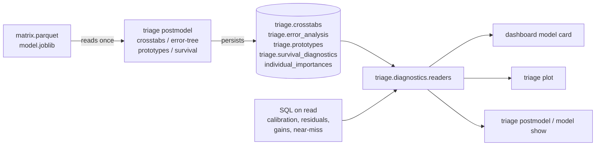
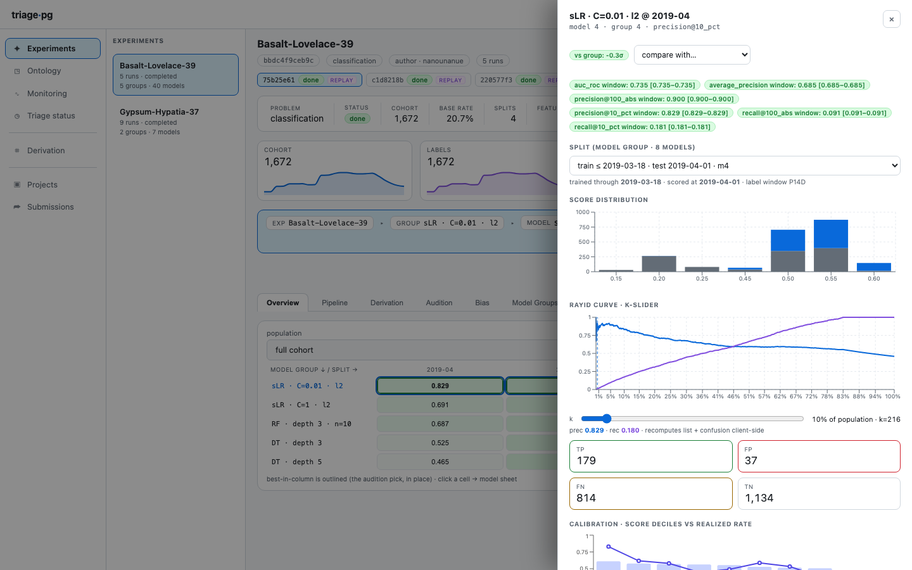

# Postmodeling diagnostics

ADR-0011 dissolved the standalone postmodeling module into three things: importances
persisted at train time, SQL views, and dashboard panels. This page is the operator's
map of what shipped where — every diagnostic is **headless-first** (ADR-0012): the CLI
and the dashboard read the same tables and functions.

## The data flow (the ADR-0011 pattern)

Matrices live in Parquet (local FS or S3), **not** in PostgreSQL — so the two
diagnostics that need feature *values* follow one pattern:



Everything else (calibration, windowed rollups, list overlap, score histograms, Rayid
curves, regression residuals and history segments, the gains curve, near-miss bands)
needs only `(entity_id, score, label)` — which is already in PostgreSQL — and is
computed by SQL functions on read. The structure checks (`postmodel structure`,
`importance`, `sensitivity`) read the stored estimator or the stored importances and
persist nothing.

Every postmodel command, `triage plot` kind and model-card panel reads the model's
`problem_type` and refuses a diagnostic that does not apply to it: the CLI exits 2 and
names the command that answers the same question for that type
(`src/triage/problem_types.py` holds the table; `triage postmodel kinds --json` prints
it for triage.el).



## What each surface answers

| Question | Surface | Where |
|---|---|---|
| Which model group should I pick? | audition ranking, 8 selection rules, regret + regret-next-time | `triage audition` · Audition tab · `triage.audition`/`audition_pick()` (migrations 0005/0013) |
| How do the groups compare at a glance? | avg ± σ, max regret, avg fit time per group | `triage models <hash>` · Model Groups tab |
| Is this split's model an outlier in its group? | window mean vs group avg ± σ (z-chip); the group sheet's band | model sheet / group sheet · `evaluations_windowed` ⋈ `triage.audition` |
| Is the model calibrated? | per decile: mean score, mean outcome (realized rate for a classifier), lift; tied scores share a decile, and `score_ties()` reports the largest tie block | model card calibration panel · `triage model show` · `triage plot calibration` · `monitoring_calibration()` (migrations 0012/0029) · guide: [reading the model card](https://ccd-ia.github.io/triage-pg/guides/reading-the-model-card/) |
| What characterizes the selected top-k? | per-feature mean/std/nonzero-rate, selected vs rest | **`triage postmodel crosstabs`** → `triage.crosstabs` → model-card panel · guide: [reading the crosstabs](https://ccd-ia.github.io/triage-pg/guides/reading-the-crosstabs/) |
| *Where* does the model fail? | error-tree rules (fp: wrong flags; fn: missed need) with support + error rate | **`triage postmodel error-tree`** → `triage.error_analysis` → model-card panel · guide: [reading the error trees](https://ccd-ia.github.io/triage-pg/guides/reading-the-error-trees/) |
| What separates TP, FP, FN and TN? | one confusion tree over every labeled row, with each leaf's class counts | **`triage postmodel error-tree --kind confusion`** (or `all`) → `triage.error_analysis.class_counts` → model card's Confusion tab · guide: [reading the error trees](https://ccd-ia.github.io/triage-pg/guides/reading-the-error-trees/) |
| Is any leaf suspiciously right? | large leaves with almost no error (fp error ≤ 0.02, or confusion leaves ≥ 98% TP, ≥ 30 rows by default), with lift over `precision@` | `triage postmodel error-rules --suspicious` · the model card's "suspiciously right" chip · `error_rules_suspicious()` · guides: [reading the error trees](https://ccd-ia.github.io/triage-pg/guides/reading-the-error-trees/), [finding leakage](https://ccd-ia.github.io/triage-pg/guides/finding-leakage/) |
| Does a failure mode recur over time? | on how many of a model group's test dates each rule signature (features and split directions, no thresholds) appears | `triage postmodel error-recurrence <group>` · group sheet recurrence table · `error_rule_recurrence()` · guide: [reading the error trees](https://ccd-ia.github.io/triage-pg/guides/reading-the-error-trees/) |
| Why is THIS entity ranked high? | per-entity β·x contributions (linear models) | persisted by `error-tree` → `individual_importances` → `/models/{id}/entities/{id}/importances` |
| Do two models flag the same people? | top-k intersection, Jaccard, Spearman ρ | `triage postmodel compare` · compare modal · `list_overlap()` (migration 0016) · guide: [reading the model card](https://ccd-ia.github.io/triage-pg/guides/reading-the-model-card/) |
| Is the model fair enough for THIS intervention? | per-group disparities + τ verdicts + the fairness tree | Bias tab wizard · [`fairness.md`](fairness.md) (migration 0014) |
| Does a slice of the cohort fare worse? | every metric on a named subset (the subset is the population) | `evaluation.subsets:` config → subset selector on the heatmap (migration 0015) · guide: [reading the model card](https://ccd-ia.github.io/triage-pg/guides/reading-the-model-card/) |
| Does the model rank the whole population, or inside a subset? | precision and recall at every cut of one test date, against that population's base rate; a subset is ranked among its own members | `triage model curve <id> [--subset]` · the model card's curve and its population selector · `model_threshold_curve(model, as_of_date, subset_hash)` · guide: [reading the threshold curve](https://ccd-ia.github.io/triage-pg/guides/reading-the-threshold-curve/) |
| How are the scores spread, by class or by event? | histogram over `[0, 1]` for a classifier and over the score range for every other type; positives vs the rest, mean outcome per bin, or events vs censored rows for survival | `triage plot scores` · model card score panel · `model_score_histogram()` (migrations 0029/0036) |
| Do the stored metrics match a recomputation? | every stored metric recomputed from predictions and labels with sklearn and numpy, largest gap per metric | **`triage check metrics --model / --group / --experiment`** (exit 1 on a gap above `--tolerance`, default 1e-9) |
| Do my groups compare on the same rows? | per-group coverage (scored over labeled rows); the metrics on the rows every group scored | **`triage postmodel compare-rows`** · `triage audition --common-rows` · coverage column in `triage audition` and the Model Groups tab · `common_rows_metrics()` (migration 0031) |
| How large are the regression errors, and where? | MAE, RMSE, WAPE, bias, top-N error share, by test date and by history band, Syntetos–Boylan class, cold start; largest errors by entity; pinball and coverage per quantile | **`triage postmodel residuals`** · `triage plot residuals`, `plot bias --by date\|band\|sbc\|cold-start`, `plot forecast-actual`, `plot forecast-time` · model card regression panels · `regression_residuals_by_segment()` (migration 0033) · guide: [reading regression diagnostics](https://ccd-ia.github.io/triage-pg/guides/reading-regression-diagnostics/) |
| Where does the model beat its baseline? | per-segment MAE against a baseline group on the rows both scored; per-entity wins, their consistency against chance and an out-of-time check | **`triage postmodel baseline`** · `triage plot segments`, `plot win-consistency` · model card baseline panel · guide: [reading regression diagnostics](https://ccd-ia.github.io/triage-pg/guides/reading-regression-diagnostics/) |
| Which rows carry the largest errors, or lose to the baseline? | regression error trees: `abs_error` leaves (mean \|e\| against the population MAE), `beats_baseline` leaves fitted on earlier test dates; crosstabs of the largest errors | **`triage postmodel error-tree --kind abs-error\|beats-baseline`** · `triage postmodel crosstabs --by abs-error:CUT` · `error-rules --suspicious --mae-ratio` (migration 0034) · guide: [reading the error trees](https://ccd-ia.github.io/triage-pg/guides/reading-the-error-trees/) |
| What did the fitted model learn? | forecast structure (distinct values, mode share, negatives), tree leaves fitted on few rows, the linear mean-shift decomposition by feature family, importance stability across splits, sensitivity to a hyperparameter | **`triage postmodel structure`**, `importance`, `sensitivity` · `triage plot importance` · model card structure panel |
| How much of the outcome does the top k capture? | lift@k, captured@k, NDCG@k, AUCC and Spearman (stored metrics); the cumulative gains curve | `triage plot gains` · model card gains panel · `allocation_at_k()`, `gains_curve()` (migration 0035) |
| Do the survival risk groups separate, and is the survival curve calibrated? | Kaplan-Meier by risk decile and tertile with log-rank, Uno's C, AUC(t), Brier(t) against the training KM, calibration at a horizon (ICI, E50); error trees on the event by a horizon | **`triage postmodel survival --horizon H`** → `triage.survival_diagnostics` (migration 0036) · `triage plot km`, `plot brier`, `plot survival-calibration` · `error-tree --horizon H` · guide: [reading survival diagnostics](https://ccd-ia.github.io/triage-pg/guides/reading-survival-diagnostics/) |
| Who just missed the list? | the selected top k, the next band of rows, and the rest: base rate, mean outcome and mean score of each; crosstabs of the list against that band | **`triage postmodel near-miss`** · `triage postmodel crosstabs --against near-miss` · model card near-miss strip · `near_miss()` (migration 0037) |
| What does a typical TP, FP or FN look like? | per class at the cut, the rows nearest the class centroid in z-scored features, with their largest deviations | **`triage postmodel prototypes`** → `triage.prototypes` (migration 0037) · model card prototypes table |
| How does list overlap change with k? | Jaccard and rank correlation of two models' lists over a sweep of cuts | `triage postmodel compare --sweep` · `triage plot overlap --sweep` |

## The error tree is a diagnostic, not a booster

"Predict on the errors" here means: fit a *shallow, readable* tree on the error
indicator so its leaves say **where** the model fails
(`inspections_1y <= 1.5 AND facility_age <= 2.5 → 80% of flags wrong`). Feed that into
feature engineering, cohort definitions, or intervention design. It is deliberately
**not** used to modify scores: a stacked error-corrector would blur model identity
(what is the hash of a model pair?) and invite test-set leakage. If an error signal is
strong enough to act on, promote it to a feature and retrain — through the normal,
governed pipeline.

## Recipes

```bash
# after a run — hash from the run output, model ids from `triage models <hash> -g <group>`
uv run triage postmodel crosstabs 42 -p 100_abs
uv run triage postmodel error-tree 42 -p 100_abs --depth 3 --min-leaf 30
uv run triage postmodel compare 42 57 -p 100_abs
uv run triage model show 42

# regression and regression_ranking (model 526, its group 71)
uv run triage postmodel residuals 526
uv run triage postmodel baseline 71
uv run triage postmodel error-tree 526 --kind abs-error
uv run triage plot forecast-actual 526 -o forecast-actual.png

# survival (model 413), at a horizon in the label's duration units
uv run triage postmodel survival 413 --horizon 90
uv run triage plot km 413 --horizon 90 -o km.png
```

Re-running any diagnostic upserts in place (idempotent). The dashboard panels show an
explicit empty-state naming the CLI command until a diagnostic has been persisted —
nothing is computed behind your back.
