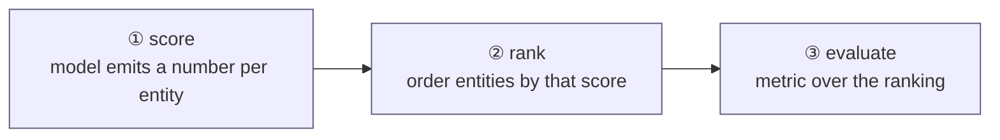
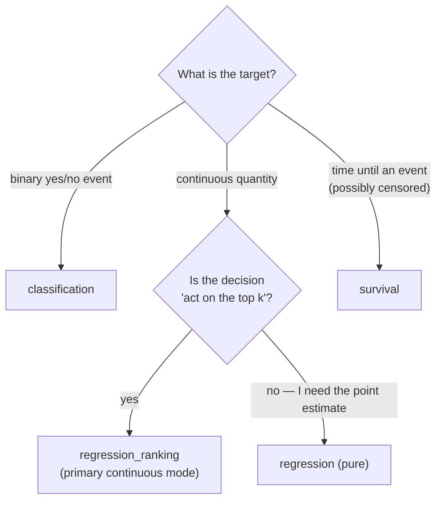

# triage-pg — `problem_type` and the ranking spine

> The narrated, exhaustive treatment of both axes — the four problem types **and** the three observation regimes (`task_framing`) — lives on the docs site: [The problem space](https://ccd-ia.github.io/triage-pg/reference/problems/). This file stays the terse in-repo reference.

> triage-pg is a **prioritization** system. Its whole architecture is one spine — **produce a score
> → rank entities → evaluate the ranking** — and the `problem_type` on an Experiment selects a few
> swaps on that spine. Pick the wrong `problem_type` and you're answering a different question.

- Source of truth: [ADR-0010](adr/0010-problem-type-ranking-spine-survival-ready-labels.md)
  (problem_type switch on a ranking spine; survival-ready labels),
  [ADR-0007](adr/0007-in-postgres-evaluation-and-sql-bias-metrics.md) (in-PG metrics, organized by problem_type).
- `problem_type` is part of the **Experiment identity** (see [experiment-and-run.md](experiment-and-run.md)):
  switching it is a *different problem*, not a new Run.

## 1. The spine

Every problem type rides the same three steps. Only the **how** of each step changes.



| `problem_type` | ① score is… | ② rank by… | ③ primary metrics | label columns |
|---|---|---|---|---|
| `classification` | `P(y=1)` | descending probability | AUC-ROC, precision@k, recall@k, AP | `outcome` (0/1) |
| `regression_ranking` | predicted value | descending predicted value | lift@k, captured@k, AUCC, Spearman + RMSE/MAE/R²/WAPE | `outcome` (continuous) |
| `regression` (pure) | predicted value | (ranking incidental) | RMSE, MAE, R², WAPE (pinball@τ for a τ-quantile model) | `outcome` (continuous) |
| `survival` | predicted risk / hazard | descending risk | C-index (Uno's C, AUC(t), Brier(t) persisted by `triage postmodel survival`) | `duration`, `event_observed` |

**Why a ranking spine at all?** Public-policy ML is almost always *"we can act on the top *k* —
which entities?"* — slow 311 requests to escalate, facilities to inspect, students to support. The
deliverable is an **ordering**, so the spine optimizes and measures the ordering directly.
precision@k / recall@k are first-class, not afterthoughts.

## 2. The three live modes

### classification
The default. The label query emits an integer `outcome` (0/1); the model emits `P(y=1)`; entities
are ranked by that probability and scored with AUC / precision@k / recall@k / average-precision.
All three tutorial datasets (DirtyDuck inspections, DonorsChoose funding, Chicago 311 resolution)
are classification.

```yaml
problem_type: classification
label_config:
  query: |
    select entity_id, (… )::int as outcome   # 0/1
    from … where {as_of_date} <= date and date < {as_of_date}::date + {label_timespan}
```

### regression_ranking — the primary mode for continuous targets
When the target is a continuous quantity (dollars at risk, days-to-resolution, demand units) but the
**decision is still "act on the top *k*"**, rank by the predicted value. The default metrics score the
allocation (lift@k and captured@k at the `precision@` cuts, the area under the gains curve, the
score–outcome Spearman correlation) **and** the forecast errors, so you get a usable priority list and
a sense of magnitude. Prefer this over pure regression whenever the output drives a prioritized
action.

```yaml
problem_type: regression_ranking
label_config:
  query: |
    select entity_id, (…)::numeric as outcome   # continuous
    from … where {as_of_date} <= date and date < {as_of_date}::date + {label_timespan}
```

### regression (pure)
When you genuinely care about the **point estimate** and not an ordering (forecasting a total, an
expected cost), use pure regression: RMSE / MAE / R² / WAPE, ranking incidental. `pinball@τ` is
computed only for a model that forecasts the τ quantile (`triage.models.forecast_quantile`) and is
NULL for every other model.

> **Example configs on the food DB:** `example/dirtyduck/experiment-regression.yaml`
> (`regression_ranking`, annotated) and `example/dirtyduck/experiment-pure-regression.yaml`
> (`regression`) — the two differ only by `problem_type` and the metric block.

## 3. Survival — runnable (ADR-0026)

The greenfield label schema carries, alongside `outcome`, the optional nullable
`(duration, event_observed)` columns, so `survival` needed **no schema migration** — and it is now
**fully implemented**: scikit-survival estimators (e.g. `ScaledCoxPHSurvivalAnalysis`) fit on the
censoring-aware labels, `.predict()` emits a **risk score** that rides the same score→rank→evaluate
spine, and the **C-index** is a PL/pgSQL function (`triage.c_index`, migration 0011) that matches
`sksurv.metrics.concordance_index_censored` to 1e-9. The rest of the censoring-aware set (Uno's C,
AUC(t), Brier(t), calibration at a horizon, Kaplan–Meier by risk decile) needs the training survival
distribution and the model's survival function, so `triage postmodel survival MODEL --horizon H`
computes it from the matrix and the model file and persists it to `triage.survival_diagnostics`.
Those are diagnostics, not evaluations: audition keeps ranking on the C-index.

```sql
-- triage.labels carries all three; classification/regression leave the survival pair NULL
label_hash, entity_id, as_of_date, label_timespan,
  outcome,                 -- classification / regression
  duration, event_observed -- survival (nullable elsewhere)
```

Survival-as-ranking (time-to-recidivism, time-to-eviction, …) is squarely in the target domain, and
binary triage would have *discarded* the censoring information ("no event in the window" = 0) that
survival needs. Requires the `survival` extra (scikit-survival): `uv sync --extra survival`.

```yaml
problem_type: survival
label_config:
  query: |
    select entity_id, duration, event_observed   # censoring-aware label
    from … where …
```

> **Example configs:** `example/dirtyduck/experiment-survival.yaml` and
> `example/chicago311/experiment-survival.yaml`.

## 4. Choosing — a 10-second guide



| If you… | use |
|---|---|
| predict a yes/no outcome and rank by probability | `classification` |
| predict a continuous value but still act on a top-*k* list | `regression_ranking` |
| only need an accurate point estimate, no prioritization | `regression` |
| predict time-to-event with censoring | `survival` |

## 5. Diagnostics per problem type

Every `triage postmodel` command and `triage plot` kind reads the model's `problem_type`
(`src/triage/problem_types.py` holds the table). A command run on a type it does not read exits
with code 2 and names the command that answers the nearest question for that type; the dashboard's
model card and `triage.el` read the same table.

| `problem_type` | Postmodel commands | Plot kinds |
|---|---|---|
| `classification` | `crosstabs` (`--against near-miss`), `error-tree` (`fp`, `fn`, `confusion`), `error-rules`, `error-recurrence`, `compare` (`--sweep`), `near-miss`, `prototypes`, `structure`, `importance` | `curve`, `curve-dates`, `error-rules`, `leaves`, `recurrence`, `crosstabs`, `crosstabs-dates`, `overlap`, `calibration`, `scores`, `gains`, `importance` |
| `regression_ranking` | everything `classification` has (positive means `outcome > 0`), plus `residuals`, `crosstabs --by abs-error`, `error-tree --kind abs-error \| beats-baseline`, `baseline` | `curve` and `curve-dates` (positive means `outcome > 0`), `error-rules`, `leaves`, `recurrence`, `crosstabs`, `crosstabs-dates`, `overlap`, `calibration` (mean outcome per score bucket), `scores`, `gains`, `importance`, `forecast-actual`, `residuals`, `bias`, `forecast-time`, `segments`, `win-consistency` |
| `regression` | `residuals`, `crosstabs --by abs-error`, `error-tree --kind abs-error \| beats-baseline`, `error-rules`, `baseline`, `compare-rows`, `structure`, `importance`, `sensitivity` | `calibration` (mean outcome per score bucket), `scores`, `gains`, `forecast-actual`, `residuals`, `bias`, `forecast-time`, `segments`, `win-consistency`, `importance` |
| `survival` | `survival --horizon H`, `error-tree --horizon H` (the classification kinds on "event by H"), `crosstabs`, `compare`, `structure`, `importance` | `km`, `brier`, `survival-calibration`, `scores` (events and censored rows apart), `importance` |

`compare-rows`, `sensitivity` and `audition --common-rows` compare model groups on the rows all of
them scored; they matter wherever a baseline abstains, which in practice means the two regression
types. The narrated version, with output from the DirtyDuck tutorial, is the docs site's
[CLI tour](https://ccd-ia.github.io/triage-pg/reference/cli/).
